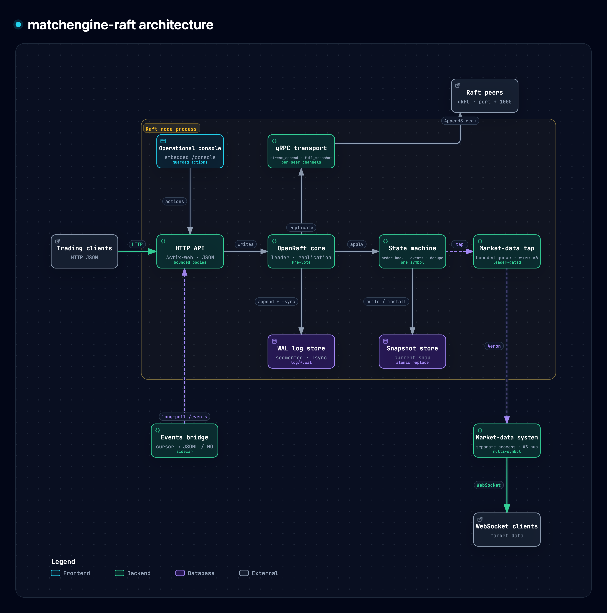
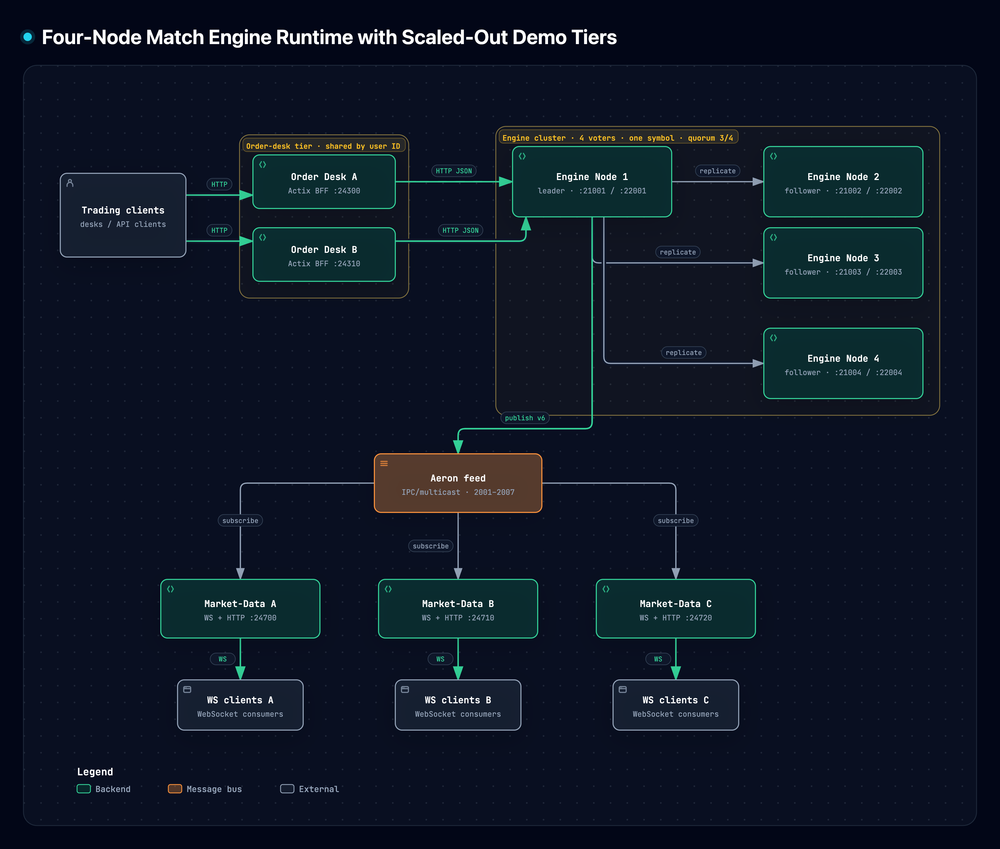
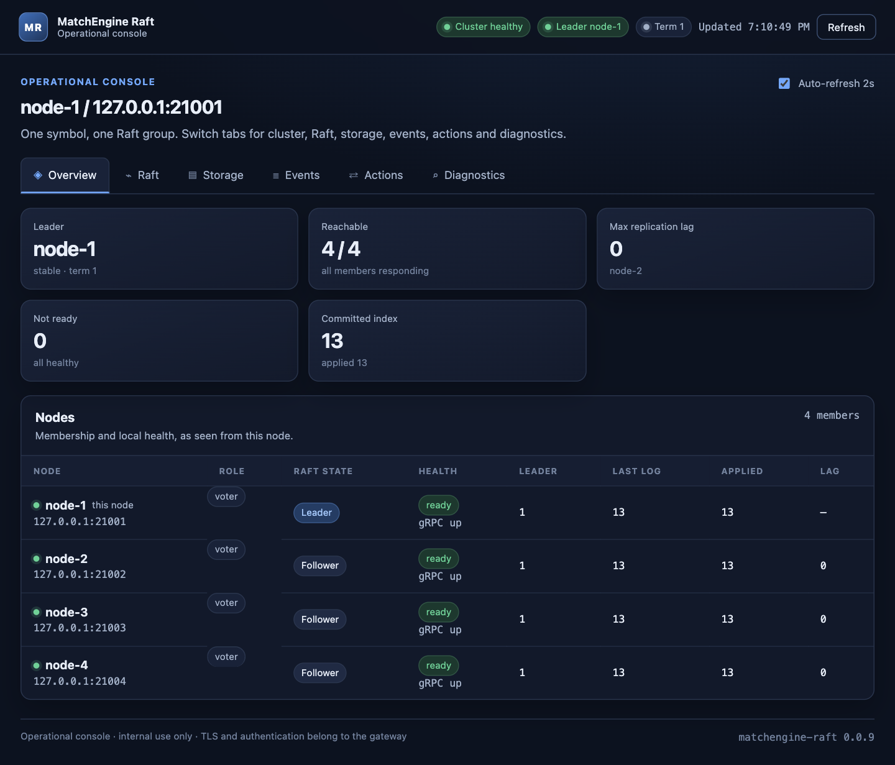
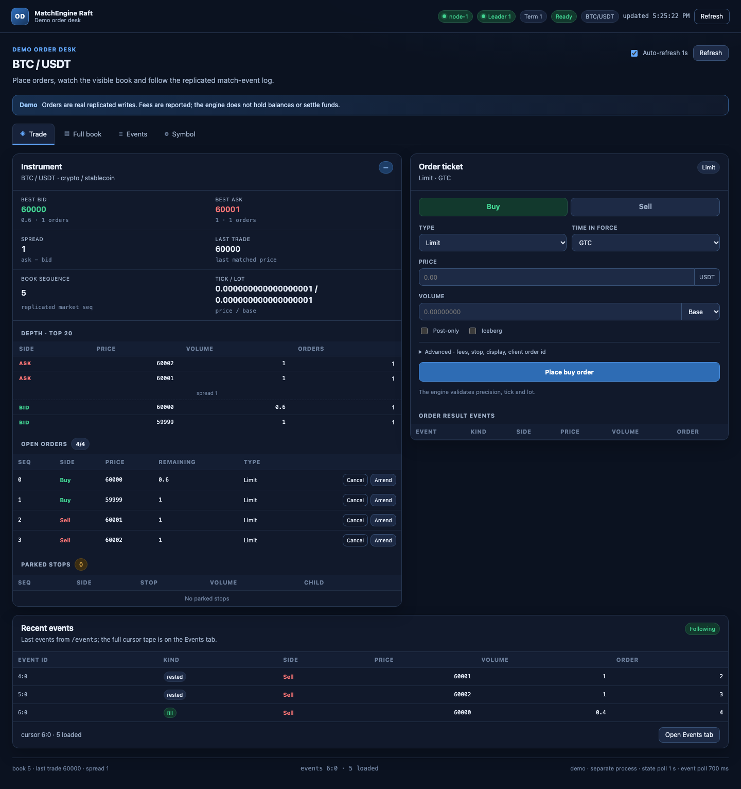
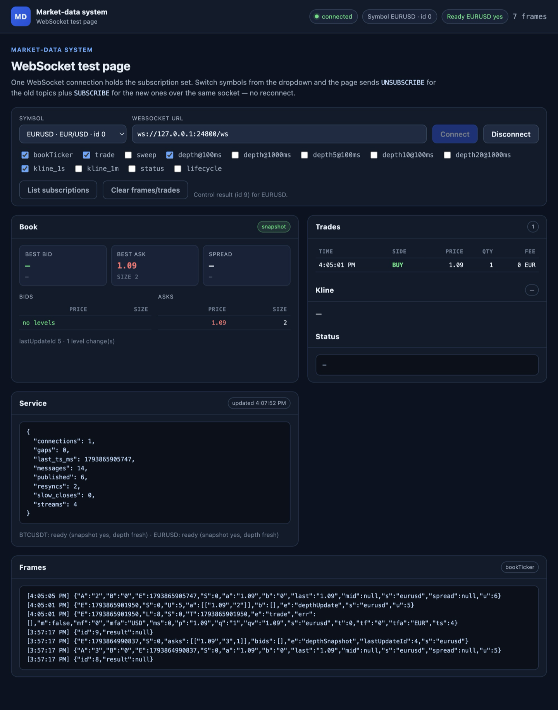

```
███╗   ███╗ █████╗ ████████╗ ██████╗██╗  ██╗███████╗███╗   ██╗ ██████╗ ██╗███╗   ██╗███████╗    ██████╗  █████╗ ███████╗████████╗
████╗ ████║██╔══██╗╚══██╔══╝██╔════╝██║  ██║██╔════╝████╗  ██║██╔════╝ ██║████╗  ██║██╔════╝    ██╔══██╗██╔══██╗██╔════╝╚══██╔══╝
██╔████╔██║███████║   ██║   ██║     ███████║█████╗  ██╔██╗ ██║██║  ███╗██║██╔██╗ ██║█████╗      ██████╔╝███████║█████╗     ██║
██║╚██╔╝██║██╔══██║   ██║   ██║     ██╔══██║██╔══╝  ██║╚██╗██║██║   ██║██║██║╚██╗██║██╔══╝      ██╔══██╗██╔══██║██╔══╝     ██║
██║ ╚═╝ ██║██║  ██║   ██║   ╚██████╗██║  ██║███████╗██║ ╚████║╚██████╔╝██║██║ ╚████║███████╗    ██║  ██║██║  ██║██║        ██║
╚═╝     ╚═╝╚═╝  ╚═╝   ╚═╝    ╚═════╝╚═╝  ╚═╝╚══════╝╚═╝  ╚═══╝ ╚═════╝ ╚═╝╚═╝  ╚═══╝╚══════╝    ╚═╝  ╚═╝╚═╝  ╚═╝╚═╝        ╚═╝
```

# Match Engine Raft

<p align="center">
  
</p>

[](https://github.com/raymondshe/matchengine-raft/actions/workflows/ci.yml)
[](https://www.rust-lang.org)
[](./LICENSE)
[](./docs)
[](./docs/MARKET_DATA_PLAN.md)
[](./docs/STORAGE.md)

A Raft-replicated matching engine in Rust for teams that need deterministic execution, configurable durability and a live market-data path — without treating the engine as a black box.

> **WAL durability is configurable.** `RAFT_WAL_FSYNC_MS` controls WAL fsync:
> **unset** = no fsync (default, fastest; a crash can lose acknowledged writes and the cluster
> requires at least 4 voters), **`0`** = fsync every append (strongest durability), **`N > 0`** =
> periodic fsync every N ms (bounds the loss window to roughly N ms). See
> [Storage](./docs/STORAGE.md) for the recovery contract.

**Why teams pick it**

- **Deterministic execution** — price-time matching where `apply` reads no wall clock; replaying the log reproduces the book exactly.
- **Configurable durability** — a hand-written segmented WAL with selectable fsync policy, atomic snapshots and snapshot + WAL-tail recovery, all exercised by restart and failure tests.
- **Raft-native** — OpenRaft 0.10 over gRPC with Pre-Vote, leadership transfer, learner catch-up and chunked snapshot install.
- **Exact 18-decimal fixed point** — no `f64` in the matching path; prices, quantities and fees survive the API, events, snapshots and feeds.
- **Live data, not batch** — the deterministic feed is published over Aeron (one exclusive publication per stream) and served as Binance-style WebSocket streams with 100/1000 ms depth conflation and horizontal scale-out.
- **Operable** — embedded console, `/health` + `/ready`, metrics, replay tools and a standalone order-desk demo.

| Area | Today |
|---|---|
| Execution | Deterministic price-time matching; `apply` reads no wall clock |
| Durability | Segmented WAL + atomic snapshots; `RAFT_WAL_FSYNC_MS` (default: no fsync, 4 voters); snapshot every 100k entries or 30 minutes |
| Replication | Raft peer RPCs over gRPC |
| Market data | Aeron egress on streams 2001–2007 + Binance-style WebSocket service |
| Symbol model | One symbol per process/cluster, configured and locked through Raft |
| Numeric model | Exact 18-decimal fixed point through matching, events, snapshots and feeds |
| Observability | Embedded console, health/readiness endpoints and metrics |
| Public edge | Bounded request/snapshot limits; loopback or private-network deployment |

## Table of Contents

- [Features](#features)
- [Architecture Overview](#architecture-overview)
- [Getting Started](#getting-started)
- [Running the Cluster](#running-the-cluster)
- [Operational Console](#operational-console)
- [Demo Order Desk](#demo-order-desk)
- [Market-Data System over Aeron](#market-data-system-over-aeron)
- [Security and Deployment Boundary](#security-and-deployment-boundary)
- [Project Structure](#project-structure)
- [Storage and Matching](#storage-and-matching)
- [API Reference](#api-reference)
- [Testing](#testing)
- [Performance and Current Limits](#performance-and-current-limits)
- [Contact](#contact)

## Features

Everything below is implemented in this repository and exercised by tests; the links point at the code.

**Matching engine**
- **Price-time priority order book** with GTC, IOC, FOK, GTD, Day, market, post-only, iceberg, stop-market and stop-limit orders.
- **Amend and cancel** with deterministic priority rules: same-price reductions keep time priority; price or size increases re-queue under a new sequence.
- **Asset-aware fee deduction** with maker/taker rates, rebates and exact notional accounting; crypto/FX default to received-asset fees, ETF/equity always settle in quote.
- **Base or quote volume** with tick/lot enforcement, quote-limit normalization and quote-budget market sweeps.
- **Exact 18-decimal fixed point** from API input through matching, events, snapshots and the market-data feed — no `f64` arithmetic in the matching path.

**Durability and recovery**
- **Raft-replicated state machine** with durable membership and application state; WAL fsync is configurable.
- **Segmented, checksummed WAL** with `RAFT_WAL_FSYNC_MS`: unset = no fsync (default; requires at least 4 voters), `0` = every append, `N > 0` = periodic every N ms; torn-tail recovery.
- **Prototype async WAL** (feature-gated, off by default): `append` defers fsync to a Tokio worker and fires `IOFlushed` only when durable; includes pending-entry reads and crash-recovery tests. Build with `--features async-wal`; run with `--async-wal` and `RAFT_WAL_FSYNC_MS=0`.
- **Four-voter no-fsync floor**: `/init` and `/change-membership` reject fewer than four voters, and writes return `503` until four voters exist, so a committed entry stays on at least three nodes.
- **Atomic snapshots** written by temp file → fsync → rename → directory fsync, with checksum validation before install.
- **Snapshot policy for real workloads**: every 100,000 applied entries or 30 minutes when newer entries exist, configurable with `--snapshot-interval-ms`.
- **Snapshot + WAL-tail recovery** that restores the latest snapshot, event window and idempotency map, then replays only newer log entries.
- **gRPC replication** with bidirectional `stream_append`, chunked snapshot transfer, Pre-Vote elections, leadership transfer and independent per-peer channels.

**APIs and data feeds**
- **Durable match-event feed** at `POST /events` with cursor pagination, long-poll (`wait_ms`), retention limits, `client_order_id` idempotency, gRPC `StreamEvents` streaming and a reference MQ bridge sidecar; replay-safe retries.
- **Deterministic market-data feed** with leader gating, shadow book, BBO, depth snapshots/deltas, lifecycle events, OHLC bars and a compact binary wire format with a reference decoder. The feature-gated **Aeron** egress publishes it on streams 2001–2007 with one exclusive publication per stream.
- **Standalone market-data system** at `demos/market_data_system/`: consumes the feed over Aeron or JSONL and serves Binance-style WebSocket streams. One instance serves several symbols from a shared hub; clients hold a per-connection subscription set, switch symbols with live `UNSUBSCRIBE`/`SUBSCRIBE`, and scale horizontally without adding engine work.
- **Flexible read consistency**: local reads, linearizable leader reads with `ReadIndex` or opt-in lease reads, and linearizable follower reads; `GET /read-policy/status` reports lease hits and fallbacks.
- **Opt-in lease reads**: `--read-policy lease` tries `ReadPolicy::LeaseRead` for `/linearizable_read`, `/events`, gRPC `StreamEvents` and `/get_linearizer`, falling back to `ReadIndex` when the lease is stale. The default remains `ReadIndex`; lease reads require bounded clock drift.
- **Leader-aware Rust client** that tracks and forwards requests to the current leader, with configurable timeouts, transient retry/backoff and typed API/no-leader errors; retries are at-least-once, so use `client_order_id` for idempotent write retries.
- **Operational APIs** for initialization, membership changes, metrics, event status and market-data status.
- **Batch writes** at `POST /write_batch`: multiple requests in one Raft entry and one WAL append, with per-request sequences and continuous event ordinals.

**Operational visibility**
- **Embedded WebUI console** at `/console/`: cluster health, Raft leadership and replication, storage/event/feed state, a leader-only event viewer and diagnostics — no build step or external assets.
- **Guarded Raft actions**: graceful leadership transfer over the gRPC `TransferLeader` RPC, a best-effort Pre-Vote election request, and snapshot triggering, with confirmation, action locking and audit logs.
- **Standalone demo order desk** at `demos/order_system/`: a separate process and crate that places real orders and shows the full book, symbol configuration, a cursor-following `/events` tape and labelled demo estimates of the order-system freeze plus maker/taker fee settlement, with a demo-only linear perpetual/leverage overlay; reuses the console theme.
- **Health and readiness probes**: `/health` reports the gRPC listener, Raft core and WAL/state-machine frontier; `/ready` additionally requires a known leader, making both suitable for orchestrators.

**Built to be trusted**
- **Bounded public edge**: request-body, read-key, event-page, idempotency-key and snapshot-size limits, with malformed input rejected before Raft.
- **Explicit internal-service contract**: loopback or trusted private networks, gateway-owned TLS/authentication, plus startup warnings for non-loopback binds.
- **Fail-fast transport health**: if the gRPC listener dies, `run()` stops the node and returns an error instead of leaving a half-healthy HTTP API serving peers that cannot reach it.
- **Correctness evidence**: randomized differential tests against a reference model, explicit order-type conformance cases, deterministic replay checks and cluster recovery tests.
- **One symbol per process/cluster** for isolated resources and failure domains; scale horizontally by running one deployment per symbol.

## Architecture Overview

This project extends the [example-raft-kv](https://github.com/datafuselabs/openraft/tree/main/example-raft-kv) with persistent storage and a gRPC transport. The software architecture is shown first, followed by the runtime architecture with the four-voter engine cluster, the order-desk tier shared by user ID, and the market-data fan-out. For an interactive, source-linked view of the engine internals, open the [interactive architecture diagram](./docs/matchengine-raft-architecture.html).

<p align="center"><strong>Software architecture</strong></p>

<p align="center">
  
</p>

<p align="center"><strong>Runtime architecture</strong></p>

<p align="center">
  
</p>

<p align="center"><em>Four-voter engine cluster, order-desk tier shared by user ID, and the leader-gated Aeron feed fanned out to stateless market-data instances.</em></p>

Peer-to-peer Raft RPCs use gRPC on `port + 1000`. The public application and management API
stays on the `--http-addr` listener. Raft RPCs are not part of the HTTP JSON API.

Set `RAFT_CORE_WORKERS` to a positive worker count to run OpenRaft's RaftCore and state-machine
worker on a dedicated multi-threaded runtime, isolated from the HTTP, gRPC and market-data tasks;
unset or `0` keeps Raft on the shared runtime.

Leader-consistent reads use `ReadIndex` by default. Set `--read-policy lease` (or
`MATCHENGINE_READ_POLICY=lease`) to try `ReadPolicy::LeaseRead` for `/linearizable_read`, `/events`,
gRPC `StreamEvents` and `/get_linearizer`, falling back to `ReadIndex` when the lease is stale.
Lease reads require bounded clock drift between nodes; `/read` remains a local, possibly stale read.

Market-data egress is off the consensus path: the tap is a bounded `try_send`, so a slow
subscriber can never block `apply`. The feature-gated `AeronSink` publishes the same wire-v6
messages on streams 2001–2007 from a dedicated publisher thread, with one exclusive publication
per stream; the JSONL sink remains available for debugging.

### Key Components

1. **RaftStorage Implementation** ([`store/`](./src/store/))
   - Raft log entries in a segmented write-ahead log (`log/*.wal`)
   - Vote and purge marker in an atomically rewritten `log/state` file
   - State machine in memory, made durable by atomic `snapshot/current.snap` files

2. **Network Layer** ([`network/`](./src/network/))
   - gRPC Raft RPCs (`src/network/grpc/`) for replication, voting and snapshot streaming
   - Separate replication, heartbeat and snapshot channels per peer
   - Management APIs for cluster administration

3. **Matching Engine** ([`order_book/`](./src/order_book/))
   - Price-time priority order book with bids and asks
   - Order types: GTC, IOC, FOK, GTD, Day, post-only, iceberg, stop-market and stop-limit
   - Deterministic expiry (`PurgeExpired` carries the timestamps through the log) and stop
     election on the replicated last trade price
   - The order book is the replicated state machine: deterministic `apply`, no clocks
   - `OrderBook::execute_order` is the full lifecycle; `place_order` is a fills-only wrapper

4. **Market-Data Egress** ([`market_data/`](./src/market_data/))
   - `apply` hands match events and a depth journal to a bounded tap (`try_send`; matching never waits)
   - A leader-gated tokio task keeps a shadow book, derives BBO/OHLC bars and encodes wire v6
   - Keys are `(symbol_id, stream_id, market_seq, sub_seq)`; one uncapped `TRADE` per taker
   - JSONL sink for debugging; the feature-gated `AeronSink` publishes streams 2001–2007 with one exclusive publication per stream

## Getting Started

### Prerequisites

- Rust 1.89 or later (edition 2024; `actix-web` and `tonic` set the floor)
- Cargo

`protoc` is not required: the build script uses `protoc-bin-vendored` to compile
`proto/raft.proto`.

### Building

```shell
cargo build
```

> **Note**: Append `--release` for production builds, but this project is primarily intended as an example and not recommended for production use without further hardening.

## Running the Cluster

Start a local three-node cluster with `./scripts/test-cluster.sh`. Manual startup, ports,
membership changes, helper scripts and recovery drills are documented in the
[runbook](./docs/RUNBOOK.md).

## Operational Console

Every node serves an embedded operational console at `/console/`. It shows cluster health, Raft
leadership and replication, durable storage and event/feed state, and offers guarded leadership
actions. See [`docs/OPERATIONAL_CONSOLE.md`](./docs/OPERATIONAL_CONSOLE.md) for the design and
[`docs/OPERATIONAL_CONSOLE_LAYOUT.html`](./docs/OPERATIONAL_CONSOLE_LAYOUT.html) for the layout
mockup.



## Demo Order Desk

`demos/order_system/` is a standalone order-entry WebUI for a running node. It is a separate crate and process;
the engine binary and its routes are unchanged. It calls the public HTTP API through the
leader-aware client and reuses the console theme. Start an initialized engine, then run:

```shell
cargo run --manifest-path demos/order_system/Cargo.toml -- \
  --addr 127.0.0.1:24300 --engine 127.0.0.1:24301 --engine-id 1
```

Open <http://127.0.0.1:24300/demo/>. Tabs cover the order ticket, the full order book, the
`/events` cursor tape and symbol configuration.



See [`demos/order_system/README.md`](./demos/order_system/README.md) for the demo flow and
[`docs/DEMO_ORDER_SYSTEM.md`](./docs/DEMO_ORDER_SYSTEM.md) for the design.

## Market-Data System over Aeron

`demos/market_data_system/` is the live distribution tier. The engine publishes
its deterministic feed through the feature-gated `AeronSink` on streams
2001–2007; one exclusive publication per stream and a dedicated publisher
thread keep a large depth snapshot from head-of-line-blocking trades. Aeron
multicast fans the same bytes out to any number of stateless service instances,
so the engine's publish cost is independent of WebSocket clients.

The service keeps a shadow book per symbol, conflates diff depth at 100/1000 ms,
pushes a snapshot on subscribe, serializes each stream message once and fans it
out through bounded per-connection queues. The test page uses one WebSocket and
switches symbols with live `UNSUBSCRIBE`/`SUBSCRIBE`:



**Why it is fast and live-safe**

- `apply` never waits on a subscriber: the tap is a bounded `try_send`, and a
  full queue drops frames and emits `GAP` while consensus continues.
- One exclusive Aeron publication per stream; a depth snapshot cannot block a
  trade or status stream.
- One JSON encode per stream message, shared as `Bytes` across every subscriber.
- 100/1000 ms depth conflation and latest-value collapse for `bookTicker` and
  partial depth, so bursts do not multiply socket writes.
- Deterministic `(symbol_id, stream_id, market_seq, sub_seq)` keys make
  failover, restart and multi-instance fan-out content-identical.
- Stateless instances rebuild from a periodic reset snapshot plus deltas and
  scale horizontally behind a load balancer.
- The feed path is load-tested at 500k fills/s (495k fills/s, zero drops at the
  8,192-frame tap queue).

Run it with `./scripts/market-data-system.sh` (two engines over Aeron IPC) and
open <http://127.0.0.1:24800/>. See
[`demos/market_data_system/README.md`](./demos/market_data_system/README.md)
and [`docs/MARKET_DATA_WEBSOCKET.md`](./docs/MARKET_DATA_WEBSOCKET.md).

## Security and Deployment Boundary

The HTTP API and the gRPC Raft listener (HTTP port + 1000) are **plaintext and unauthenticated by
design**. This is an internal matching engine, not an internet-facing gateway: run it only on
loopback or a trusted private network, firewall both ports, and terminate TLS plus client
authentication at the gateway in front of it. TLS/mTLS and API authentication are intentionally
not implemented in this process, where they would add latency without protecting a public surface.

The node logs a warning when it is bound to a non-loopback address. Request handling is bounded at
the edge, before Raft proposes anything:

| Surface | Limit |
|---|---|
| Application/management JSON bodies | 1 MiB (`MAX_REQUEST_BODY_BYTES`) |
| `client_order_id` | 1–128 bytes, ASCII letters/digits plus `. _ - :`; empty rejected |
| `/read` key | 1–128 printable ASCII bytes |
| `/events` page size | 1–1000 events |
| `/events` long-poll wait | 0–1000 ms (`wait_ms`) |
| `/write_batch` | 1–128 non-nested requests, unique `client_order_id`s |
| gRPC Raft message | 64 MiB (`MAX_MESSAGE_SIZE`) |
| gRPC snapshot stream | 256 MiB total (`MAX_SNAPSHOT_BYTES`), checked before each chunk is appended |

Malformed JSON and invalid fields return `400`; oversized bodies return `413`. The replicated
`client_order_id` dedupe map retains at most 262,144 records, so the key bound also bounds its
memory.

## Project Structure

Top-level layout: `src/` (engine), `proto/` (gRPC schema), `examples/` (replay and dump tools),
`demos/` (order desk and market-data system) and `tests/cluster/` (integration tests). See
[Project structure](./docs/PROJECT_STRUCTURE.md) for the full tree.

## Storage and Matching

The engine uses a segmented WAL and atomic snapshots. Order types, amendments, match-result
delivery and the market-data feed are documented separately:

- [Storage: WAL, snapshots, recovery and dump tools](./docs/STORAGE.md)
- [Matching: order types and amendment rules](./docs/MATCHING.md)
- [Match-result delivery](./docs/MATCH_RESULTS.md)
- [Market-data feed plan](./docs/MARKET_DATA_PLAN.md)

## API Reference

The HTTP application/admin APIs and the gRPC Raft service are documented in
[API reference](./docs/API.md). Main routes: `/write`, `/write_batch`, `/read`,
`/linearizable_read`, `/follower_read`, `/events`, `/read-policy/status`, `/health`, `/ready`, `/metrics` and `/console/`.

## Testing

`cargo test` runs the cluster integration suite. Test ports, replay cases, dump tools and the
failure matrix are documented in [Testing](./docs/TESTING.md).

## Performance and Current Limits

Measured baseline (Apple M4, Rust 1.93.1, release bench profile; single-node e2e/storage medians
from 2026-11-06; 4-node no-fsync cluster from 2026-11-07; write concurrency/batching sweep, async WAL prototype and read-path benchmark from 2026-11-08;
full methodology in [`docs/PERFORMANCE.md`](./docs/PERFORMANCE.md)):

| Workload | Result |
|---|---:|
| Order book: sweep 1k asks / 100 levels | 105.6 µs |
| End-to-end `/write` p50 / p99 (single node, fsync every append) | 3.96 ms / 5.17 ms |
| Concurrent `/write` (single node, fsync every append) | 17,245 writes/s |
| Sequential `/write_batch` (single node, fsync every append, 128 orders) | 23,249 orders/s |
| Concurrent `/write_batch` (single node, fsync every append, 100 × 32) | 139,323 orders/s |
| 4-node no-fsync cluster: sequential `/write` p50 / p99 | 186.8 µs / 368.9 µs |
| 4-node no-fsync cluster: concurrency sweep peak (256 in flight) | 90,569 writes/s, p99 6.47 ms |
| 4-node no-fsync cluster: 1,024 / 4,096 in flight | 44,829 / 50,996 writes/s, p99 21.79 / 76.47 ms |
| 4-node no-fsync cluster: sequential `/write_batch` (128 orders) | 227,319 orders/s |
| 4-node no-fsync cluster: concurrent `/write_batch` (100 × 32) | 216,163 orders/s |
| 4-node no-fsync cluster: `/linearizable_read` p50 / p99 (1 reader, ReadIndex → lease) | 119.7 / 243.6 µs → 54.9 / 83.9 µs |
| 4-node no-fsync cluster: `/linearizable_read` throughput (64 readers, ReadIndex → lease) | 30,232 → 51,777 reads/s |
| Market-data feed at 500k fills/s | 495k fills/s, 0 drops at 8,192-frame queue |
| WAL append / read (20k entries, 100-entry batches, fsync every append) | 26,043 / 2,614,579 entries/s |
| WAL append, async prototype (feature-gated, every append) | 172k entries/s median; 65.2k-192.2k range |
| Single-node e2e concurrent writes, every append (sync → async) | 18,344 → 17,277 writes/s (within noise) |

The 4-node figures use a 3-of-4 quorum on loopback with WAL fsync disabled and all four nodes in
one process; the range and cross-host caveats are in [`docs/PERFORMANCE.md`](./docs/PERFORMANCE.md).
Lease reads are opt-in; the default remains `ReadIndex` because lease reads require bounded clock drift.
The write sweep peaks at 256 in-flight; payload/purge/linger/runtime/LTO defaults were not improved by the one-factor sweeps.

WAL fsync is controlled by `RAFT_WAL_FSYNC_MS`: unset = no fsync (default), `0` = every append,
`N > 0` = periodic every N ms. Non-every-append modes trade durability for throughput; with fsync
disabled the same WAL benchmark appends about 2M entries/s. When fsync is disabled the node
requires at least four voters; the demo scripts use `RAFT_WAL_FSYNC_MS=0` for three-node setups.
See [Storage](./docs/STORAGE.md).

The full benchmark methodology, storage-path details and optimization history are in
[PERFORMANCE.md](./docs/PERFORMANCE.md). Snapshot **v10** and wire **v6** are breaking changes;
see [DECIMAL.md](./docs/DECIMAL.md). Known gaps and the roadmap are tracked in
[TODO.md](./TODO.md).

## Contact

- Google Chat: [rshen.sy@gmail.com](https://chat.google.com/u/0/dm/rshen.sy@gmail.com)

## Credits

This project is a fork from [example-raft-kv](https://github.com/datafuselabs/openraft/tree/main/example-raft-kv) in the [OpenRaft](https://github.com/datafuselabs/openraft) project.

Special thanks to the Databend community and Zhang Yanpo for their support.

## License

MIT — see [`LICENSE`](./LICENSE).

The project started as a fork of
[example-raft-kv](https://github.com/datafuselabs/openraft/tree/main/example-raft-kv) in the
[OpenRaft](https://github.com/datafuselabs/openraft) project, which is dual-licensed under MIT or
Apache-2.0. The original copyright and license notices continue to apply to code derived from it;
this repository is distributed under the MIT license in `LICENSE`.
