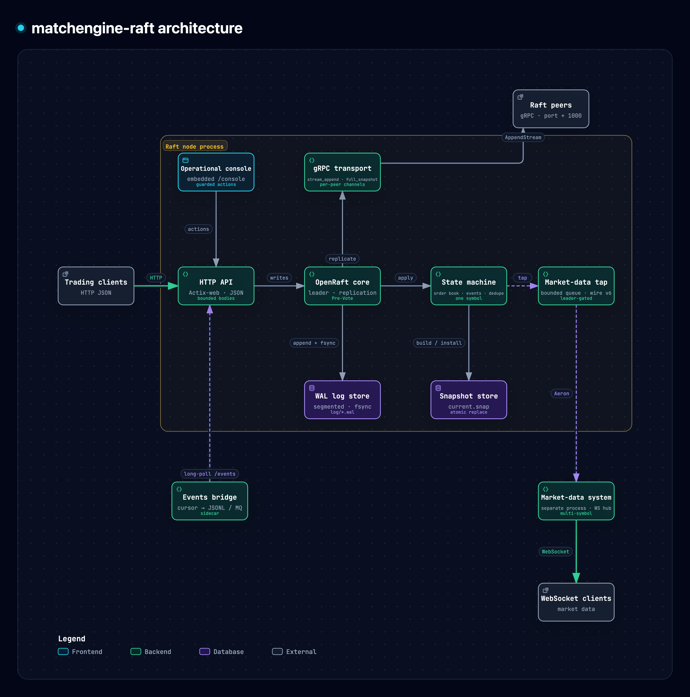
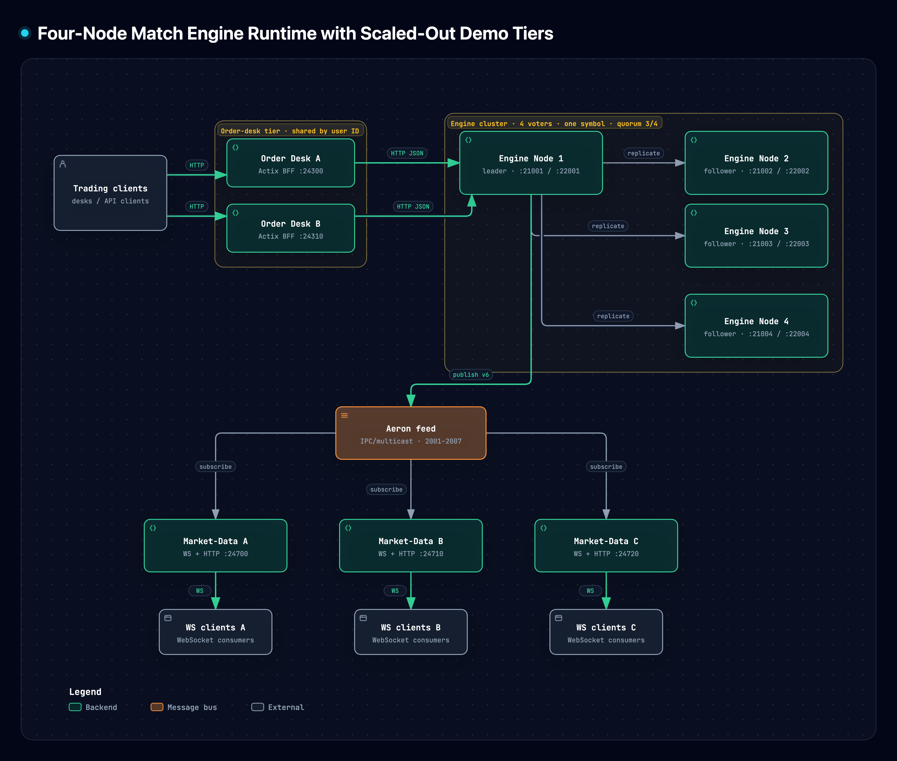
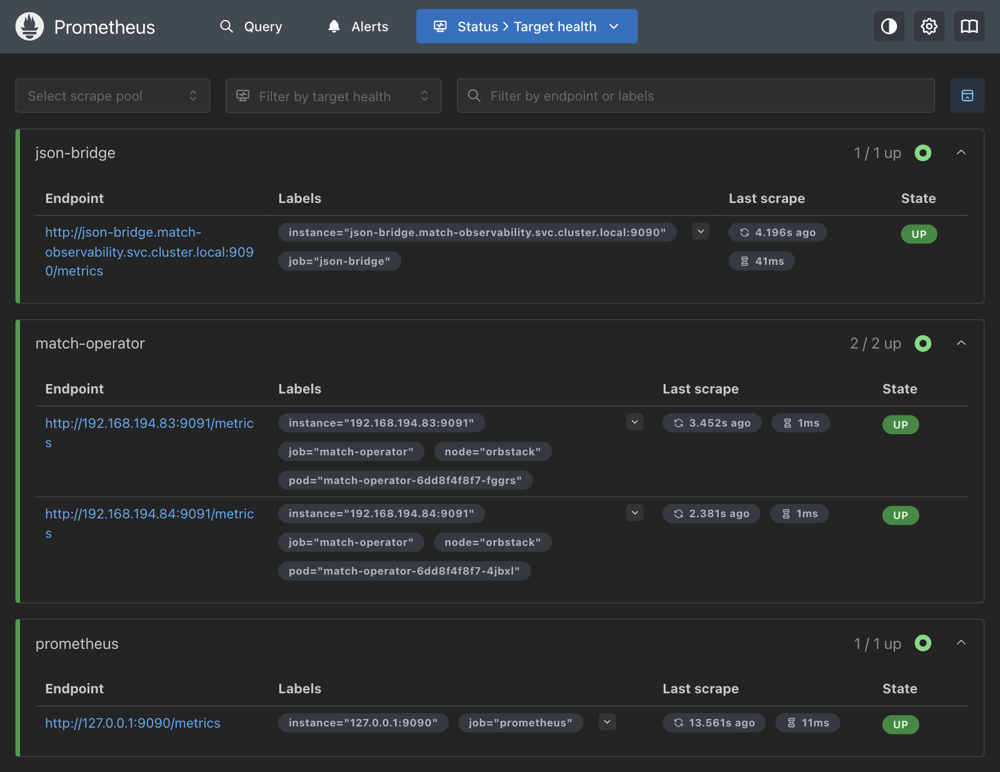
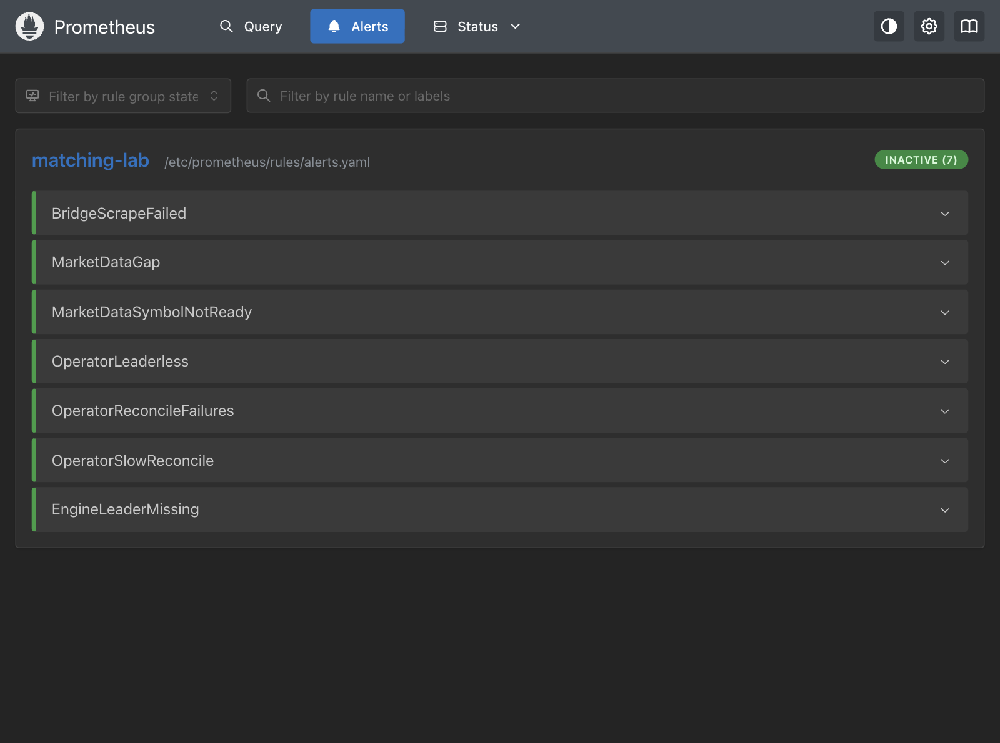

```
███╗   ███╗ █████╗ ████████╗ ██████╗██╗  ██╗███████╗███╗   ██╗ ██████╗ ██╗███╗   ██╗███████╗    ██████╗  █████╗ ███████╗████████╗
████╗ ████║██╔══██╗╚══██╔══╝██╔════╝██║  ██║██╔════╝████╗  ██║██╔════╝ ██║████╗  ██║██╔════╝    ██╔══██╗██╔══██╗██╔════╝╚══██╔══╝
██╔████╔██║███████║   ██║   ██║     ███████║█████╗  ██╔██╗ ██║██║  ███╗██║██╔██╗ ██║█████╗      ██████╔╝███████║█████╗     ██║
██║╚██╔╝██║██╔══██║   ██║   ██║     ██╔══██║██╔══╝  ██║╚██╗██║██║   ██║██║██║╚██╗██║██╔══╝      ██╔══██╗██╔══██║██╔══╝     ██║
██║ ╚═╝ ██║██║  ██║   ██║   ╚██████╗██║  ██║███████╗██║ ╚████║╚██████╔╝██║██║ ╚████║███████╗    ██║  ██║██║  ██║██║        ██║
╚═╝     ╚═╝╚═╝  ╚═╝   ╚═╝    ╚═════╝╚═╝  ╚═╝╚══════╝╚═╝  ╚═══╝ ╚═════╝ ╚═╝╚═╝  ╚═══╝╚══════╝    ╚═╝  ╚═╝╚═╝  ╚═╝╚═╝        ╚═╝
```

# ⚡ Matchengine Raft

<p align="center">
  
</p>

[](https://github.com/raymondshe/matchengine-raft/actions/workflows/ci.yml)
[](https://www.rust-lang.org)
[](./LICENSE)
[](./docs)
[](./docs/MARKET_DATA_PLAN.md)
[](./docs/zh-CN/STORAGE.md)

**一套可检查、可重放、可运维的完整交易所系统——从撮合到行情，再到下单与集群控制。**

核心是用 Rust 编写的 Raft 复制撮合引擎：18 位精度的确定性订单执行、完整的订单类型生命周期、
复制的撮合事件，以及由你按部署场景调节的 WAL 持久性策略。每一次状态变化都可观察——重放日志、
导出快照、复现成交，或在运维控制台里实时查看订单簿。

核心之外是交易所的其他部分。确定性行情链路通过 Aeron 多播或 NATS 将成交分发到 Binance 风格的
WebSocket 服务，背后是 TDengine 中的精确历史 K 线、按 symbol 分配的写者 Lease，以及真正修复缺口
而非掩盖缺口的 REST 尾部回填。无状态下单 BFF 驱动 React 交易终端，订单簿始终由行情 feed 提供，
客户端绝不轮询引擎。

运维从一开始就是设计的一部分，而不是事后补丁。CRD 驱动的 Kubernetes 控制平面负责选出 operator、
引导 Raft、逐 Pod 滚动升级并执行 wire/快照版本兼容门禁、通过恢复并校验哈希来验证备份，同时输出
指标、日志、告警和仪表盘。结果是一套能在单机实验室运行、又能扩展到分片集群的系统——没有黑盒，
没有隐藏状态，也不需要猜测引擎到底做了什么。

**✨ 为什么选择它**

- 🎯 **确定性执行** — 价格-时间优先撮合，`apply` 不读墙上时钟；重放日志可以精确复现订单簿。
- 🛡️ **可配置持久化** — 自研分段 WAL（fsync 策略可选，`--max-wal-append-bytes` 按字节切分单次追加）、原子快照和“快照 + WAL 尾部”恢复，均由重启和故障测试覆盖。
- 🧭 **Raft 原生** — OpenRaft 0.10 + gRPC，支持 Pre-Vote、领导权转移、学习者追赶和分块快照安装。
- 🔢 **18 位定点数** — 撮合路径不使用 `f64`；价格、数量和费用在 API、事件、快照和 feed 中全程精确。
- 📡 **实时行情** — 确定性 feed 通过 Aeron 发布（每个流一个独占 publication），再由 Binance 风格 WebSocket 服务分发，支持 100/1000 ms 深度合并和水平扩展。
- 📈 **精确小数的历史 K 线** — TDengine 存储稀疏 `1s` 成交 K 线和物化的 `1m`/`5m` 汇总，更粗周期在读取时用 `INTERVAL` 汇总（`30m` 优先由 `5m` 生成，缺失时回退 `1m`）；单 writer、无状态查询端，通过 Binance 兼容的 `/klines` 供交易终端冷启动使用。
- 🖥️ **交易终端** — 纯 React/TS 的 Binance 风格现货终端，复用现有行情 WebSocket 和下单 BFF，不含 Rust，也不会直接调用引擎 `/write`。
- 🧰 **可运维** — 内置控制台、`/health` + `/ready`、指标、重放工具和独立下单演示。
- ☸️ **Kubernetes 集群管理** — 参考管理器和 supervisor 可管理数千个单 symbol 引擎，支持零影响 symbol 生命周期、重启保护和带存储决策的 shard 删除。

## 🧩 五个项目，一套系统

| 项目 | 说明 | 入口 |
|---|---|---|
| 🦀 **match_engine** | Raft 复制、确定性撮合：订单簿、WAL/快照、gRPC Raft、事件日志、行情 feed 和运维控制台 | [`match_engine/README_CN.md`](./match_engine/README_CN.md) |
| ☸️ **k8s_control_plane** | 面向单 symbol 引擎集群的 CRD 管理器、Lease 选举 operator、渲染器和 GUI | [`k8s_control_plane/README.md`](./k8s_control_plane/README.md) |
| 📡 **market_data_system** | 独立的 Aeron/NATS/JSONL 消费端，提供 Binance 风格 WebSocket 行情和 TDengine 历史 K 线 | [`market_data_system/README.md`](./market_data_system/README.md) |
| 🧾 **order_system** | 独立下单 WebUI，以及演示用冻结/结算估算 | [`order_system/README.md`](./order_system/README.md) |
| 🖥️ **trading_terminal** | 纯 React/TS 的 Binance 风格现货终端：订单簿、成交、K 线和下单票据，经 nginx 部署 | [`trading_terminal/README.md`](./trading_terminal/README.md) |

```text
.
├── match_engine/          # 引擎 crate、bench、示例、测试、fuzz、控制台资源和 Dockerfile
├── k8s_control_plane/     # 管理 API/GUI、operator 和 CRD
├── market_data_system/    # WebSocket 行情服务 + 历史 K 线写入/查询
├── order_system/          # 演示下单系统
├── trading_terminal/      # React/TS 交易终端 + nginx 代理（无 Rust，独立构建）
├── docs/                  # 跨项目设计、API、runbook、架构图和性能文档
├── scripts/               # 集群、实验环境和 demo 编排
└── .github/workflows/     # CI、fuzz 和 benchmark workflow
```

## 🏗️ 架构

本项目扩展了 [example-raft-kv](https://github.com/datafuselabs/openraft/tree/main/example-raft-kv)，
增加了持久化存储、gRPC 传输和实时行情链路。下面是软件架构，以及四投票成员引擎集群、按用户 ID
共享的订单系统层和行情分发的运行时架构。可交互、带源码引用的引擎内部架构见
[交互式架构图](./docs/matchengine-raft-architecture.html)。

<p align="center"><strong>软件架构</strong></p>

<p align="center">
  
</p>

<p align="center"><strong>运行时架构</strong></p>

<p align="center">
  
</p>

<p align="center"><em>四投票成员引擎集群、按用户 ID 共享的订单系统层，以及 leader-gated Aeron feed 分发到无状态行情实例。</em></p>

Raft 节点间 RPC 使用 gRPC，端口为 HTTP 端口 + 1000；公共应用和管理 API 仍在 `--http-addr` 上，
Raft RPC 不属于 HTTP JSON API。

设置 `RAFT_CORE_WORKERS` 为正数可让 OpenRaft 的 RaftCore 和状态机 worker 运行在独立的
`raft-worker` 多线程 runtime 上，与 HTTP、gRPC 和行情任务隔离；未设置或 `0` 时仍使用共享 runtime。

leader 一致读默认使用 `local_lease`：`/linearizable_read`、`/events`、gRPC `StreamEvents` 和
`/get_linearizer` 先使用 OpenRaft 的调用侧 lease 缓存，再走核心 lease 路径，lease 过期时回退
`ReadIndex`。设置 `--read-policy read_index`（或 `MATCHENGINE_READ_POLICY=read_index`）强制每次
quorum 往返，`lease` 保留核心路径。lease read 要求节点间时钟漂移有界；`/read` 仍是本地读。

行情出口不在共识路径上：tap 使用有界 `try_send`，慢订阅者不会阻塞 `apply`。feature 门控的
`AeronSink` 从独立 publisher 线程把同一份 wire-v7 消息发布到 2001–2007 流，每个流一个独占
publication；JSONL sink 仍可用于调试。

## 🧪 核心能力

- **撮合引擎**：GTC/IOC/FOK/GTD/Day、市价、市价转限价、Post-Only、冰山单、止损市价/限价、移动止损、Peg 和 STP；改单/撤单遵循确定性优先级；按资产扣费、tick/lot 和 quote 预算扫描；端到端 18 位定点数。
- **持久化与恢复**：Raft 复制状态机、分段校验 WAL、可配置 fsync、原子快照、快照 + WAL 尾部恢复、四投票成员无 fsync 下限、gRPC `stream_append` 和分块快照安装。
- **API 与行情**：`/write`、`/write_batch`、`/read`、`/linearizable_read`、`/events`、gRPC `StreamEvents`、持久事件游标、`client_order_id` 幂等、Aeron 行情出口和 Binance 风格 WebSocket 服务。
- **可观测与运维**：内置 `/console/`、`/health`、`/ready`、`/pretrade/status`、metrics、受保护的 Raft 操作、网关/私有网络边界和请求大小限制。
- **Kubernetes 集群管理**：CRD 期望状态、Lease 选举 operator、四 Pod shard、supervisor 零影响模式、单 Pod 滚动、release/capacity 门禁、PVC 保留和跨 shard cutover/rollback。

## 🚀 快速开始

### 运行引擎

```shell
cd match_engine
cargo build --release
cargo run --release --bin matchengine-raft -- --id 1 --http-addr 127.0.0.1:21001
```

Rust 1.89+（edition 2024）。构建脚本自带 `protoc`，无需系统安装。

### 启动本地集群

```shell
./scripts/test-cluster.sh
```

脚本会构建、启动四节点集群、初始化、添加 learner、变更 membership，并从每个节点读取订单簿。
可用 `--nodes N`、`--base-port`、`--keep`、`--no-fsync`、`status` 和 `stop` 控制。手动启动、
成员变更、故障演练和恢复流程见 [runbook](./docs/zh-CN/RUNBOOK.md)。

### 运行演示

```shell
./scripts/demo-pair.sh             # 两个引擎 + 下单系统
./scripts/market-data-system.sh    # 两个引擎 + 行情 WebSocket 服务
```

## 🧾 演示组件

独立下单系统见 [`order_system/README.md`](./order_system/README.md)，行情服务见
[`market_data_system/README.md`](./market_data_system/README.md)；运行方式、截图和设计文档都在各自的
README 中。

## 🗄️ 基于 TDengine 的历史 K 线

`market_data_system --history` 在现有服务内增加持久化 K 线层——不新建 crate，也不新增对外端口。
单个 writer 把确定性的成交 tap 折叠成稀疏的 `1s` 成交 K 线和物化的 `1m` 汇总，以规范的 18 位小数
文本 upsert 到 TDengine；`3m`…`3d` 在读取时由 `1m` 通过 `INTERVAL` 汇总。读取时把 DECIMAL 列
`CAST` 为 `VARCHAR`，再用严格的 scale-18 解析器处理，因此 `f64` 或 96 位客户端小数都不可能悄悄
舍入数值。writer 行携带引擎 `market_seq` 和自身成交游标，替换实例可从最新行恢复，无需热备；查询端
完全无状态，直接读 TDengine。`GET /klines` 为 Binance 兼容的稠密数组，同一批行也用于 WebSocket
订阅回放。

**阶段 P0**（schema、成交驱动 writer、`/klines`、WS 回放）已实现并在 OrbStack 实验环境接通。
成交 spool、Lease 故障切换、修订/缺口表、`/bars`、导入器、时区锚定和三节点生产拓扑仍属于设计范围。

[](./docs/historical-bars-tdengine.html)

[打开交互式 Archify 图](./docs/historical-bars-tdengine.html) ·
[完整设计与实测数据](./docs/HISTORICAL_BARS.md) ·
[服务配置](./market_data_system/README.md)

上图是已检入的 Archify HTML 导出文件的静态截图；HTML 支持 route/lens 视图以及图片/SVG/WebM 导出。

## 🖥️ 交易终端

[`trading_terminal/`](./trading_terminal/) 是 Binance 风格现货交易界面，也是**纯前端项目**：React +
TypeScript 独立 Vite 构建，不依赖 Rust crate，也不嵌入任何 Rust 二进制。nginx 仅作部署管道：静态托管
SPA，并把同源 `/md/*` 代理到全局行情服务、`/demo/api/*` 代理到下单 BFF，因此 BFF 的同源
`Origin` 校验无需 CORS 改动即可通过。下单走 BFF 的 `X-Demo-Action: submit`，浏览器从不直接调用
引擎 `/write`。

订单簿以价差为中心上下锚定：卖盘底部对齐贴价差上方，买盘顶部对齐贴价差下方。图表在每次 symbol/interval
切换时从 TDengine 支持的 `/md/klines` 拉取最多 500 根 K 线来初始化，再叠加实时成交与 `kline` 帧，
且不会重新打开已闭合的历史 K 线；标题栏显示种子数量（`HISTORY 500`）。


截图来自 OrbStack 实验环境 <http://terminal.match-eu-1.example/>（演示种子数据，非交易所历史）。
部署说明见 [`trading_terminal/README.md`](./trading_terminal/README.md) 和
[`k8s_control_plane/deploy/terminal.yaml`](./k8s_control_plane/deploy/terminal.yaml)。

## ☸️ Kubernetes 控制平面

引擎一个进程只交易一个 symbol，因此多 symbol 部署是多个独立 Raft 集群。
[`k8s_control_plane/`](./k8s_control_plane/) 是参考控制平面：用四 Pod `SymbolShard` 打包多个
单 symbol 引擎进程，校验放置和端口，渲染 StatefulSet/Services/PDB/NetworkPolicy，并规划 bootstrap、
membership、路由和同版本升级。manager API/GUI 负责 symbol 目录、RBAC、审批和受白名单限制的引擎
控制台代理。它可以预留空 shard、把新 symbol 放入预留或现有 shard 的下一个空闲 slot/port，并为已有
symbol 准备 shadow migration。supervisor 模式通过只改 ConfigMap 添加 symbol，已有引擎进程保持运行；
containers 模式需要显式允许重启。

同一个控制平面支持单个 symbol 的优雅停启，保留 slot、端口和 PVC，并在不重新 `/init` 的情况下恢复
WAL/snapshot；空闲 shard 可删除，并显式选择保留 PVC 或不可逆删除。期望状态可以使用 JSON demo store
或 CRD 后端；后者通过 Kubernetes API server 写入七个 `matching.io` CRD（含 `MarketDataService`）（底层 etcd），并从 informer
重建缓存。Lease 选举的 operator 监听 CRD、apply/prune 渲染出的工作负载、给 dedicated leader Pod 打标签、
写入 shard/deployment/route 状态、bootstrap/config 每个 Raft 组、在 quorum 门禁下逐 Pod 滚动、执行 PVC
保留窗口，并用不重叠的 Raft ID 范围完成跨 shard cutover/rollback。

[](./docs/kubernetes-console-architecture.html)

[交互式图](./docs/kubernetes-console-architecture.html) ·
[设计与 CRD](./docs/KUBERNETES_CONTROL_PLANE.md) ·
[etcd 存储](./docs/ETCD_STORAGE.md) ·
[本地测试计划](./docs/KUBERNETES_LOCAL_TESTING.md) ·
[参考 demo](./k8s_control_plane/README.md)


## 🔒 安全与部署边界

HTTP API 和 gRPC Raft 监听器（HTTP 端口 + 1000）按设计是**明文且无认证**的。这是内部撮合引擎，
不是面向公网的网关：只应运行在回环或可信私有网络，防火墙保护两个端口，并在前面的网关终止 TLS
和客户端认证。TLS/mTLS 和 API 认证刻意不在本进程实现，因为对内部接口只会增加延迟。

节点绑定非回环地址时会打印警告。请求在进入 Raft 前受限：JSON body 1 MiB、`client_order_id`
1–128 字节、`/read` key 1–128 可打印 ASCII、`/events` 1–1000 条、长轮询 0–1000 ms、
`/write_batch` 1–128 条且 `client_order_id` 唯一、gRPC 消息 64 MiB、快照流总量 256 MiB。
畸形 JSON/非法字段返回 `400`，超大请求体返回 `413`；`client_order_id` 去重表最多 262,144 条。

## 📊 性能

参考机器（Apple M4、Rust 1.93.1、release bench profile）的主要数据。纯订单簿行不含 HTTP、Raft 和 WAL；
复制行使用四个进程内 loopback 投票成员并关闭 WAL fsync。方法、分位数、持久化模式和 caveat 见
[`docs/PERFORMANCE.md`](./docs/PERFORMANCE.md)。

| 工作负载 | 结果 |
|---|---:|
| 订单簿深扫（100 档） | 11.66M fills/s |
| 订单簿深度撤单 | 19.63M cancels/s |
| BBO 推进 / 查询 | 20.37M advances/s / 434.5M queries/s |
| 真实混合回放（add/cancel/amend/stop/iceberg/taker） | 968,709 ops/s |
| 复制写入，512 并发（预连接） | 114,484 writes/s，p99 5.76 ms |
| 复制写入，1,024 并发（预连接） | 99,330 writes/s，p99 8.74 ms |
| 复制顺序 128 单批量 | 227,319 orders/s |
| 复制 100 x 32 并发批量 | 216,163 orders/s |
| 本地 lease 线性一致读（1 / 64 读者） | 27,357 / 56,924 reads/s；p50 34.8 / 53.5 µs |
| 本地 lease follower 读（1 / 64 读者） | 12,564 / 39,473 reads/s；p50 78.4 / 198.1 µs |
| 本地 lease 事件读（1 / 64 读者） | 8,224 / 45,243 reads/s；p50 118.8 µs / 1.34 ms |
| 行情 feed（null sink） | 495k fills/s，8,192 帧队列 0 丢弃 |

**推荐生产配置。** 最大吞吐：保持 `RAFT_WAL_FSYNC_MS` 未设置（要求至少 4 个投票成员），
`RAFT_CORE_WORKERS` 未设置，OpenRaft `300/1/0` 默认值，使用 `/write_batch` 32–128 单；默认 1,024
并发写入准入，超出返回 `429` 并退避重试；需要更紧的尾延迟时降到 `512`。只有在 NTP/PTP 保证时钟漂移
有界时才保留 local-lease 读，否则设置 `--read-policy read_index`。写入必须在非干净崩溃后存活时设置
`RAFT_WAL_FSYNC_MS=0` 并批量写入。不要使用 10 ms fsync、1 ms batch linger、1,024-entry
payload/purge、async WAL 或 thin LTO，它们都没有超过默认配置。详见
[生产配置决策](./docs/PERFORMANCE.md#production-configuration-decisions-2026-11-08)。

## 📈 可观测性界面

实验环境的 Prometheus 与 Grafana 展示抓取状态、告警状态、Raft 与行情速率，以及 operator 的 reconcile/rollout 计数。
安装与验证见 [`docs/OBSERVABILITY.md`](./docs/OBSERVABILITY.md)。






## 📚 文档与测试

- [引擎 README](./match_engine/README_CN.md) — 构建/运行、引擎配置和内部结构。
- [API](./docs/zh-CN/API.md) — HTTP 应用/管理路由和 gRPC Raft 服务。
- [存储](./docs/zh-CN/STORAGE.md) — WAL、快照、恢复和转储工具。
- [撮合](./docs/MATCHING.md) — 订单类型和改单规则。
- [事件交付](./docs/MATCH_RESULTS.md) — 事件、游标和幂等。
- [测试](./docs/zh-CN/TESTING.md) — 集群测试、回放矩阵和故障测试。
- [性能](./docs/PERFORMANCE.md) — 实测基线和测量方法。
- [Kubernetes 行情消息总线](./docs/AERON_K8S_MESSAGE_BUS.md) — 行情消息总线、multicast 限制和扩展方案。
- [交易终端](./trading_terminal/README.md) — React/TS 客户端、部署代理和由 TDengine 种子的图表。
- [历史 K 线](./docs/HISTORICAL_BARS.md) — TDengine schema、精确小数契约、HA 契约和实测数据；[可交互 Archify 导出](./docs/historical-bars-tdengine.html)与 PNG 预览已一并检入。
- [Runbook](./docs/zh-CN/RUNBOOK.md) — 集群、升级、迁移和恢复流程。
- [第三方调研](./docs/THIRD_PARTY_INVESTIGATION.md) — 外部引擎 review。
- [TODO](./TODO.md) — 当前优先级和路线图。

```shell
cargo test --manifest-path match_engine/Cargo.toml --locked
cargo test --manifest-path k8s_control_plane/Cargo.toml --locked
cargo test --manifest-path market_data_system/Cargo.toml --locked
cargo test --manifest-path order_system/Cargo.toml --locked
```

## 📬 联系方式与致谢

- Google Chat: [rshen.sy@gmail.com](https://chat.google.com/u/0/dm/rshen.sy@gmail.com)
- 本项目 fork 自 [example-raft-kv](https://github.com/datafuselabs/openraft/tree/main/example-raft-kv)
  （[OpenRaft](https://github.com/datafuselabs/openraft) 项目）。
- 感谢 Databend 社区和 Zhang Yanpo 的支持。

## 📄 License

MIT，见 [`LICENSE`](./LICENSE)。

项目最初 fork 自 [example-raft-kv](https://github.com/datafuselabs/openraft/tree/main/example-raft-kv)，
原项目采用 MIT 或 Apache-2.0 双许可；原始版权和许可声明继续适用于派生代码。本仓库以 MIT 许可分发。
