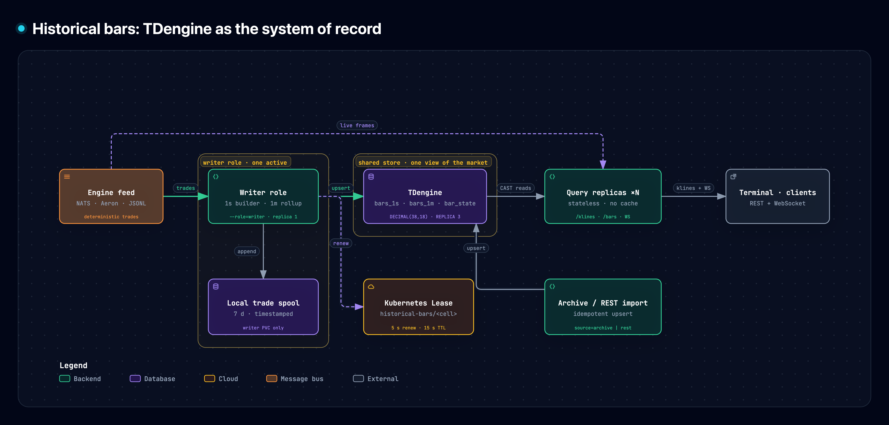
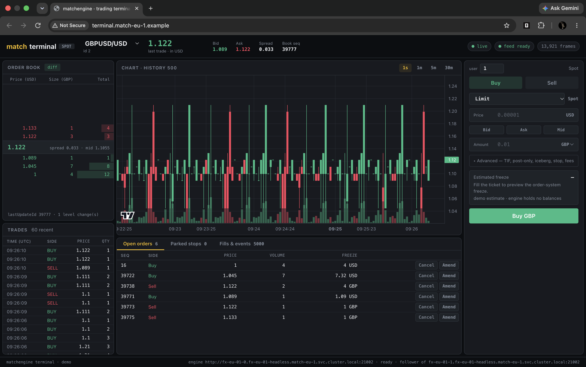
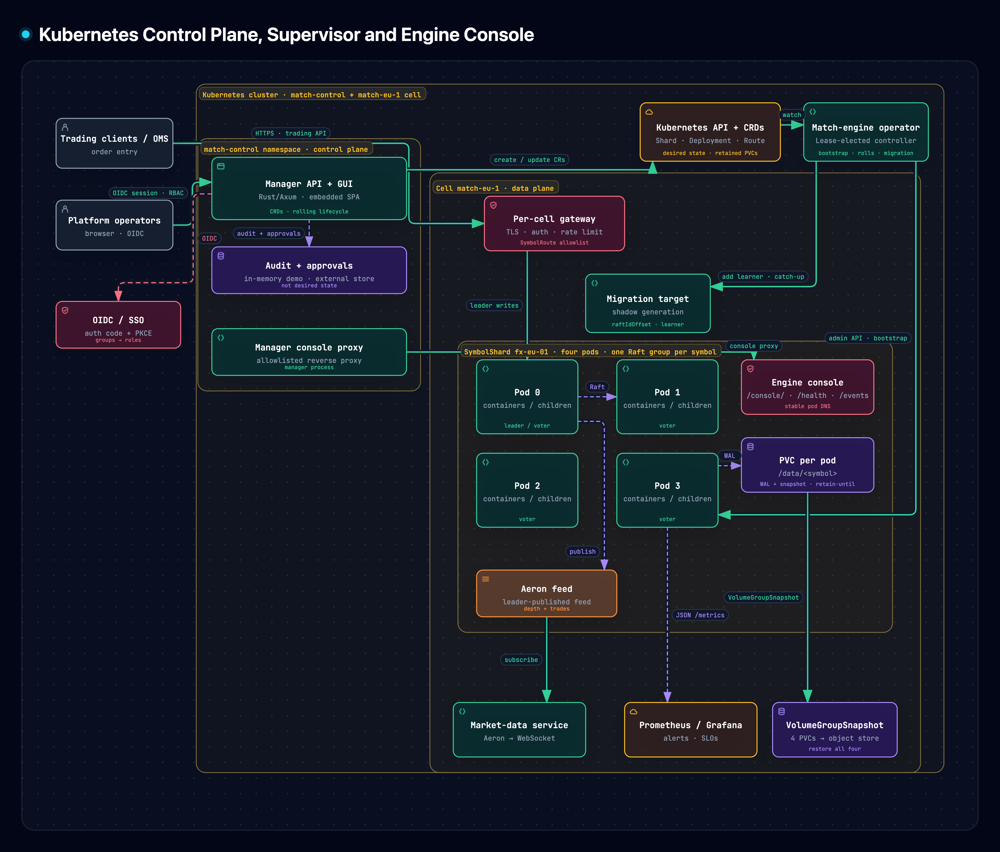
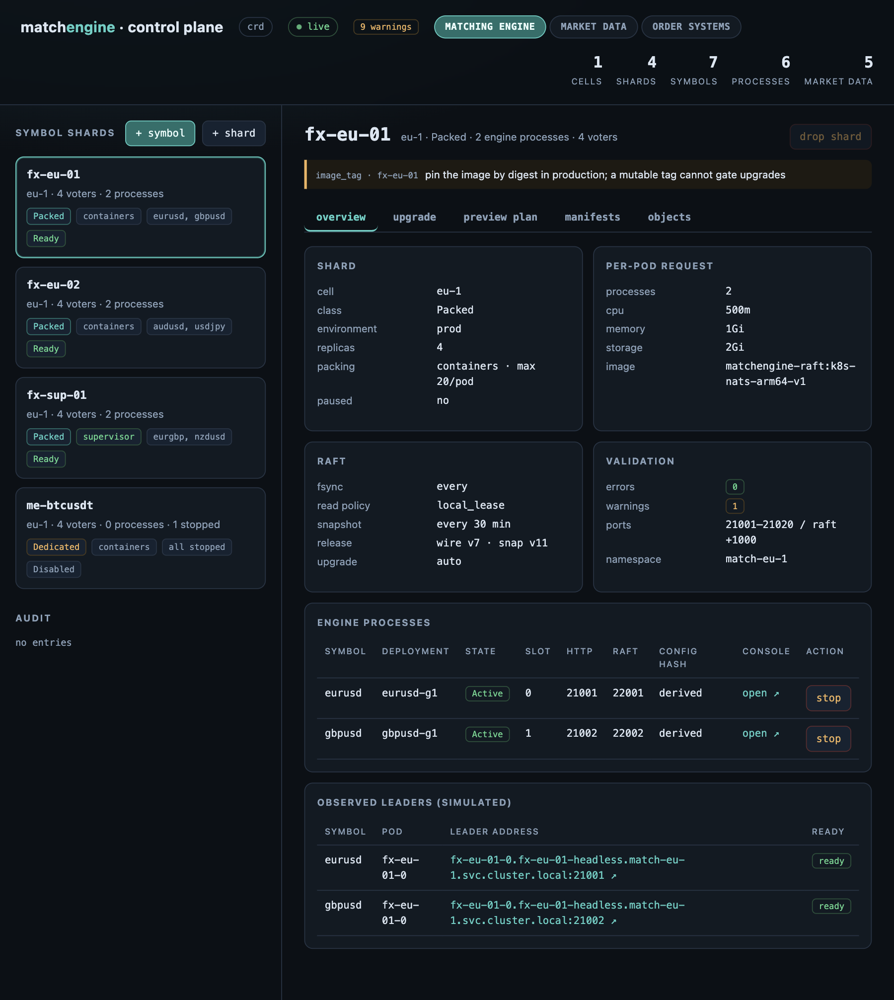
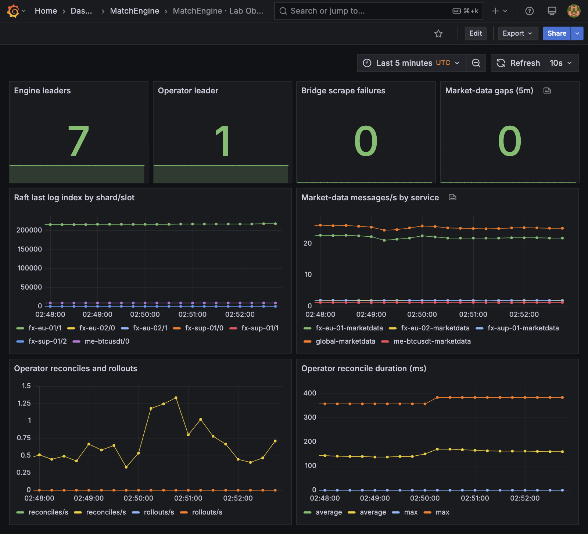

```
███╗   ███╗ █████╗ ████████╗ ██████╗██╗  ██╗███████╗███╗   ██╗ ██████╗ ██╗███╗   ██╗███████╗    ██████╗  █████╗ ███████╗████████╗
████╗ ████║██╔══██╗╚══██╔══╝██╔════╝██║  ██║██╔════╝████╗  ██║██╔════╝ ██║████╗  ██║██╔════╝    ██╔══██╗██╔══██╗██╔════╝╚══██╔══╝
██╔████╔██║███████║   ██║   ██║     ███████║█████╗  ██╔██╗ ██║██║  ███╗██║██╔██╗ ██║█████╗      ██████╔╝███████║█████╗     ██║
██║╚██╔╝██║██╔══██║   ██║   ██║     ██╔══██║██╔══╝  ██║╚██╗██║██║   ██║██║██║╚██╗██║██╔══╝      ██╔══██╗██╔══██║██╔══╝     ██║
██║ ╚═╝ ██║██║  ██║   ██║   ╚██████╗██║  ██║███████╗██║ ╚████║╚██████╔╝██║██║ ╚████║███████╗    ██║  ██║██║  ██║██║        ██║
╚═╝     ╚═╝╚═╝  ╚═╝   ╚═╝    ╚═════╝╚═╝  ╚═╝╚══════╝╚═╝  ╚═══╝ ╚═════╝ ╚═╝╚═╝  ╚═══╝╚══════╝    ╚═╝  ╚═╝╚═╝  ╚═╝╚═╝        ╚═╝
```

# ⚡ Matchengine Raft

<p align="center">
  
</p>

[](https://github.com/raymondshe/matchengine-raft/actions/workflows/ci.yml)
[](https://www.rust-lang.org)
[](./LICENSE)
[](./docs)
[](./docs/MARKET_DATA_PLAN.md)
[](./docs/zh-CN/STORAGE.md)

**一套可检查、可重放、可运维的完整交易所系统——从撮合到行情，再到下单与集群控制。**

核心是用 Rust 编写的 Raft 复制撮合引擎：18 位精度的确定性订单执行、完整的订单类型生命周期、
复制的撮合事件，以及由你按部署场景调节的 WAL 持久性策略。每一次状态变化都可观察——重放日志、
导出快照、复现成交，或在运维控制台里实时查看订单簿。

核心之外是交易所的其他部分。确定性行情链路通过 Aeron 多播或 NATS 将成交分发到 Binance 风格的
WebSocket 服务，背后是 TDengine 中的精确历史 K 线、按 symbol 分配的写者 Lease，以及真正修复缺口
而非掩盖缺口的 REST 尾部回填。无状态下单 BFF 驱动 React 交易终端，订单簿始终由行情 feed 提供，
客户端绝不轮询引擎。

运维从一开始就是设计的一部分，而不是事后补丁。CRD 驱动的 Kubernetes 控制平面负责选出 operator、
引导 Raft、逐 Pod 滚动升级并执行 wire/快照版本兼容门禁、通过恢复并校验哈希来验证备份，同时输出
指标、日志、告警和仪表盘。结果是一套能在单机实验室运行、又能扩展到分片集群的系统——没有黑盒，
没有隐藏状态，也不需要猜测引擎到底做了什么。

**本页导航：** [为什么选择它](#-为什么选择它) · [项目地图](#-五个项目一套系统) ·
[架构](#-架构) · [快速开始](#-快速开始) · [核心能力](#-核心能力) ·
[历史 K 线](#-基于-tdengine-的历史-k-线) · [交易终端](#-交易终端) ·
[Kubernetes](#-kubernetes-控制平面) · [安全边界](#-安全与部署边界) ·
[性能](#-性能) · [可观测性](#-可观测性界面) · [文档](#-文档与测试)。

## ✨ 为什么选择它

| 层次 | 能力 | 入口 |
|---|---|---|
| ⚡ **撮合** | 确定性的价格-时间优先订单簿、完整订单类型、STP 和 18 位定点数；`apply` 不读时钟，重放日志即可复现订单簿。 | [核心能力](#-核心能力) · [撮合](./docs/zh-CN/MATCHING.md) |
| 🛡️ **持久化与共识** | OpenRaft 0.10 + gRPC、Pre-Vote 与领导权转移、可配置 fsync 的分段校验 WAL、原子快照和快照 + WAL 尾部恢复。 | [存储](./docs/zh-CN/STORAGE.md) · [API](./docs/API.md) |
| 📡 **行情** | 有界且 leader-gated 的成交 feed，经 Aeron/NATS 分发为 Binance 风格 WebSocket；TDengine 历史 K 线精确到 18 位，按 symbol 的 Lease 保证单 writer，REST 尾部回填真实缺口。 | [历史 K 线](#-基于-tdengine-的历史-k-线) · [行情服务](./market_data_system/README.md) |
| 🧾 **客户端与 API** | leader 感知客户端、`/events` 游标、批量写入、local-lease 读与 `ReadIndex` 回退、按节点写入准入。 | [API](./docs/API.md) · [撮合结果](./docs/MATCH_RESULTS.md) |
| 🖥️ **交易界面** | 无状态下单 BFF + 纯 React/TS 终端；订单簿来自行情 feed，浏览器绝不调用引擎 `/write`。 | [终端](#-交易终端) · [下单系统](./order_system/README.md) |
| ☸️ **运维** | 内置控制台、探针、指标、重放工具、CRD 集群控制、逐 Pod 滚动、可校验备份和现成可观测栈。 | [Kubernetes](#-kubernetes-控制平面) · [可观测性](#-可观测性界面) |

## 🧩 五个项目，一套系统

| 项目 | 说明 | 入口 |
|---|---|---|
| 🦀 **match_engine** | Raft 复制、确定性撮合：订单簿、WAL/快照、gRPC Raft、事件日志、行情 feed 和运维控制台 | [`match_engine/README_CN.md`](./match_engine/README_CN.md) |
| ☸️ **k8s_control_plane** | 面向单 symbol 引擎集群的 CRD 管理器、Lease 选举 operator、渲染器和 GUI | [`k8s_control_plane/README.md`](./k8s_control_plane/README.md) |
| 📡 **market_data_system** | 独立的 Aeron/NATS/JSONL 消费端，提供 Binance 风格 WebSocket 行情和 TDengine 历史 K 线 | [`market_data_system/README.md`](./market_data_system/README.md) |
| 🧾 **order_system** | 独立下单 WebUI，以及演示用冻结/结算估算 | [`order_system/README.md`](./order_system/README.md) |
| 🖥️ **trading_terminal** | 纯 React/TS 的 Binance 风格现货终端：订单簿、成交、K 线和下单票据，经 nginx 部署 | [`trading_terminal/README.md`](./trading_terminal/README.md) |

```text
.
├── match_engine/          # 引擎 crate、bench、示例、测试、fuzz、控制台资源和 Dockerfile
├── k8s_control_plane/     # 管理 API/GUI、operator 和 CRD
├── market_data_system/    # WebSocket 行情服务 + 历史 K 线写入/查询
├── order_system/          # 演示下单系统
├── trading_terminal/      # React/TS 交易终端 + nginx 代理（无 Rust，独立构建）
├── docs/                  # 跨项目设计、API、runbook、架构图和性能文档
├── scripts/               # 集群、实验环境和 demo 编排
└── .github/workflows/     # CI、fuzz 和 benchmark workflow
```

## 🏗️ 架构

本项目扩展了 [example-raft-kv](https://github.com/datafuselabs/openraft/tree/main/example-raft-kv)，
增加了持久化存储、gRPC 传输和实时行情链路。下面是软件架构，以及四投票成员引擎集群、按用户 ID
共享的订单系统层和行情分发的运行时架构。可交互、带源码引用的引擎内部架构见
[交互式架构图](./docs/matchengine-raft-architecture.html)。

<p align="center"><strong>软件架构</strong></p>

<p align="center">
  
</p>

<p align="center"><strong>运行时架构</strong></p>

<p align="center">
  
</p>

<p align="center"><em>四投票成员引擎集群、按用户 ID 共享的订单系统层，以及 leader-gated Aeron feed 分发到无状态行情实例。</em></p>

Raft 节点间 RPC 使用 gRPC，端口为 HTTP 端口 + 1000；公共应用和管理 API 仍在 `--http-addr` 上，
Raft RPC 不属于 HTTP JSON API。

设置 `RAFT_CORE_WORKERS` 为正数可让 OpenRaft 的 RaftCore 和状态机 worker 运行在独立的
`raft-worker` 多线程 runtime 上，与 HTTP、gRPC 和行情任务隔离；未设置或 `0` 时仍使用共享 runtime。

leader 一致读默认使用 `local_lease`：`/linearizable_read`、`/events`、gRPC `StreamEvents` 和
`/get_linearizer` 先使用 OpenRaft 的调用侧 lease 缓存，再走核心 lease 路径，lease 过期时回退
`ReadIndex`。设置 `--read-policy read_index`（或 `MATCHENGINE_READ_POLICY=read_index`）强制每次
quorum 往返，`lease` 保留核心路径。lease read 要求节点间时钟漂移有界；`/read` 仍是本地读。

行情出口不在共识路径上：tap 使用有界 `try_send`，慢订阅者不会阻塞 `apply`。feature 门控的
`AeronSink` 从独立 publisher 线程把同一份 wire-v7 消息发布到 2001–2007 流，每个流一个独占
publication；JSONL sink 仍可用于调试。

## 🧪 核心能力

✅ 以下能力均已在本仓库实现并有测试覆盖。

**🧩 撮合引擎**
- **价格-时间优先订单簿**：支持 GTC、IOC、FOK、GTD、Day、市价、市价转限价、Post-Only、冰山单、止损市价、止损限价、移动止损和 Peg 单，以及 STP 自成交防护。
- **改单与撤单**：确定性优先级规则——同价减量保留时间优先；价格或数量增加则以新 sequence 重新排队。
- **按资产扣费**：maker/taker 费率、返佣和精确名义金额核算；加密/FX 默认以 received 资产扣费，ETF/股票始终以 quote 结算。
- **基础或计价单位量**：tick/lot 校验、quote 限价归一化与 quote 预算市价扫单。
- **端到端 18 位定点数**：从 API 输入到撮合、事件、快照和行情 feed，撮合路径不使用 `f64`。

**🛡️ 持久化与恢复**
- **Raft 复制状态机**：成员与应用状态持久化；WAL fsync 可配置。
- **分段校验 WAL**：`RAFT_WAL_FSYNC_MS` 未设置 = 不 fsync（默认，要求至少 4 个投票成员），`0` = 每次 append，`N > 0` = 每 N ms 定期；支持尾部损坏恢复。`--max-wal-append-bytes`（默认 8 MiB）把一次 apply 批次拆成字节受限写入，共用一个磁盘锁和一次 fsync。
- **原型异步 WAL**（feature 门控，默认关闭）：`append` 将 fsync 延后到 Tokio worker，仅在持久化后触发 `IOFlushed`；包含待处理条目读取与崩溃恢复测试。用 `--features async-wal` 构建，用 `--async-wal` 与 `RAFT_WAL_FSYNC_MS=0` 运行。
- **四投票成员无 fsync 下限**：`/init` 与 `/change-membership` 拒绝少于四票，写入在凑齐四票前返回 `503`，确保已提交条目至少在三个节点上。
- **原子快照**：临时文件 → fsync → rename → 目录 fsync，安装前校验校验和。快照字节以 `Arc<[u8]>` 共享；gRPC 接收的快照写入经过校验的 staging 文件，而非无界内存缓冲。
- **面向真实负载的快照策略**：每 100,000 条 apply，或有新条目时每 30 分钟一次，可用 `--snapshot-interval-ms` 调整。
- **快照 + WAL 尾部恢复**：恢复最新快照、事件窗口与幂等 map，仅重放更新的日志条目。
- **gRPC 复制**：双向 `stream_append`、分块快照传输、Pre-Vote 选举、领导权转移和每 peer 独立通道。

**🔌 API 与行情**
- **持久撮合事件 feed**：`POST /events` 支持游标分页、长轮询（`wait_ms`）、保留上限、`client_order_id` 幂等、gRPC `StreamEvents` 流和参考 MQ bridge sidecar；重试安全。
- **确定性行情 feed**：leader 门控、shadow book、BBO、深度快照/增量、生命周期事件、OHLC K 线和紧凑二进制 wire 格式（含参考解码器）。feature 门控的 **Aeron** 出口在 2001–2007 流发布，每流一个独占 publication，带空闲 STATUS 心跳和 stream-2010 快照请求通道。
- **独立行情系统** [`market_data_system/`](./market_data_system/)：经 Aeron/JSONL 消费 feed，提供 Binance 风格 WebSocket。单实例通过共享 hub 服务多个 symbol；连接维护订阅集合，用实时 `UNSUBSCRIBE`/`SUBSCRIBE` 切换 symbol，可水平扩展而不增加引擎负担。迟到订阅者向引擎请求即时快照；`/ready` 也会因缺少帧/心跳而超时。
- **灵活读一致性**：本地 `/read`、线性一致 leader 读和 follower 读。leader 一致路径默认使用 OpenRaft 调用侧 lease 缓存（`local_lease`），再走核心 lease 路径，lease 过期时回退 `ReadIndex`；`--read-policy read_index` 强制新的 quorum 往返，`lease` 保留核心路径。四节点实测相较核心 lease 路径，读吞吐高 11–36%，64 读者 p50/p99 低约 40%。lease read 要求时钟漂移有界（NTP/PTP）；`/read-policy/status` 报告命中与回退。
- **leader 感知 Rust 客户端**：跟踪并转发请求到当前 leader，超时/瞬时重试/退避可配置，错误类型区分 API 与无 leader；重试为 at-least-once，幂等写入请使用 `client_order_id`。
- **运维 API**：初始化、成员变更、metrics、事件状态与行情状态。
- **批量写入** `POST /write_batch`：多个请求合并为一个 Raft entry 和一次 WAL append，每个请求独立 sequence，事件 ordinal 连续。
- **关注 P99 的写入准入**：每节点默认限制 1,024 个并发 `/write` 与 `/write_batch`，超出返回 `429`，并在 `/admission/status` 暴露当前/峰值/准入/拒绝计数。

**📊 运维可见性**
- **内置 WebUI 控制台** `/console/`：集群健康、Raft 领导与复制、存储/事件/feed 状态、仅 leader 可用的事件查看器和诊断——无需构建步骤或外部资源。页面主标题显示已应用的 `BASE/QUOTE` 交易 symbol。
- **受保护的 Raft 操作**：通过 gRPC `TransferLeader` 优雅转移领导权、尽力发起 Pre-Vote 选举、触发快照，均需确认、操作锁和审计日志。
- **独立演示下单台** [`order_system/`](./order_system/)：独立进程与 crate，可真实下单并展示完整订单簿、symbol 配置、游标跟随的 `/events` 记录，以及带标注的订单系统冻结与 maker/taker 手续费结算演示估算，含演示用线性永续/杠杆叠加层；复用控制台主题。
- **健康与就绪探针**：`/health` 报告 gRPC 监听器、Raft core 和 WAL/状态机前沿；`/ready` 额外要求已知 leader；`/pretrade/status` 报告 symbol/配置就绪原因，适合编排器与 pre-trade 门禁。

**☸️ Kubernetes 集群控制（生产形态）**
- **一个控制平面管理数千个单 symbol 引擎**——每个 symbol 独立进程和四投票 Raft 组；2,000 symbol 即 8,000 个引擎进程，按每 Pod 20 进程打包为 100 个四 Pod shard（400 Pod），并划分 cell。打包减少 Pod 与 Kubernetes 对象，不改变每 symbol 的 Raft 组。
- **零影响 supervisor 模式**——每 Pod 一个 supervisor 容器读取 `processes.json` 并启停单个子进程；添加/停止/启动 symbol 不影响其他引擎的 PID、监听与数据目录。OrbStack 验证中，添加和轮转子进程时所有 Pod UID 与重启计数保持不变。
- **显式 containers 爆炸半径保护**——非空 containers shard 返回 `409 restart_required`；`allowRestart` 才允许一票一 Pod 的滚动，常规添加不会静默重启整个集群。
- **完整生命周期与存储决策**——优雅停启复用同一 deployment、slot/端口和 PVC，无需重新 `/init` 即可恢复 WAL/snapshot；空闲 shard 可删除，并显式选择保留 PVC 以便恢复或不可逆删除。
- **CRD 期望状态**——七个 `matching.io` CRD（`TradingSymbol`、`SymbolShard`、`SymbolDeployment`、`SymbolRoute`、`Cell`、`MarketDataService`、`OrderSystem`）带 status subresource；manager 通过 Kubernetes API server 写入，用 informer 重建缓存，使用 `resourceVersion` 并发控制并对 status 写入限流。etcd 保存 CR；manager 从不直接连接 etcd，引擎 WAL/事件也不写入 etcd。
- **Lease 选举 cell operator**——监听 CRD，server-side apply/prune StatefulSet/Services/PDB/NetworkPolicy/ConfigMap，为 dedicated-shard leader 打标签供 leader Service 使用，写入 shard/deployment/route/symbol 状态与 conditions。watch 触发即时 reconcile；Kubernetes Lease 保证副本间互斥。
- **期望状态 manager，而非手工 YAML 堆**——目录校验、最低空闲 slot 与 `httpBasePort + slot` 分配、渲染 StatefulSet/Services/PDB/NetworkPolicy/ConfigMap、reconcile bootstrap/upgrade 计划、审计，以及跨 shard/cell 的引擎控制台代理。
- **生产 Kubernetes 原语**——四投票 shard、每 Pod 一个 PVC、PDB、NetworkPolicy、headless gRPC service、健康/就绪探针、非 root 镜像和 leader 感知路由元数据。参考 manager、supervisor 与 Lease 选举 operator 均已在本仓库实现；operator 还执行 bootstrap/config/membership、quorum 安全的 containers 增删启停滚动、PVC 保留和跨 shard cutover/rollback。

可运行实现见 [Kubernetes 控制平面 demo](./k8s_control_plane/README.md)，生产 operator 契约见[设计文档](./docs/KUBERNETES_CONTROL_PLANE.md)。

**✅ 值得信赖**
- **有界公共边缘**：请求体、read key、事件页、幂等 key 和快照大小均有限制，畸形输入在进入 Raft 前被拒绝。
- **明确的内部服务契约**：仅回环或可信私有网络，TLS/认证由网关负责，并对非回环绑定打印启动告警。
- **传输故障快速失败**：gRPC 监听器退出时 `run()` 停止节点并返回错误，而不是让半健康的 HTTP API 继续服务无法到达的 peer。
- **正确性证据**：对照参考模型的随机差分测试、显式订单类型 conformance 用例、确定性回放检查和集群恢复测试。
- **一个进程/集群一个 symbol**：资源与故障域隔离；通过为每个 symbol 部署一套实例实现水平扩展。

## 🚀 快速开始

| 目标 | 从哪里开始 |
|---|---|
| 检查单节点引擎及其 HTTP API | 下方[运行引擎](#运行引擎) |
| 验证复制、成员变更与恢复 | 下方[启动本地集群](#启动本地集群) |
| 一起查看下单与行情 | 下方[运行演示](#运行演示) |
| 运维多 symbol 集群 | [Kubernetes 控制平面](#-kubernetes-控制平面) |
| 先理解设计再动手 | [架构](#-架构)与[文档](#-文档与测试) |

### 运行引擎

```shell
cd match_engine
cargo build --release
cargo run --release --bin matchengine-raft -- --id 1 --http-addr 127.0.0.1:21001
```

Rust 1.89+（edition 2024）。构建脚本自带 `protoc`，无需系统安装。

### 启动本地集群

```shell
./scripts/test-cluster.sh
```

脚本会构建、启动四节点集群、初始化、添加 learner、变更 membership，并从每个节点读取订单簿。
可用 `--nodes N`、`--base-port`、`--keep`、`--no-fsync`、`status` 和 `stop` 控制。手动启动、
成员变更、故障演练和恢复流程见 [runbook](./docs/zh-CN/RUNBOOK.md)。

### 运行演示

```shell
./scripts/demo-pair.sh             # 两个引擎 + 下单系统
./scripts/market-data-system.sh    # 两个引擎 + 行情 WebSocket 服务
```

## 🧾 演示组件

独立下单系统见 [`order_system/README.md`](./order_system/README.md)，行情服务见
[`market_data_system/README.md`](./market_data_system/README.md)；运行方式、截图和设计文档都在各自的
README 中。

## 🗄️ 基于 TDengine 的历史 K 线

`market_data_system --history` 在现有服务内增加持久化 K 线层——不新建 crate，也不新增对外端口。
单个 writer 把确定性的成交 tap 折叠成稀疏的 `1s` 成交 K 线以及物化的 `1m`/`5m` 汇总，以规范的
18 位小数文本 upsert 到 TDengine；`3m`…`3d` 在读取时通过 `INTERVAL` 汇总（`30m` 优先由 `5m`
生成，缺失时回退 `1m`）。读取时把 DECIMAL 列
`CAST` 为 `VARCHAR`，再用严格的 scale-18 解析器处理，因此 `f64` 或 96 位客户端小数都不可能悄悄
舍入数值。writer 行携带引擎 `market_seq` 和自身成交游标，替换实例可从最新行恢复，无需热备；查询端
完全无状态，直接读 TDengine。`GET /klines` 为 Binance 兼容的稠密数组，同一批行也用于 WebSocket
订阅回放。

**P0 与 P1** 已在 OrbStack 实验环境实现并验证：schema、成交驱动 writer、`/klines`、WS 回放，
以及滚动成交 spool、修订/缺口表、按 symbol 的 Lease 故障切换、REST 尾部缺口修复和原生
`/bars?since=<seq>`。归档导入器与 reconciler、基于缺口的读门禁、时区锚定和三节点生产拓扑仍待完成。

[](./docs/historical-bars-tdengine.html)

[打开交互式 Archify 图](./docs/historical-bars-tdengine.html) ·
[完整设计与实测数据](./docs/HISTORICAL_BARS.md) ·
[服务配置](./market_data_system/README.md)

上图是已检入的 Archify HTML 导出文件的静态截图；HTML 支持 route/lens 视图以及图片/SVG/WebM 导出。

## 🖥️ 交易终端

[`trading_terminal/`](./trading_terminal/) 是 Binance 风格现货交易界面，也是**纯前端项目**：React +
TypeScript 独立 Vite 构建，不依赖 Rust crate，也不嵌入任何 Rust 二进制。nginx 仅作部署管道：静态托管
SPA，并把同源 `/md/*` 代理到全局行情服务、`/demo/api/*` 代理到下单 BFF，因此 BFF 的同源
`Origin` 校验无需 CORS 改动即可通过。下单走 BFF 的 `X-Demo-Action: submit`，浏览器从不直接调用
引擎 `/write`。

订单簿以价差为中心上下锚定：卖盘底部对齐贴价差上方，买盘顶部对齐贴价差下方。图表在每次 symbol/interval
切换时从 TDengine 支持的 `/md/klines` 拉取最多 500 根 K 线来初始化，再叠加实时成交与 `kline` 帧，
且不会重新打开已闭合的历史 K 线；标题栏显示种子数量（`HISTORY 500`）。



截图来自 OrbStack 实验环境 <http://terminal.match-eu-1.example/>（演示种子数据，非交易所历史）。
部署说明见 [`trading_terminal/README.md`](./trading_terminal/README.md) 和
[`k8s_control_plane/deploy/terminal.yaml`](./k8s_control_plane/deploy/terminal.yaml)。

## ☸️ Kubernetes 控制平面

引擎一个进程只交易一个 symbol，因此多 symbol 部署是多个独立 Raft 集群。
[`k8s_control_plane/`](./k8s_control_plane/) 是参考控制平面：用四 Pod `SymbolShard` 打包多个
单 symbol 引擎进程，校验放置和端口，渲染 StatefulSet/Services/PDB/NetworkPolicy，并规划 bootstrap、
membership、路由和同版本升级。manager API/GUI 负责 symbol 目录、RBAC、审批和受白名单限制的引擎
控制台代理。它可以预留空 shard、把新 symbol 放入预留或现有 shard 的下一个空闲 slot/port，并为已有
symbol 准备 shadow migration。supervisor 模式通过只改 ConfigMap 添加 symbol，已有引擎进程保持运行；
containers 模式需要显式允许重启。

同一个控制平面支持单个 symbol 的优雅停启，保留 slot、端口和 PVC，并在不重新 `/init` 的情况下恢复
WAL/snapshot；空闲 shard 可删除，并显式选择保留 PVC 或不可逆删除。期望状态可以使用 JSON demo store
或 CRD 后端；后者通过 Kubernetes API server 写入七个 `matching.io` CRD（含 `MarketDataService`）（底层 etcd），并从 informer
重建缓存。Lease 选举的 operator 监听 CRD、apply/prune 渲染出的工作负载、给 dedicated leader Pod 打标签、
写入 shard/deployment/route 状态、bootstrap/config 每个 Raft 组、在 quorum 门禁下逐 Pod 滚动、执行 PVC
保留窗口，并用不重叠的 Raft ID 范围完成跨 shard cutover/rollback。

[](./docs/kubernetes-console-architecture.html)

[交互式图](./docs/kubernetes-console-architecture.html) ·
[设计与 CRD](./docs/KUBERNETES_CONTROL_PLANE.md) ·
[etcd 存储](./docs/ETCD_STORAGE.md) ·
[本地测试计划](./docs/KUBERNETES_LOCAL_TESTING.md) ·
[参考 demo](./k8s_control_plane/README.md)



manager GUI 的**撮合引擎**视图：在线 `fx-eu-01` shard 托管 `eurusd` 与 `gbpusd`，均为 Ready，展示每 Pod 请求、放置与释放校验、每进程控制台链接和观测到的 leader。manager 还有**行情**（terminal 与 fast WebSocket 层）与**订单系统**（按用户 ID 分片、Demo 下单台链接和镜像选择器）视图。

## 🔒 安全与部署边界

HTTP API 和 gRPC Raft 监听器（HTTP 端口 + 1000）按设计是**明文且无认证**的。这是内部撮合引擎，
不是面向公网的网关：只应运行在回环或可信私有网络，防火墙保护两个端口，并在前面的网关终止 TLS
和客户端认证。TLS/mTLS 和 API 认证刻意不在本进程实现，因为对内部接口只会增加延迟。

节点绑定非回环地址时会打印警告。请求在进入 Raft 前在边缘受限：

| 接口 | 限制 |
|---|---|
| 应用/管理 JSON body | 1 MiB (`MAX_REQUEST_BODY_BYTES`) |
| `client_order_id` | 1–128 字节，ASCII 字母数字加 `. _ - :`；空值拒绝 |
| `/read` key | 1–128 可打印 ASCII 字节 |
| `/events` 每页 | 1–1000 条 |
| `/events` 长轮询 | 0–1000 ms (`wait_ms`) |
| `/write_batch` | 1–128 条非嵌套请求，`client_order_id` 唯一 |
| gRPC Raft 消息 | 64 MiB (`MAX_MESSAGE_SIZE`) |
| gRPC 快照流 | 总量 256 MiB (`MAX_SNAPSHOT_BYTES`)，每块 staging 前校验 |

畸形 JSON 与非法字段返回 `400`；超大请求体返回 `413`。复制的 `client_order_id` 去重表最多保留 262,144 条记录，因此 key 长度上限也限制了其内存占用。
## 📊 性能

参考机器（Apple M4、Rust 1.93.1、release bench profile）的主要数据。纯订单簿行不含 HTTP、Raft 和 WAL；
复制行使用四个进程内 loopback 投票成员并关闭 WAL fsync。方法、分位数、持久化模式和 caveat 见
[`docs/PERFORMANCE.md`](./docs/PERFORMANCE.md)。

**订单簿亮点（2026-11-26）。** 停单、GTD 截止时间和 peg 订单改为索引后，三个原本每次请求都执行的全表扫描被消除：

| 路径 | 之前 | 之后 |
|---|---:|---:|
| 纯订单簿真实混合回放（`replay_mix`） | 616k ops/s | **3.09M ops/s**（约 5 倍） |
| Peg 查找，5k 订单簿、无 peg | ~19 µs/次 apply | **0.41 µs/次**（约 45 倍） |
| Peg 查找，32 个 peg 订单 | ~16–19 µs/次 apply | **2.3 µs/次** |

未完成的条目见[订单簿性能审查](./docs/ORDER_BOOK_PERFORMANCE_REVIEW.md)；前后数据见
[`docs/PERFORMANCE.md`](./docs/PERFORMANCE.md)。

**apply 路径亮点（2026-11-26）。** 现在只在有客户端等待时才构造响应，批量写入也只向 sink 发布一次，而不是每个子请求一次：

| 路径 | 之前 | 之后 |
|---|---:|---:|
| `apply_path` rest / cancel / fill 每次 apply 的分配次数 | 3.17 / 3.00 / 4.00 | **0.17 / 0.00 / 1.00** |
| 批量 rest 每次 apply 的分配次数 / 申请字节 | 1.19 / 1,875 B | **0.21 / 1,141 B** |
| 带 client_order_id 的 Place 分配次数 | 3.32 | **2.32** |

未完成的条目见[apply 路径性能审查](./docs/APPLY_PATH_PERFORMANCE_REVIEW.md)；实测数据见
[`docs/PERFORMANCE.md`](./docs/PERFORMANCE.md)。

| 工作负载 | 结果 |
|---|---:|
| 订单簿深扫（100 档） | 11.66M fills/s |
| 订单簿深度撤单 | 19.63M cancels/s |
| BBO 推进 / 查询 | 20.37M advances/s / 434.5M queries/s |
| 真实混合回放（add/cancel/amend/stop/iceberg/taker） | 3.09M ops/s |
| 复制写入，512 并发（预连接） | 114,484 writes/s，p99 5.76 ms |
| 复制写入，1,024 并发（预连接） | 99,330 writes/s，p99 8.74 ms |
| 复制顺序 128 单批量 | 227,319 orders/s |
| 复制 100 x 32 并发批量 | 216,163 orders/s |
| 本地 lease 线性一致读（1 / 64 读者） | 27,357 / 56,924 reads/s；p50 34.8 / 53.5 µs |
| 本地 lease follower 读（1 / 64 读者） | 12,564 / 39,473 reads/s；p50 78.4 / 198.1 µs |
| 本地 lease 事件读（1 / 64 读者） | 8,224 / 45,243 reads/s；p50 118.8 µs / 1.34 ms |
| 行情 feed（null sink） | 495k fills/s，8,192 帧队列 0 丢弃 |
| WAL append/read，无 fsync（仅存储） | 2.15M / 5.66M entries/s |

纯订单簿数据是单进程订单簿的最优值，不是端到端容量。四节点数据使用同一进程内的 3-of-4 quorum loopback；它们不模拟跨主机网络延迟、独立磁盘竞争或主机故障。预连接写入在 512–1,024 并发处趋于平稳；早期的连接风暴测试包含 TCP 建连，低估了容量。单节点顺序写入在每次 append 都 fsync 时低得多（262 writes/s），但 100 x 32 批量仍可达 180k orders/s；权衡详见 `PERFORMANCE.md`。

**推荐生产配置。** 最大吞吐：保持 `RAFT_WAL_FSYNC_MS` 未设置（要求至少 4 个投票成员），
`RAFT_CORE_WORKERS` 未设置，OpenRaft `300/1/0` 默认值，使用 `/write_batch` 32–128 单；默认 1,024
并发写入准入，超出返回 `429` 并退避重试；需要更紧的尾延迟时降到 `512`。只有在 NTP/PTP 保证时钟漂移
有界时才保留 local-lease 读，否则设置 `--read-policy read_index`。写入必须在非干净崩溃后存活时设置
`RAFT_WAL_FSYNC_MS=0` 并批量写入。不要使用 10 ms fsync、1 ms batch linger、1,024-entry
payload/purge、async WAL 或 thin LTO，它们都没有超过默认配置。详见
[生产配置决策](./docs/PERFORMANCE.md#production-configuration-decisions-2026-11-08)。

## 📈 可观测性界面

一个 Grafana 面板即可查看 Raft 与行情速率、抓取状态、告警以及 operator 的 reconcile/rollout 计数。
安装、验证和其他视图见 [`docs/OBSERVABILITY.md`](./docs/OBSERVABILITY.md)。



## 📚 文档与测试

- [引擎 README](./match_engine/README_CN.md) — 构建/运行、引擎配置和内部结构。
- [API](./docs/zh-CN/API.md) — HTTP 应用/管理路由和 gRPC Raft 服务。
- [存储](./docs/zh-CN/STORAGE.md) — WAL、快照、恢复和转储工具。
- [撮合](./docs/MATCHING.md) — 订单类型和改单规则。
- [事件交付](./docs/MATCH_RESULTS.md) — 事件、游标和幂等。
- [测试](./docs/zh-CN/TESTING.md) — 集群测试、回放矩阵和故障测试。
- [性能](./docs/PERFORMANCE.md) — 实测基线和测量方法。
- [Kubernetes 行情消息总线](./docs/AERON_K8S_MESSAGE_BUS.md) — 行情消息总线、multicast 限制和扩展方案。
- [实验室可观测性](./docs/OBSERVABILITY.md) — HPA CPU 的 metrics-server、Prometheus 桥接、operator 指标、告警、Grafana 面板和 Loki 日志收集。
- [交易终端](./trading_terminal/README.md) — React/TS 客户端、部署代理和由 TDengine 种子的图表。
- [历史 K 线](./docs/HISTORICAL_BARS.md) — TDengine schema、精确小数契约、HA 契约和实测数据；[可交互 Archify 导出](./docs/historical-bars-tdengine.html)与 PNG 预览已一并检入。
- [Runbook](./docs/zh-CN/RUNBOOK.md) — 集群、升级、迁移和恢复流程。
- [第三方调研](./docs/THIRD_PARTY_INVESTIGATION.md) — 外部引擎 review。
- [TODO](./TODO.md) — 当前优先级和路线图。

```shell
cargo test --manifest-path match_engine/Cargo.toml --locked
cargo test --manifest-path k8s_control_plane/Cargo.toml --locked
cargo test --manifest-path market_data_system/Cargo.toml --locked
cargo test --manifest-path order_system/Cargo.toml --locked
```

## 📬 联系方式与致谢

- Google Chat: [rshen.sy@gmail.com](https://chat.google.com/u/0/dm/rshen.sy@gmail.com)
- 本项目 fork 自 [example-raft-kv](https://github.com/datafuselabs/openraft/tree/main/example-raft-kv)
  （[OpenRaft](https://github.com/datafuselabs/openraft) 项目）。
- 感谢 Databend 社区和 Zhang Yanpo 的支持。

## 📄 License

MIT，见 [`LICENSE`](./LICENSE)。

项目最初 fork 自 [example-raft-kv](https://github.com/datafuselabs/openraft/tree/main/example-raft-kv)，
原项目采用 MIT 或 Apache-2.0 双许可；原始版权和许可声明继续适用于派生代码。本仓库以 MIT 许可分发。
