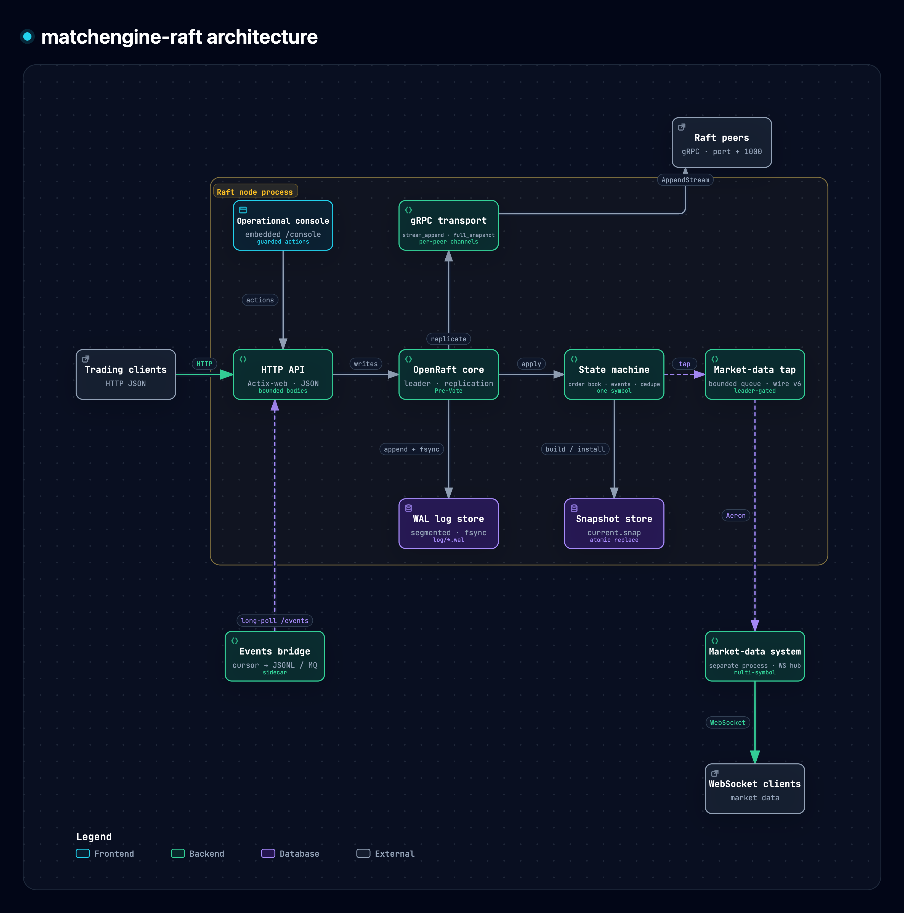
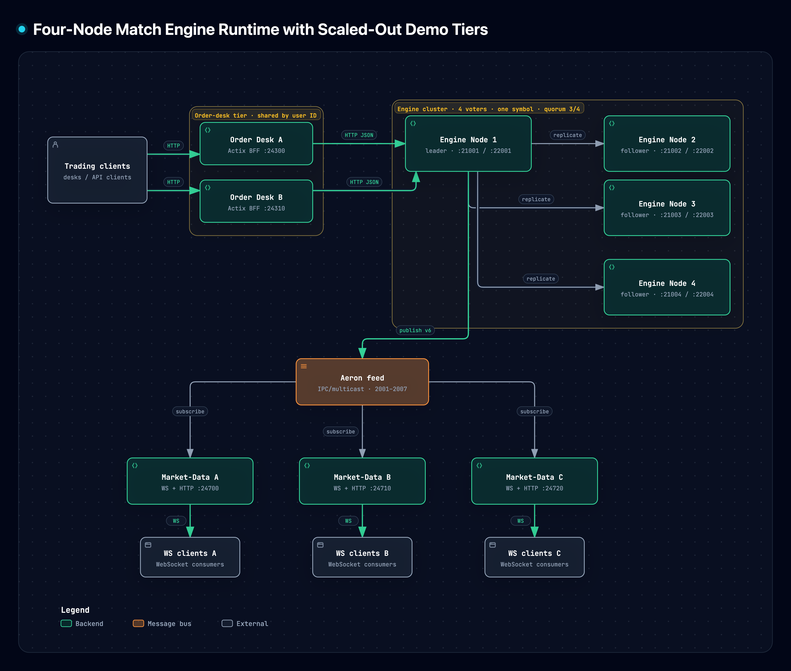
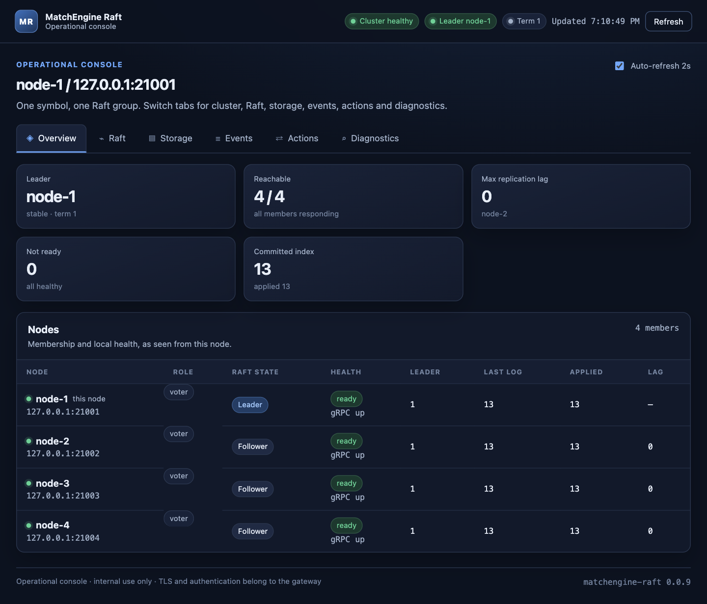
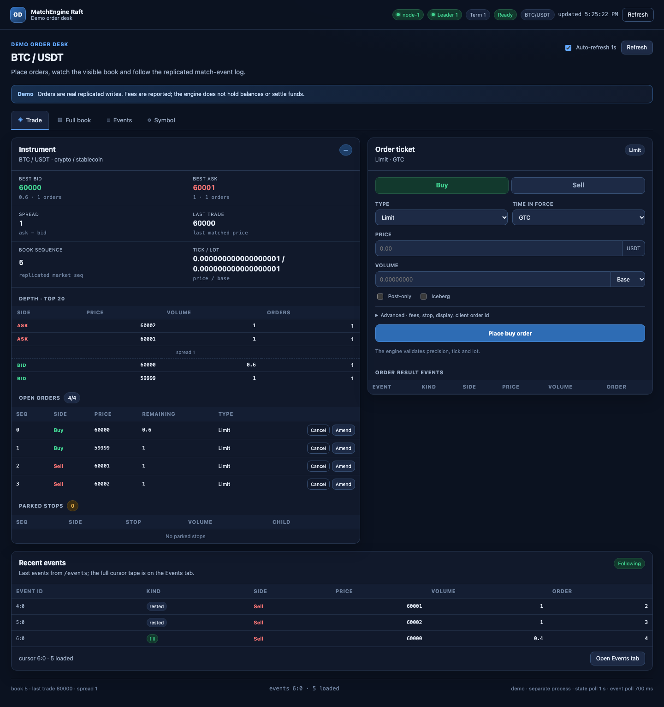
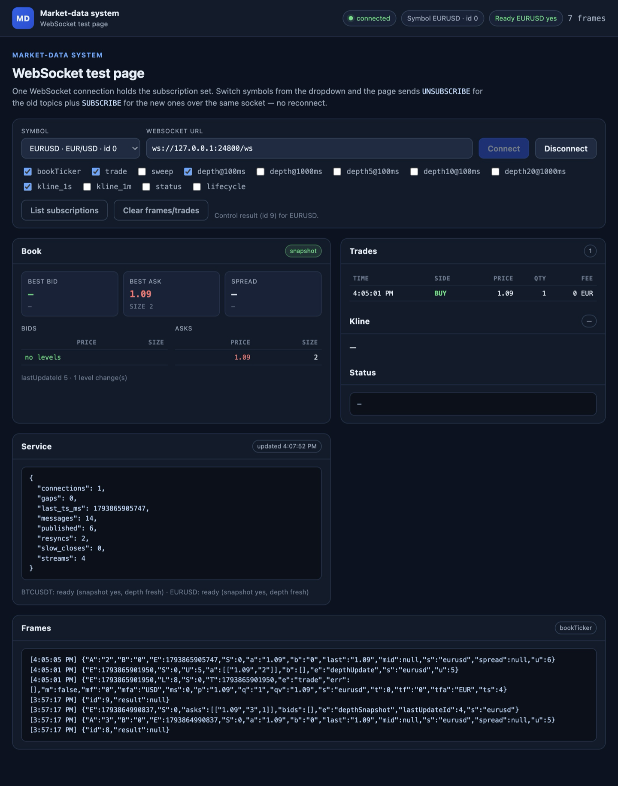

```
███╗   ███╗ █████╗ ████████╗ ██████╗██╗  ██╗███████╗███╗   ██╗ ██████╗ ██╗███╗   ██╗███████╗    ██████╗  █████╗ ███████╗████████╗
████╗ ████║██╔══██╗╚══██╔══╝██╔════╝██║  ██║██╔════╝████╗  ██║██╔════╝ ██║████╗  ██║██╔════╝    ██╔══██╗██╔══██╗██╔════╝╚══██╔══╝
██╔████╔██║███████║   ██║   ██║     ███████║█████╗  ██╔██╗ ██║██║  ███╗██║██╔██╗ ██║█████╗      ██████╔╝███████║█████╗     ██║
██║╚██╔╝██║██╔══██║   ██║   ██║     ██╔══██║██╔══╝  ██║╚██╗██║██║   ██║██║██║╚██╗██║██╔══╝      ██╔══██╗██╔══██║██╔══╝     ██║
██║ ╚═╝ ██║██║  ██║   ██║   ╚██████╗██║  ██║███████╗██║ ╚████║╚██████╔╝██║██║ ╚████║███████╗    ██║  ██║██║  ██║██║        ██║
╚═╝     ╚═╝╚═╝  ╚═╝   ╚═╝    ╚═════╝╚═╝  ╚═╝╚══════╝╚═╝  ╚═══╝ ╚═════╝ ╚═╝╚═╝  ╚═══╝╚══════╝    ╚═╝  ╚═╝╚═╝  ╚═╝╚═╝        ╚═╝
```

# Match Engine Raft

<p align="center">
  
</p>

[](https://github.com/raymondshe/matchengine-raft/actions/workflows/ci.yml)
[](https://www.rust-lang.org)
[](./LICENSE)
[](./docs)
[](./docs/MARKET_DATA_PLAN.md)
[](./docs/zh-CN/STORAGE.md)

一个用 Rust 构建、基于 Raft 复制的撮合引擎，面向需要确定性执行、可靠恢复和实时行情链路的团队——而不是把撮合引擎当成黑盒。

> **WAL 持久性可配置。** `RAFT_WAL_FSYNC_MS` 控制 WAL fsync：
> **未设置** = 不 fsync（默认，最快；崩溃可能丢失已确认写入，且集群要求至少 4 个投票成员），
> **`0`** = 每次追加都 fsync（最强持久性），**`N > 0`** = 每 N 毫秒周期 fsync（将丢失窗口限制在约 N ms）。
> 恢复契约见[存储](./docs/zh-CN/STORAGE.md)。

**为什么选择它**

- **确定性执行** — 价格-时间优先撮合，`apply` 不读墙上时钟；重放日志可以精确复现订单簿。
- **可配置持久化** — 自研分段 WAL（fsync 策略可选，`--max-wal-append-bytes` 按字节切分单次追加）、原子快照和“快照 + WAL 尾部”恢复，均由重启和故障测试覆盖。
- **Raft 原生** — OpenRaft 0.10 + gRPC，支持 Pre-Vote、领导权转移、学习者追赶和分块快照安装。
- **18 位定点数** — 撮合路径不使用 `f64`；价格、数量和费用在 API、事件、快照和 feed 中全程精确。
- **实时行情** — 确定性 feed 通过 Aeron 发布（每个流一个独占 publication），再由 Binance 风格 WebSocket 服务分发，支持 100/1000 ms 深度合并和水平扩展。
- **可运维** — 内置控制台、`/health` + `/ready`、指标、重放工具和独立下单演示。

| 维度 | 当前状态 |
|---|---|
| 执行 | 确定性价格-时间撮合；`apply` 不读墙上时钟 |
| 持久化 | 可配置 fsync 的分段 WAL + 原子快照；`RAFT_WAL_FSYNC_MS` 默认不 fsync（要求 4 个投票成员）；每 100,000 条或 30 分钟生成快照 |
| 复制 | Raft 节点间 RPC 使用 gRPC |
| 行情数据 | Aeron 出口（2001–2007 流 + 2010 快照请求）+ Binance 风格 WebSocket 服务 |
| 标的模型 | 一个进程/集群一个标的，经 Raft 配置并在交易开始后锁定 |
| 数值模型 | 撮合、事件、快照和 feed 全程使用 18 位定点数 |
| 可观测性 | 内置控制台、健康/就绪检查和指标 |
| 公共入口 | 请求/快照大小受限；仅支持回环或私有网络部署 |

## 目录

- [功能特性](#功能特性)
- [架构概述](#架构概述)
- [快速开始](#快速开始)
- [运行集群](#运行集群)
- [运维控制台](#运维控制台)
- [演示下单系统](#演示下单系统)
- [基于 Aeron 的行情数据系统](#基于-aeron-的行情数据系统)
- [安全与部署边界](#安全与部署边界)
- [项目结构](#项目结构)
- [存储与撮合](#存储与撮合)
- [API 参考](#api-参考)
- [测试](#测试)
- [性能与当前限制](#性能与当前限制)
- [联系方式](#联系方式)

## 功能特性

以下能力均已实现并有测试覆盖，链接指向对应代码。

**撮合引擎**
- **价格-时间优先订单簿**，支持 GTC、IOC、FOK、GTD、Day、市价、市价转限价、Post-Only、冰山单、止损市价单、止损限价单、移动止损和 Peg 订单，以及自成交防护。
- **改单与撤单**遵循确定性优先级：同价减量保留时间优先；改价或增量会以新序列号重新排队。
- **按资产扣费**，支持 maker/taker 费率、返佣和精确名义金额计算；加密货币/FX 默认收到资产扣费，ETF/股票始终以 quote 资产结算。
- **Base 或 quote 数量**，支持 tick/lot 校验、quote 限价单归一化和 quote 预算市价扫描。
- **端到端 18 位定点数**，从 API 输入、撮合、事件、快照到行情 feed 全程使用定点数，撮合路径不做 `f64` 运算。

**持久化与恢复**
- **Raft 复制状态机**，成员和应用状态持久化，WAL fsync 可配置。
- **分段校验 WAL**，`RAFT_WAL_FSYNC_MS`：未设置 = 不 fsync（默认，要求至少 4 个投票成员），`0` = 每次追加，`N > 0` = 每 N ms 周期；支持撕裂尾部恢复。
- **异步 WAL 原型**（feature-gated，默认关闭）：`append` 将 fsync 交给 Tokio worker，只有持久化后才触发 `IOFlushed`；包含 pending 读取和崩溃恢复测试。使用 `--features async-wal` 构建，运行时设置 `--async-wal` 和 `RAFT_WAL_FSYNC_MS=0`。
- **无 fsync 的四投票成员下限**：`/init` 和 `/change-membership` 拒绝少于 4 个投票成员，写入在达到 4 个成员前返回 `503`，使一条已提交日志至少存在于 3 个节点。
- **原子快照**，通过临时文件 → fsync → rename → 目录 fsync 写入，安装前校验 checksum。
- **面向真实负载的快照策略**：每 100,000 条已应用日志或每 30 分钟（有新 entry 时）生成快照，可用 `--snapshot-interval-ms` 调整。
- **快照 + WAL 尾部恢复**：先加载最新快照、事件窗口和幂等表，再只重放更新的日志条目。
- **gRPC 复制**，支持双向 `stream_append`、分块快照传输、Pre-Vote 选举、领导权转移和每个对端独立通道。

**API 与数据 Feed**
- **持久化撮合事件 Feed**：`POST /events` 游标分页、长轮询（`wait_ms`）、保留上限、`client_order_id` 幂等、gRPC `StreamEvents` 流式推送和参考 MQ bridge sidecar，安全重试。
- **确定性行情 Feed**：领导者门控、影子订单簿、BBO、深度快照/增量、生命周期事件、OHLC K 线和紧凑二进制行情格式（含参考解码器）。feature 门控的 **Aeron** 出口通过 2001–2007 流发布，每个流一个独占 publication，并带空闲 STATUS 心跳和 2010 快照请求通道。
- **独立行情数据系统** `demos/market_data_system/`：通过 Aeron 或 JSONL 消费 feed，并提供 Binance 风格 WebSocket 行情流。一个实例通过共享 hub 服务多个 symbol；连接持有自己的订阅集合，可用实时 `UNSUBSCRIBE`/`SUBSCRIBE` 切换 symbol，并可水平扩展而不增加引擎开销。晚加入的客户端可直接向引擎请求快照；缺少帧/心跳时 `/ready` 会失效。
- **灵活读取一致性**：本地读、默认使用 lease read 并可回退 `ReadIndex` 的 leader 线性一致读，以及 follower 线性一致读；`GET /read-policy/status` 报告 lease 命中与回退。
- **默认 lease read**：leader 一致读会为 `/linearizable_read`、`/events`、gRPC `StreamEvents` 和 `/get_linearizer` 先尝试 `ReadPolicy::LeaseRead`，lease 过期时回退到 `ReadIndex`。设置 `--read-policy read_index` 可强制每次使用新的 quorum 往返。lease read 要求节点间时钟漂移有界（NTP/PTP）。
- **领导者感知 Rust 客户端**，自动跟踪并转发到当前领导者，支持可配置超时、瞬时错误重试/退避以及类型化的 API/无领导者错误；重试是至少一次语义，写入重试应使用 `client_order_id` 实现幂等。
- **运维 API**：初始化、成员变更、指标、事件状态和行情状态。
- **批量写入**：`POST /write_batch` 将多个请求放入一个 Raft entry 和一次 WAL 追加，逐项返回序列号，事件序号在 entry 内连续。
- **P99 感知写入准入**：每个节点默认限制 1,024 个并发 `/write` 和 `/write_batch` 请求，超出返回 `429`；`/admission/status` 报告当前、峰值、准入和拒绝计数。

**运维可见性**
- **内置 WebUI 控制台** `/console/`：集群健康、Raft 领导与复制、存储/事件/行情状态、仅领导者可见的事件查看器和诊断信息，无需构建步骤或外部资源。
- **受保护的 Raft 操作**：通过 gRPC `TransferLeader` 进行优雅领导者切换、尽力而为的 Pre-Vote 选举请求和快照触发，带确认、操作锁和审计日志。
- **独立演示下单系统** `demos/order_system/`：独立进程与 crate，可提交真实订单，展示完整订单簿、标的自定义、游标跟随的 `/events` 事件流，以及带“演示估算”标注的订单系统冻结额与 maker/taker 费用结算预览，并复用控制台主题。
- **健康与就绪探针**：`/health` 报告 gRPC 监听器、Raft 核心和 WAL/状态机前沿；`/ready` 还要求已知领导者，适合编排系统使用。

**可信赖的工程质量**
- **受限的公共入口**：请求体、read key、事件分页、幂等键和快照大小均有上限，畸形输入在进入 Raft 前拒绝。
- **明确的内部服务契约**：仅支持回环或可信私有网络，TLS/认证由网关负责，并在绑定非回环地址时发出启动警告。
- **传输故障快速失败**：gRPC 监听器失效时，`run()` 会停止节点并返回错误，而不是留下一个对等节点无法访问、却仍在提供 HTTP 的“半健康”节点。
- **正确性证据**：参考模型随机差分测试、订单类型显式一致性测试、确定性重放检查和集群恢复测试。
- **一个进程/集群只交易一个标的**，隔离资源与故障域；多标的通过横向部署多个实例扩展。

## 架构概述

本项目扩展了 [example-raft-kv](https://github.com/datafuselabs/openraft/tree/main/example-raft-kv)，增加了持久化存储和 gRPC 传输。下面先展示软件架构，再展示四投票成员集群、按用户 ID 共享的订单系统层和行情分发的运行时架构；引擎内部的可交互、带源码引用架构图见[交互式架构图](./docs/matchengine-raft-architecture.html)。

<p align="center"><strong>软件架构</strong></p>

<p align="center">
  
</p>

<p align="center"><strong>运行时架构</strong></p>

<p align="center">
  
</p>

<p align="center"><em>四投票成员集群、按用户 ID 共享的订单系统层，以及由 leader 门控的 Aeron 行情总线向无状态行情服务实例分发。</em></p>

节点间 Raft RPC 使用 `端口 + 1000` 上的 gRPC。公共应用/管理 API 仍由 `--http-addr` 监听器提供；
Raft RPC 不属于 HTTP JSON API。

将 `RAFT_CORE_WORKERS` 设为正数时，OpenRaft 的 RaftCore 和状态机 worker 运行在专用多线程运行时，
与 HTTP、gRPC 和行情任务隔离；未设置或设为 `0` 时 Raft 继续使用共享运行时。

Leader 一致读默认使用 lease：`/linearizable_read`、`/events`、gRPC `StreamEvents` 和
`/get_linearizer` 会先尝试 `ReadPolicy::LeaseRead`，lease 过期时回退到 `ReadIndex`。设置
`--read-policy read_index`（或 `MATCHENGINE_READ_POLICY=read_index`）可强制每次使用新的 quorum
往返。lease read 要求节点间时钟漂移有界；`/read` 仍是本地、可能过期的读。

行情输出不参与共识：tap 使用有界 `try_send`，因此慢订阅者永远不会阻塞 `apply`。feature 门控的
`AeronSink` 由专用发布线程把同样的线格式 v7 消息发布到 2001–2007 流，每个流一个独占 publication；
JSONL sink 继续用于调试。

### 核心组件

1. **RaftStorage 实现** ([`store/`](./src/store/))
   - Raft 日志存储在分段 WAL（`log/*.wal`）中
   - 投票和 purge 标记存储在原子重写的 `log/state` 文件中
   - 内存状态机，通过原子写入的 `snapshot/current.snap` 持久化

2. **网络层** ([`network/`](./src/network/))
   - gRPC Raft RPC（`src/network/grpc/`），负责复制、投票和快照流式传输
   - 每个对端独立的复制、心跳和快照通道
   - 用于集群管理的管理 API

3. **撮合引擎** ([`order_book/`](./src/order_book/))
   - 价格-时间优先的订单簿（买单与卖单）
   - 订单类型：GTC、IOC、FOK、GTD、Day、市价转限价、Post-Only、冰山单、止损市价单、止损限价单、移动止损和 Peg 订单；支持 STP 模式
   - 确定性过期（`PurgeExpired` 通过日志携带时间戳）与基于复制的最后成交价触发止损
   - 订单簿就是被复制的状态机：`apply` 确定性执行，不读时钟
   - `OrderBook::execute_order` 是完整生命周期，`place_order` 是只返回成交的兼容包装

4. **行情数据出口** ([`market_data/`](./src/market_data/))
   - `apply` 将撮合事件和深度日志交给有界 tap（`try_send`，撮合路径永不等待）
   - 仅领导者发布的任务维护影子订单簿、生成 BBO/OHLC K 线并编码线格式 v7
   - 消息键为 `(symbol_id, stream_id, market_seq, sub_seq)`；每个 taker 一条不设上限的 `TRADE`
   - JSONL sink 用于调试；feature 门控的 `AeronSink` 通过 2001–2007 流发布，每个流一个独占 publication

## 快速开始

### 前置要求

- Rust 1.89 或更高版本（edition 2024；下限由 `actix-web` 和 `tonic` 决定）
- Cargo

无需安装 `protoc`：构建脚本通过 `protoc-bin-vendored` 编译 `proto/raft.proto`。

### 构建

```shell
cargo build
```

> **注意**: 生产环境构建可以添加 `--release`，但本项目主要作为示例，不建议在生产环境中直接使用，需要进一步加固。

## 运行集群

用 `./scripts/test-cluster.sh` 启动本地三节点集群；手动启动、端口、成员变更、辅助脚本和恢复演练见
[运行手册](./docs/zh-CN/RUNBOOK.md)。

## 运维控制台

每个节点在 `/console/` 提供内置运维控制台，展示集群健康、Raft 领导与复制、持久化存储、事件窗口和
行情 feed 状态，并提供受保护的领导者切换、选举请求和快照操作。设计见
[`docs/OPERATIONAL_CONSOLE.md`](./docs/OPERATIONAL_CONSOLE.md)，布局预览见
[`docs/OPERATIONAL_CONSOLE_LAYOUT.html`](./docs/OPERATIONAL_CONSOLE_LAYOUT.html)。



## 演示下单系统

`demos/order_system/` 是面向运行中节点的独立下单 WebUI。它是单独的 crate 和进程，不修改引擎二进制及其路由；
通过 leader-aware 客户端调用公共 HTTP API，并复用控制台主题。先启动并初始化引擎，再运行：

```shell
cargo run --manifest-path demos/order_system/Cargo.toml -- \
  --addr 127.0.0.1:24300 --engine 127.0.0.1:24301 --engine-id 1
```

打开 <http://127.0.0.1:24300/demo/>。标签页包含下单、完整订单簿、`/events` 游标事件流和标的自定义。
下单前会预览订单系统预计冻结的资产；点击订单可查看估算冻结额，以及 maker/taker 各自交付/收取的资产、
费用和资金扣减方式。下单面板还提供仅用于演示的 **永续** 产品与 `1..=100` 倍杠杆选择：这是一个线性
quote 保证金叠加层，会估算名义价值、初始保证金和费用，要求 `fee_asset_policy=quote`，但发给引擎的仍是
普通订单，产品/杠杆标签仅保存在 demo 进程内存中。引擎不持有余额、保证金或冻结状态，这些数字仅为演示
估算，规则见 [`docs/FEE_DEDUCTION.md`](./docs/FEE_DEDUCTION.md) §6.6。



运行流程见 [`demos/order_system/README.md`](./demos/order_system/README.md)，设计见
[`docs/DEMO_ORDER_SYSTEM.md`](./docs/DEMO_ORDER_SYSTEM.md)。

## 基于 Aeron 的行情数据系统

`demos/market_data_system/` 是实时行情分发层。引擎通过 feature 门控的 `AeronSink` 把确定性 feed
发布到 2001–2007 流；每个流一个独占 publication，并由专用发布线程发送，因此大深度快照不会阻塞成交或
状态流。Aeron 多播把同一份字节扇出到任意数量的无状态服务实例，引擎发布成本与 WebSocket 客户端数量无关。

服务按 symbol 维护影子订单簿，以 100/1000 ms 合并深度增量，订阅时推送快照，每条流消息只编码一次 JSON，
再通过有界连接队列扇出。测试页面只使用一个 WebSocket，通过实时 `UNSUBSCRIBE`/`SUBSCRIBE` 切换 symbol：



**高性能与实时安全设计**

- `apply` 从不等待订阅者：tap 是有界 `try_send`，队列满时丢帧并发送 `GAP`，共识继续推进。
- 每个流一个独占 Aeron publication；深度快照不会阻塞成交或状态流。
- 每条流消息只编码一次 JSON，以 `Bytes` 共享给所有订阅者。
- 空闲时发送 STATUS 心跳，保证 `@status` 可检测存活；晚加入的客户端可通过 2010 流请求立即快照，无需等待周期广播。
- 100/1000 ms 深度合并，`bookTicker` 和部分深度按最新值折叠，突发流量不会放大 socket 写入。
- 确定性的 `(symbol_id, stream_id, market_seq, sub_seq)` 键保证主备切换、重启和多实例扇出内容一致。
- 无状态实例从周期重置快照 + 增量恢复，可在负载均衡后水平扩展。
- feed 路径已按 500k fills/s 压测（495k fills/s，8,192 帧 tap 队列零丢弃）。

运行 `./scripts/market-data-system.sh`（两个引擎通过 Aeron IPC）并打开
<http://127.0.0.1:24800/>。详见
[`demos/market_data_system/README.md`](./demos/market_data_system/README.md) 和
[`docs/MARKET_DATA_WEBSOCKET.md`](./docs/MARKET_DATA_WEBSOCKET.md)。

## 安全与部署边界

HTTP API 与 gRPC Raft 监听端口（HTTP 端口 + 1000）**按设计就是明文且无认证**。这是内部撮合引擎，
不是面向公网的网关：只能绑定回环地址或可信私有网络，并对两个端口设置防火墙；TLS 和客户端认证
由前置网关终止。TLS/mTLS 与 API 认证刻意不在本进程中实现——这里没有公网暴露面，额外加解密只会增加延迟。

节点绑定非回环地址时会记录警告。请求在进入 Raft 之前就在边缘层受限：

| 入口 | 限制 |
|---|---|
| 应用/管理 JSON 请求体 | 1 MiB（`MAX_REQUEST_BODY_BYTES`） |
| `client_order_id` | 1–128 字节，仅限 ASCII 字母/数字及 `. _ - :`；拒绝空字符串 |
| `/read` 键 | 1–128 个可打印 ASCII 字节 |
| `/events` 分页大小 | 1–1000 个事件 |
| `/events` 长轮询等待 | 0–1000 ms（`wait_ms`） |
| `/write_batch` | 1–128 个非嵌套请求，`client_order_id` 不得重复 |
| gRPC Raft 消息 | 64 MiB（`MAX_MESSAGE_SIZE`） |
| gRPC 快照流 | 总量 256 MiB（`MAX_SNAPSHOT_BYTES`），在写入每个 chunk 的暂存文件前检查 |

畸形 JSON 和非法字段返回 `400`；超大请求体返回 `413`。复制的 `client_order_id` 去重表最多保留
262,144 条记录，因此键长度限制也限制了该表的内存占用。

## 项目结构

顶层结构：`src/`（引擎）、`proto/`（gRPC schema）、`examples/`（回放/转储工具）、`demos/`
（下单系统和行情系统）、`tests/cluster/`（集成测试）。完整目录树见
[项目结构](./docs/zh-CN/PROJECT_STRUCTURE.md)。

## 存储与撮合

引擎使用分段 WAL 和原子快照；订单类型、改单规则、撮合结果和行情 feed 分别记录在：

- [存储：WAL、快照、恢复和转储工具](./docs/zh-CN/STORAGE.md)
- [撮合：订单类型和改单规则](./docs/zh-CN/MATCHING.md)
- [撮合结果](./docs/zh-CN/MATCH_RESULTS.md)
- [行情 feed 细节](./docs/zh-CN/MARKET_DATA_PLAN.md)

## API 参考

HTTP 应用/管理 API 和 gRPC Raft 服务见 [API 参考](./docs/zh-CN/API.md)。主要路由：
`/write`、`/write_batch`、`/read`、`/linearizable_read`、`/follower_read`、`/events`、`/read-policy/status`、
`/admission/status`、`/health`、`/ready`、`/metrics` 和 `/console/`。

## 测试

`cargo test` 运行集群集成测试。测试端口、回放用例、转储工具和故障矩阵见
[测试](./docs/zh-CN/TESTING.md)。

## 性能与当前限制

参考机器（Apple M4、Rust 1.93.1、release bench profile）的头部数字。订单簿行不含 HTTP、Raft 和 WAL；
复制行使用四个同进程 loopback 投票节点并关闭 WAL fsync。方法、分位数、持久化模式和限制见
[性能细节](./docs/zh-CN/PERFORMANCE.md)。

| 工作负载 | 结果 |
|---|---:|
| 订单簿深扫（100 档） | 11.66M fills/s |
| 订单簿深取消 | 19.63M cancels/s |
| BBO advance / BBO query | 20.37M advances/s / 434.5M queries/s |
| 真实混合 replay（add/cancel/amend/stop/iceberg/taker） | 968,709 ops/s |
| 4 节点复制写入，512 在途（预连接） | 114,484 writes/s，p99 5.76 ms |
| 4 节点复制写入，1,024 在途（预连接） | 99,330 writes/s，p99 8.74 ms |
| 4 节点串行 128 单批次 | 227,319 orders/s |
| 4 节点 100 x 32 并发批次 | 216,163 orders/s |
| Lease 线性一致读（1 / 64 读者） | 17,559 / 51,777 reads/s；p50 54.9 / 91.5 µs |
| 行情 feed（null sink） | 495k fills/s，8,192 帧队列 0 丢弃 |
| WAL 追加 / 读取，不 fsync（仅存储） | 2.15M / 5.66M entries/s |

订单簿数字是单进程订单簿操作的最佳值，不是端到端容量。四节点行使用 loopback 上 3/4 quorum、四个节点在同一
进程，不模拟跨主机网络、独立磁盘竞争或主机故障。预连接写入在 512–1,024 在途达到平台；此前的连接风暴 sweep 包含 TCP 建连开销，低估了容量。每次追加 fsync
的持久模式在单节点串行路径低得多（262 writes/s），但单节点 100 x 32 批次仍可达 180k orders/s；
持久性权衡见 PERFORMANCE.md。

**推荐生产配置。** 追求最大吞吐时保持 `RAFT_WAL_FSYNC_MS` 未设置（默认；要求至少 4 个投票节点），
保持 `RAFT_CORE_WORKERS` 未设置和 OpenRaft `300/1/0` 默认参数，使用 `/write_batch`（每批 32–128 单）。
服务端默认每个节点限制 1,024 个并发 `/write` 和 `/write_batch` 请求；超出返回 `429`，客户端应退避重试。
约 1,024 个并发客户端且需要更紧尾延迟时，将 `--max-inflight-writes` 降到 `512`；设为 `0` 可关闭拒绝；请按实际负载调优。
只有在 NTP/PTP 时钟漂移有界时保留默认 lease read，否则设置 `--read-policy read_index`。
如果已确认写入必须在非正常崩溃后仍不丢失，设置 `RAFT_WAL_FSYNC_MS=0`，并用批量写入摊薄 fsync 成本。
不要使用 10ms fsync、1ms batch linger、1,024 的 payload/purge、异步 WAL 或 thin LTO；这些都没有
超过默认配置。详见[生产配置决策](./docs/zh-CN/PERFORMANCE.md#生产配置决策2026-11-08)。

WAL fsync 由 `RAFT_WAL_FSYNC_MS` 控制：未设置 = 不 fsync（默认；要求至少 4 个投票成员），`0` = 每次
追加，`N > 0` = 周期 fsync。`--max-wal-append-bytes`（默认 8 MiB）把一次 apply 批次切成按字节有界的
写入，仍共用一次磁盘锁和一次 fsync。持久性契约见[存储](./docs/zh-CN/STORAGE.md)，权衡见
[生产配置决策](./docs/zh-CN/PERFORMANCE.md#生产配置决策2026-11-08)。

完整基准方法、存储路径细节和优化历史见 [性能细节](./docs/zh-CN/PERFORMANCE.md)。快照 **v11** 和
wire **v7** 是破坏性变更，见 [DECIMAL.md](./docs/DECIMAL.md)。已知差距和路线图见
[TODO.md](./TODO.md)。

## 联系方式

- Google Chat: [rshen.sy@gmail.com](https://chat.google.com/u/0/dm/rshen.sy@gmail.com)

## 致谢

本项目是从 [OpenRaft](https://github.com/datafuselabs/openraft) 项目中的 [example-raft-kv](https://github.com/datafuselabs/openraft/tree/main/example-raft-kv) 分叉而来的。

特别感谢 Databend 社区和张延坡的支持。

## 许可证

MIT —— 见 [`LICENSE`](./LICENSE)。

本项目最初分叉自 [OpenRaft](https://github.com/datafuselabs/openraft) 项目中的
[example-raft-kv](https://github.com/datafuselabs/openraft/tree/main/example-raft-kv)，上游采用
MIT 或 Apache-2.0 双许可。源自上游的代码继续适用其原始版权与许可声明；本仓库以 `LICENSE`
中的 MIT 许可证分发。
