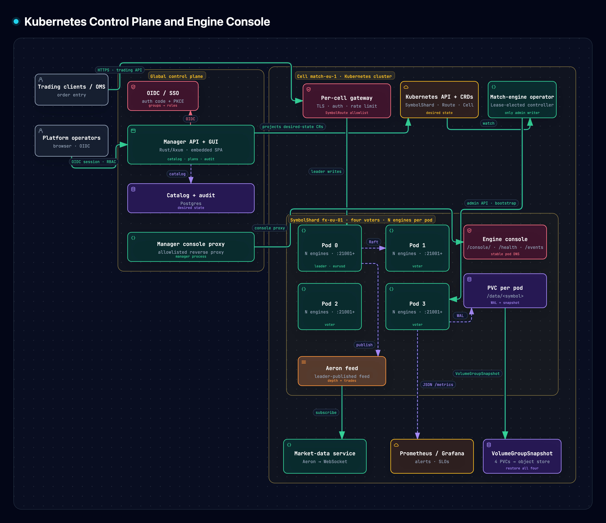
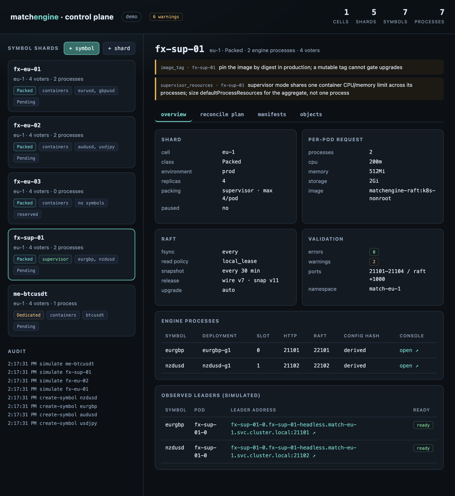

# Kubernetes control plane (reference demo)

Reference implementation of the design in
[`docs/KUBERNETES_CONTROL_PLANE.md`](../../docs/KUBERNETES_CONTROL_PLANE.md): the CRD-shaped
catalog, preflight validation, Kubernetes manifest rendering, and the operator's reconcile
decision logic for hundreds of single-symbol Raft shards.

This is a **demo crate**, not production infrastructure. It has no Kubernetes client, no
controller loop, no database and no authentication. It exists to make the design executable and
testable: one command renders the exact manifest set, one command prints what the operator would
do next, and the embedded GUI shows the catalog, validation report and reconcile plan.

[](../../docs/kubernetes-console-architecture.html)

[Open the interactive diagram](../../docs/kubernetes-console-architecture.html).



The reference manager GUI: shard catalog, per-shard packing mode, validation, reconcile plan,
manifests, audit and engine-console links. The selected `fx-sup-01` shard is supervisor-mode and
hosts two symbols added without restarting the existing engine processes.

```
demos/k8s_control_plane/
├── src/model.rs       CRD-shaped data model (Cell, SymbolShard, SymbolDeployment, …)
├── src/bundle.rs      ShardBundle + built-in demo catalog
├── src/validate.rs    placement, port, resource, symbol and asset rules
├── src/render.rs      StatefulSet / Services / PDB / NetworkPolicy / ConfigMap
├── src/reconcile.rs   bootstrap, membership, config, routing and upgrade plans
├── src/store.rs       in-memory catalog with JSON persistence and audit
├── src/api.rs         Axum manager API
├── src/gui.rs         embedded single-page GUI
├── src/main.rs        serve | render | validate | plan | seed
└── examples/          demo ShardBundle JSON files
```

## Quick start

From the repository root:

```bash
cd demos/k8s_control_plane

# Manager GUI + API on http://127.0.0.1:8099/
cargo run -- serve

# Same, with a persisted catalog (seeded on first start)
cargo run -- serve --state /tmp/matchengine-k8s-control-plane/catalog.json

# Render a shard (JSON List; kubectl accepts it directly)
cargo run -- render --shard fx-eu-01 --profile local > fx.json
kubectl apply -f fx.json

# Validate the demo catalog or a bundle file
cargo run -- validate
cargo run -- validate --bundle examples/fx-eu-01.json

# Print the operator's next steps for a simulated observation
cargo run -- plan --shard fx-eu-01 --scenario fresh
cargo run -- plan --shard fx-eu-01 --scenario upgrade --wire-version 8

# Regenerate the example bundles
cargo run -- seed --out examples
```

The demo catalog contains three shards:

| Shard | Class | Processes | Symbols |
|---|---|---|---|
| `fx-eu-01` | packed | 2 per pod (ports `21001`, `21002`) | `eurusd`, `gbpusd` |
| `fx-eu-02` | packed | 0 (reserved; 4 slots on `21041`–`21044`) | — |
| `me-btcusdt` | dedicated | 1 per pod (port `21001`) | `btcusdt` |

Every shard has four voters. The Raft port is always the HTTP port + 1000. Each process is the
existing single-symbol engine binary; packing does not merge Raft groups.

## Manager API

| Method | Path | Description |
|---|---|---|
| `GET` | `/` | embedded GUI |
| `GET` | `/api/v1/health` | catalog counts and validation summary |
| `GET` | `/api/v1/catalog` | full catalog plus validation report |
| `GET` | `/api/v1/shards` | shard list with per-pod CPU/memory requests, `slots`, `freeSlots`, phase and paused state |
| `POST` | `/api/v1/shards` | reserve an empty shard from a `SymbolShard` body |
| `POST` | `/api/v1/shards/{name}/drop` | drop an idle shard; `retainStorage` (default `true`) keeps the PVCs so it can be brought up again, `false` deletes them |
| `GET` | `/api/v1/shards/{name}` | shard detail, deployments, symbols, routes, simulated observation, `slots`/`freeSlots`/`empty`, a shard-scoped `shardValidation`, and per-process `engineConsoles` (`url` and `proxyUrl`) |
| `GET/POST` | `/api/v1/shards/{name}/processes/{symbol}/pods/{pod}/console/*` | reverse proxy to that engine's `/console/` assets, JSON APIs and guarded actions; `/init`, `/write`, `/read` and Raft RPCs are never reachable |
| `GET` | `/api/v1/shards/{name}/manifests` | rendered `v1/List`; `?profile=local\|production` |
| `GET` | `/api/v1/shards/{name}/plan` | plan for a simulated observation; `?scenario=…` |
| `POST` | `/api/v1/shards/{name}/plan` | plan for an explicit `observation` and `targetRelease` |
| `POST` | `/api/v1/shards/{name}/simulate` | patch route/deployment status from a scenario (demo only) |
| `GET` | `/api/v1/symbols` | symbols with their deployment, shard and validation |
| `POST` | `/api/v1/symbols` | create a symbol; bind it to `shard`, or auto-place in `cell`; `allowRestart` defaults to `false` |
| `POST` | `/api/v1/symbols/{symbol}/migrate` | create a shadow deployment in `targetShard` and return the migration plan; the target must be zero-impact unless `allowRestart` |
| `POST` | `/api/v1/symbols/{symbol}/shutdown` | gracefully stop one engine; mark its deployment/route `Disabled`, retain data and slot; a non-empty containers shard needs `allowRestart` |
| `POST` | `/api/v1/symbols/{symbol}/start` | re-enable a disabled engine from its retained data/slot; supervisor starts only that child; same `allowRestart` guard |
| `GET` | `/api/v1/validate` | catalog validation report as JSON and text |
| `POST` | `/api/v1/bundles` | validate and upsert a `ShardBundle` |
| `GET` | `/api/v1/audit` | recent audit entries |

### Create a symbol, reserve a shard, migrate

The demo catalog includes `fx-eu-02`, a reserved packed shard with four slots on ports
`21041`–`21044` and no processes. The GUI exposes **+ symbol** and **+ shard**; the same operations
are available over HTTP.

Reserve an empty shard:

```bash
curl -s -X POST http://127.0.0.1:8099/api/v1/shards \
  -H 'content-type: application/json' -d '{
  "name": "fx-eu-03",
  "namespace": "match-eu-1",
  "spec": {
    "cell": "eu-1",
    "environment": "prod",
    "class": "Packed",
    "replicas": 4,
    "packing": { "mode": "containers", "maxProcessesPerPod": 4 },
    "image": "matchengine-raft:k8s-nonroot",
    "storage": { "className": "local-path", "size": "2Gi" },
    "defaultProcessResources": {
      "requests": { "cpu": "250m", "memory": "512Mi" },
      "limits": { "cpu": "1", "memory": "1Gi" }
    },
    "network": { "httpBasePort": 21061 }
  }
}'
```

Place a new symbol on the reserved shard (slot 0, HTTP `21041`):

```bash
curl -s -X POST http://127.0.0.1:8099/api/v1/symbols \
  -H 'content-type: application/json' -d '{
  "shard": "fx-eu-02",
  "symbol": {
    "name": "usdjpy",
    "namespace": "",
    "spec": {
      "symbolId": 10,
      "base": { "code": "USD", "class": "fiat", "decimals": 2 },
      "quote": { "code": "JPY", "class": "fiat", "decimals": 0 },
      "priceDecimals": 3,
      "priceTick": "0.001",
      "baseLot": "0.01",
      "feeAssetPolicy": "received",
      "stp": "off",
      "owner": "fx-team",
      "generation": 1
    }
  }
}'
```

Omit `shard` and supply `cell` to auto-place; the manager chooses the most packed shard with a
free slot. Naming a reserved shard explicitly is how a new or migrated symbol consumes the
reservation.

Prepare a migration from `fx-eu-01` to the reserved shard:

```bash
curl -s -X POST http://127.0.0.1:8099/api/v1/symbols/eurusd/migrate \
  -H 'content-type: application/json' -d '{"targetShard":"fx-eu-02"}'
```

This creates `eurusd-shadow` in the target shard with `desiredState: Shadow`; the source route
stays active. The returned plan covers applying the target shard, `/init` on the target, adding
the target pod/port pairs as learners, catch-up, membership change, route cutover and draining the
source. Data movement is the engine's Raft learner catch-up, not a manager copy.

All three mutations validate the whole candidate catalog before committing. The demo does not
apply Kubernetes objects or call the engine; the operator materializes the rendered shard and
executes the plan.

### Zero-impact additions

A pod's container list is immutable. Adding a container in **containers** mode changes the
StatefulSet pod template, so the operator must recreate every pod in the shard. That restarts
every hosted engine one voter at a time; quorum stays at 3/4 and the PVC keeps the data, but it is
not a no-restart operation. The manager therefore rejects an addition to a non-empty
containers-mode shard with `409 restart_required`. Auto-placement skips those shards by default.

Use **supervisor** mode for zero-impact additions. A supervisor shard runs one supervisor
container per pod; the symbol list is the `processes.json` entry in the shard ConfigMap. Adding a
symbol updates that ConfigMap only: the supervisor starts the new child on each pod, while every
existing child keeps its PID, listener and data directory. The StatefulSet pod template does not
change, so no pod is recreated. New packed shards created through the GUI default to supervisor
mode. An empty containers shard is zero-impact only for its *first* symbol; later additions to it
are treated like any other non-empty containers shard.

```bash
# Reserve a supervisor shard (the GUI's + shard form does this by default).
curl -s -X POST http://127.0.0.1:8099/api/v1/shards \
  -H 'content-type: application/json' -d '{
  "name": "fx-sup-01", "namespace": "match-eu-1",
  "spec": {
    "cell": "eu-1", "class": "Packed", "replicas": 4,
    "packing": { "mode": "supervisor", "maxProcessesPerPod": 4 },
    "image": "matchengine-raft:k8s-nonroot",
    "storage": { "className": "local-path", "size": "2Gi" },
    "defaultProcessResources": {
      "requests": { "cpu": "500m", "memory": "1Gi" },
      "limits": { "cpu": "2", "memory": "4Gi" }
    },
    "network": { "httpBasePort": 21101 }
  }
}'

# Both placements are zero-impact; the supervisor starts a child without a pod restart.
curl -s -X POST http://127.0.0.1:8099/api/v1/symbols \
  -H 'content-type: application/json' -d '{ "shard": "fx-sup-01", "symbol": { ... } }'
curl -s -X POST http://127.0.0.1:8099/api/v1/symbols \
  -H 'content-type: application/json' -d '{ "shard": "fx-sup-01", "symbol": { ... } }'
```

To deliberately add a container to a **non-empty containers** shard, opt in explicitly:

```bash
curl -s -X POST http://127.0.0.1:8099/api/v1/symbols \
  -H 'content-type: application/json' -d '{
    "shard": "fx-eu-01", "allowRestart": true,
    "symbol": { ... }
  }'
```

That path is data-safe (graceful pod recreation, same PVC, one voter at a time) but it **does**
restart every engine in the shard, so it is not used for zero-impact placement. The GUI disables
non-empty containers-mode targets and labels them `restart required`.

### Graceful shutdown

The shard detail table has a **stop** button per active process. It calls:

```bash
curl -s -X POST http://127.0.0.1:8099/api/v1/symbols/nzdusd/shutdown \
  -H 'content-type: application/json' -d '{}'
```

The manager sets `SymbolDeployment.spec.desiredState=Disabled`,
`SymbolRoute.spec.state=Disabled` and both status phases to `Disabled`. The deployment record,
route, slot/ports and PVC stay; the response returns the operator steps:

- **Supervisor mode:** apply the updated ConfigMap. The supervisor sees the child disappear from
  `processes.json`, sends SIGTERM to that PID, waits up to 30 seconds and keeps the other children
  running. This is the zero-impact shutdown path.
- **Containers mode:** the target is the last active engine in the shard: prune the StatefulSet and
  pods, keep the PVC. If other engines are active, the request returns `409 restart_required`
  because removing a container recreates every pod; pass `{"allowRestart": true}` to accept the
  one-voter-at-a-time roll.

`freeSlots` does not increase and the slot is not reused while the data is retained. Disabled rows
remain visible as `stopped` with a **start** button. Starting is the symmetric operation:

```bash
curl -s -X POST http://127.0.0.1:8099/api/v1/symbols/nzdusd/start \
  -H 'content-type: application/json' -d '{}'
```

The manager reuses the existing deployment, generation, slot, ports and PVC. In supervisor mode
the updated ConfigMap makes the supervisor start that child on all four pods; in containers mode
the workload is re-materialized (or rolled with `allowRestart`) and the same PVC is mounted. The
engine recovers its own WAL/snapshot and rejoins the same four-voter group, so the operator does not
call `/init` or `ConfigureSymbol` again unless the data directory was deleted. The route stays
`Pending` until the engine reports `/ready` and a leader, then it is published back to `Active`.
Use `kubectl -n match-eu-1 exec <pod> -- curl -s http://127.0.0.1:9090/processes` to verify
supervisor children before and after.

### Dropping a shard

Dropping is only allowed after every engine in the shard is stopped. The **drop shard** button is
disabled while any process is active; the API returns `409 shard_not_idle` and names the symbols
that still need to be shut down. Dropping an idle shard never restarts another engine.

The drop dialog asks the storage question before anything is removed:

- **Keep storage (recommended, default):** prune the StatefulSet/Services/PDB/NetworkPolicy/
  ConfigMap but keep the PVCs. The shard can be recreated later with the same name, replicas and
  storage class; new pods bind the retained PVCs and recover their WAL/snapshot.
- **Delete storage:** also delete the PVCs. The data cannot be recovered from the cluster.

```bash
# Keep the PVCs: the shard can be brought up again.
curl -s -X POST http://127.0.0.1:8099/api/v1/shards/fx-eu-03/drop \
  -H 'content-type: application/json' -d '{"retainStorage": true}'

# Delete the PVCs: destructive.
curl -s -X POST http://127.0.0.1:8099/api/v1/shards/fx-eu-03/drop \
  -H 'content-type: application/json' -d '{"retainStorage": false}'
```

The manager always removes the shard, its deployments, and routes that point at those deployments.
A symbol is removed only if no deployment in another shard still references it, so a migration
shadow survives. The response lists `removedDeployments`, `removedRoutes`, `removedSymbols` and the
predicted `pvcs` (`data-<shard>-0..N-1`), plus the operator steps:

- `prune-workload` (or `remove-catalog` for a reserved shard);
- `keep-storage` or `delete-storage`;
- `verify`.

The manager does not call Kubernetes. The GUI requires typing the shard name and defaults to
keeping storage. Dropping a shard does not delete its backups; only the PVC deletion is
irreversible.

### Simulation scenarios

`fresh`, `ready`, `degraded`, `leader-loss`, `config-drift`, `upgrade`. They are synthesized
from the catalog, not read from a cluster, so the GUI and `plan` work offline.

## What the renderer emits

For one shard:

- a `ConfigMap` with the derived slot/port map (a cache, not the source of truth);
- a headless `Service` with one HTTP and one Raft port per process, `publishNotReadyAddresses:
  true` (bootstrap needs DNS before readiness);
- a metrics `Service`;
- a leader `Service` for dedicated shards (packed shards use `SymbolRoute.status.leaderAddr`);
- a `PodDisruptionBudget` with `minAvailable: replicas - 1`;
- a `NetworkPolicy` allowing Raft and console peer HTTP only between shard pods, HTTP from
  gateway/observability/control-plane namespaces, plus DNS and HTTPS egress;
- a `StatefulSet` with `podManagementPolicy: Parallel`, `updateStrategy: OnDelete`, one engine
  container per deployment, per-container probes on `/health` and `/ready`, a shared `data` PVC
  and a `tmp` `emptyDir`.

An empty reserved shard renders only the `ConfigMap`, `PodDisruptionBudget` and `NetworkPolicy`.
Binding the first symbol adds the Services, leader Service (dedicated) and StatefulSet. A
containers shard whose deployments are all `Disabled` renders the same minimal set: the workload
can be pruned while the PVC is retained. A supervisor shard keeps its supervisor StatefulSet with
an empty `processes.json`, so the pod stays available for a later re-enable.

For **supervisor** mode the StatefulSet has one `supervisor` container and a read-only ConfigMap
volume; `processes.json` lists the child processes. The headless and metrics Services expose the
full reserved port range, and the supervisor container declares those ports. Adding a
`SymbolDeployment` changes only the ConfigMap, so the pod template and existing child processes
stay untouched. Disabled deployments are omitted from `processes.json`, which stops exactly that
child.

Containers bind their stable pod DNS name (`$(POD_NAME).<shard>-headless.<namespace>.svc...`)
on their own HTTP port. The engine's `--id` is the pod ordinal, which repeats across processes;
the port selects the Raft instance. The image is expected to run as a non-root user (see the
design doc, §5.4).

`--profile local` relaxes required pod anti-affinity to preferred, drops the zone spread
constraint and defaults the storage class to `local-path`, for OrbStack/k3d.

## Engine console links

The shard detail page links every engine process through the manager's reverse proxy:

```
/api/v1/shards/<shard>/processes/<symbol>/pods/<pod>/console/
```

The browser only needs the manager origin. The proxy dials the pod's
`<shard>-<pod>.<shard>-headless.<namespace>.svc.cluster.local:<httpPort>/console/`, follows the
observed leader when one exists (falling back to pod 0), and rewrites the console's absolute
asset/API paths onto the proxy prefix. Only the console assets, `/console/api/*`, the five guarded
console actions, `/health` and `/events` are forwardable; `/init`, `/write`, `/read` and Raft RPCs
are not. The manager therefore needs network access to engine pods, which it has in-cluster.

When the manager runs outside the cluster, set a dial host instead of the pod FQDN:

```bash
cargo run -- serve --engine-console-host 127.0.0.1
```

The ports still come from each deployment's placement, so this works when local engines listen on
the catalog's HTTP ports. The direct pod URL remains in the shard detail payload as
`engineConsoles[].url` for `kubectl port-forward` use; the GUI uses `proxyUrl`.

## What the planner decides

`reconcile::plan_shard` returns a plan, not a mutation. The order is:

1. **Wait for pods** — no `/init` until every pod for that process is healthy.
2. **Bootstrap** — one `POST /init` per process with the four voter FQDNs. A process that
   already reports voters is never re-initialized.
3. **Membership** — a voter-set mismatch becomes `POST /change-membership`, never a
   StatefulSet replica edit.
4. **Symbol config** — apply `ConfigureSymbol` through the leader when the observed hash
   differs, then verify `/read symbol_config`.
5. **Routing** — publish the observed leader into `SymbolDeployment`/`SymbolRoute` status.
6. **Upgrade** — `auto` picks:
   - rolling when the target release keeps wire v7 / snapshot v11 (or declares
     `mixedVersionSafe`): transfer leadership off each pod, restart it, wait for `/ready`;
   - stop-the-world otherwise: require a verified backup newer than 24 h, pause routes,
     snapshot every process, restart all pods together.

A paused shard produces no mutation steps. A stop-the-world upgrade without a fresh backup is
blocked and returns the backup step first.

## Validation rules

`validate.rs` encodes the constraints that are expensive to discover at runtime:

- DNS-1123 names, one symbol per process, unique slot and HTTP port per shard;
- `httpPort == httpBasePort + slot` and `raftPort == httpPort + 1000`;
- at least 3 voters; unset WAL fsync requires 4 voters;
- dedicated shards use exactly one process per pod; packed shards cap at 20;
- `priceTick` precision ≤ `priceDecimals`, `baseLot` precision ≤ base decimals;
- ETF/equity bases force `feeAssetPolicy: quote`;
- CPU/memory requests are non-zero and do not exceed limits;
- nodes, deployments and routes must resolve to each other, and symbol IDs are unique per cell;
- images should be digest-pinned (warning).

Errors block rendering; warnings do not.

## Tests and CI

```bash
cargo fmt --manifest-path demos/k8s_control_plane/Cargo.toml -- --check
cargo clippy --manifest-path demos/k8s_control_plane/Cargo.toml --all-targets -- -D warnings
cargo test --manifest-path demos/k8s_control_plane/Cargo.toml
```

The suite covers the CRD model, validation rules, renderer output (including the stable supervisor
pod template and disabled-process filtering), JSON persistence, every API endpoint (including the
containers restart guard, the supervisor zero-impact shutdown, the retained-data start and the
idle-shard drop with both storage choices), and each planner path (fresh bootstrap, blocked
bootstrap, membership drift, config drift, leader loss, rolling upgrade, stop-the-world backup gate,
paused shard, disabled processes). The root crate adds `tests/cluster/test_supervisor.rs`, which
proves that adding or removing a child does not change the existing child's PID.

The crate is standalone (`[workspace]` in its `Cargo.toml`) and is not wired into the root
workspace or CI yet. To add it, mirror the `demos/order_system` CI steps in
`.github/workflows/ci.yml`.

## Deliberate limitations

- No Kubernetes client/controller, no CRD installation, no admission webhooks, no `Lease`
  leader election. The operator is still a design.
- Supervisor mode is implemented as a reference pod agent (`src/bin/match_supervisor.rs`); it
  manages children under the shared container CPU/memory limit. Per-process cgroups, log rotation
  and a production-grade supervisor control API remain future work.
- Status is synthesized for the demo; there is no per-process status endpoint in the engine yet
  (phase 2 in the design doc).
- Backups are planned but not executed; the demo has no `VolumeGroupSnapshot` integration.
- No authentication or authorization. The real manager and operator sit behind the platform's
  SSO and RBAC; the public engine edge remains plaintext behind the gateway.
- JSON persistence replaces Postgres; there is no multi-user concurrency control beyond one
  process-wide lock and the audit trail.

The engine interface used by the plans is real: `/init`, `/add-learner`,
`/change-membership`, `/write {"ConfigureSymbol": …}`, `/read symbol_config`, `/ready`,
`/metrics`, and the console actions for transfer-leader and snapshot.
