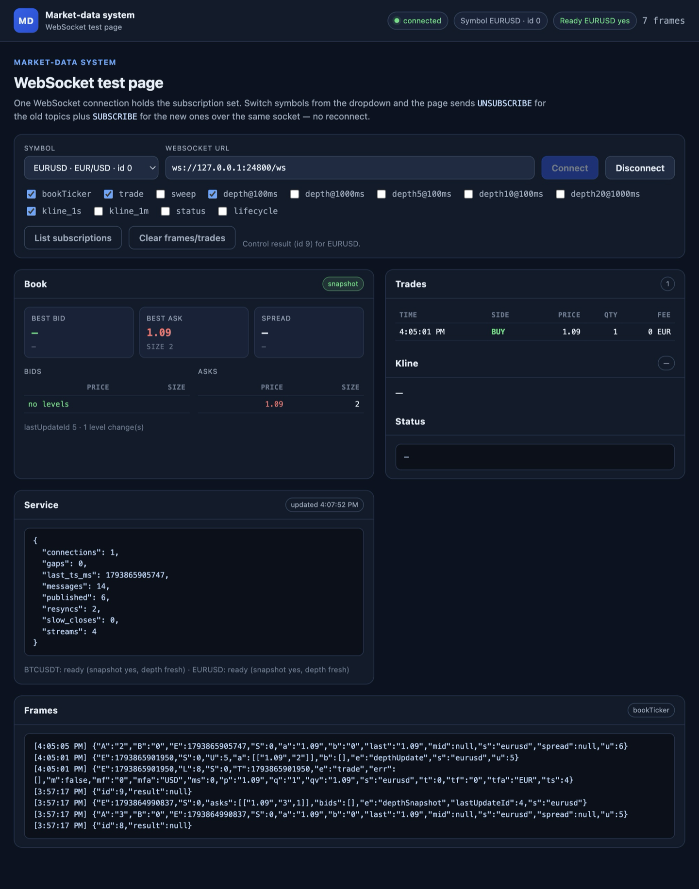

# Market-data system

A standalone service that consumes the engine's deterministic market-data feed
and serves **Binance-style WebSocket streams**. It is a separate process and
crate; the engine's matching, Raft and storage paths are untouched.

One instance can serve **several instruments**. Each symbol has its own feed
source and shadow state; the WebSocket hub is shared, and a connection owns one
subscription set over `<symbol>@<stream>` keys. Following Binance, switching
symbols is `UNSUBSCRIBE` for the old symbol's topics plus `SUBSCRIBE` for the
new ones **on the same socket** — no reconnect. A client may also hold streams
for several symbols at once (up to 1024 streams per connection).

<p align="center">
  
</p>

The page shows the shared hub in action: one WebSocket connection, per-symbol
readiness, a live book/trade tape and the raw frames. Switching the dropdown
unsubscribes the old symbol's topics and subscribes the new ones without
reconnecting.

The production transport is **Aeron**: each engine publishes one stream per
product on a multicast/unicast channel (or IPC on one host), and each service
instance subscribes independently. That gives low latency and horizontal
scale-out — adding instances adds client capacity without adding engine work.
The engine's JSONL `--market-data-log` feed is also supported as a driverless
fallback for development.

```
engine A (EUR/USD) ── AeronSink ── streams 2001..2007 ──┐
engine B (BTC/USDT) ─ AeronSink ── streams 2001..2007 ──┤  multicast / IPC
                                                        ▼
                                        market-data instance
                     per-symbol AeronSource → assembler → depth conflation
                                                        │
                                          shared WS hub → clients
```

## Why Aeron

The production path is built for a live feed, not a request/response API:

- **One exclusive publication per stream** (TRADE, BBO, DEPTH_SNAPSHOT,
  DEPTH_DELTA, LIFECYCLE, STATUS, BAR) from a dedicated publisher thread. A
  large depth snapshot cannot head-of-line-block a trade or status frame.
- **Multicast fan-out**: the engine publishes once and every market-data
  instance subscribes independently. Adding WebSocket clients or service
  instances does not change the engine's publish cost.
- **Never on the matching path**: `apply` only appends the visible-depth
  journal and `try_send`s into a bounded tap. A full queue drops frames and
  emits `GAP`; consensus latency is independent of subscribers.
- **Deterministic content**: `(symbol_id, stream_id, market_seq, sub_seq)` keys
  are identical on leader, followers, failover and restart, so instances and
  clients can deduplicate and replay safely.
- **Service-side fan-out**: a per-symbol assembler, 100/1000 ms depth
  conflation, one JSON encode per stream message shared as `Bytes`, bounded
  per-connection FIFOs, and close code `1013` for slow consumers.
- **Stateless scale-out**: an instance rebuilds from the periodic reset
  snapshot plus deltas; add instances behind a load balancer without any engine
  involvement.

The feed path has been load-tested at 500k fills/s (495k fills/s, zero drops
at the 8,192-frame tap queue; see [`docs/PERFORMANCE.md`](../../docs/PERFORMANCE.md)).
The Aeron transport keeps that same backpressure contract: a slow instance
falls behind and re-syncs from the next snapshot rather than slowing the
engine.

## Run with Aeron (one host, IPC)

```shell
./scripts/market-data-system.sh
```

It builds the engine with `--features market-data-aeron` and this crate with
`--features aeron`, then starts two single-node engines with embedded media
drivers in separate directories: EUR/USD on `127.0.0.1:24801` and BTC/USDT on
`127.0.0.1:24802`. One service on `127.0.0.1:24800` consumes both. Open the test
page at `http://127.0.0.1:24800/` and switch symbols from the dropdown; the
page keeps one WebSocket open and changes subscriptions live. Raw endpoints are
`ws://127.0.0.1:24800/ws/eurusd@bookTicker` and
`ws://127.0.0.1:24800/stream?streams=eurusd@bookTicker/btcusdt@depth@100ms`.

For multiple hosts, run a supervised Aeron media driver on each host (or one
embedded publisher driver plus a driver per service host) and publish each
symbol to its own multicast channel:

```shell
# engine A: EUR/USD
cargo run --release --features market-data-aeron -- \
  --id 1 --http-addr 127.0.0.1:21001 \
  --market-data-aeron-channel 'aeron:udp?endpoint=239.1.2.3:24001|interface=eth0' \
  --market-data-aeron-snapshot-every-ms 5000

# engine B: BTC/USDT
cargo run --release --features market-data-aeron -- \
  --id 1 --http-addr 127.0.0.1:21002 \
  --market-data-aeron-channel 'aeron:udp?endpoint=239.1.2.4:24001|interface=eth0' \
  --market-data-aeron-snapshot-every-ms 5000

# service (repeat per instance / host); channels and dirs align with --symbol
cargo run --release --manifest-path demos/market_data_system/Cargo.toml --features aeron -- \
  --addr 127.0.0.1:24700 \
  --aeron-channel 'aeron:udp?endpoint=239.1.2.3:24001|interface=eth0' \
  --aeron-channel 'aeron:udp?endpoint=239.1.2.4:24001|interface=eth0' \
  --symbol eurusd:0:EUR:USD \
  --symbol btcusdt:1:BTC:USDT
```

The engine picks the Aeron sink when `--market-data-aeron-channel` is set. One
exclusive publication per stream prevents a large depth snapshot from
head-of-line-blocking a trade or status frame. A fresh reset depth snapshot is
re-broadcast every `--market-data-aeron-snapshot-every-ms` (default 30 s) so a
service that starts mid-stream can join without waiting for an election.

## Run with JSONL (no media driver)

```shell
# engine: write the feed to a local JSONL file
cargo run --release --bin matchengine-raft -- \
  --id 1 --http-addr 127.0.0.1:21001 \
  --market-data-log /tmp/market-data.jsonl

# service: replay the file from the start and follow it
cargo run --manifest-path demos/market_data_system/Cargo.toml -- \
  --market-data-log /tmp/market-data.jsonl \
  --symbol eurusd:0:EUR:USD

# several symbols: repeat --market-data-log once per --symbol, in order
cargo run --manifest-path demos/market_data_system/Cargo.toml -- \
  --market-data-log /tmp/eurusd.jsonl \
  --market-data-log /tmp/btcusdt.jsonl \
  --symbol eurusd:0:EUR:USD \
  --symbol btcusdt:1:BTC:USDT
```

The JSONL log is node-local and debug-only (it duplicates lines when the engine
replays entries after a restart); the assembler dedupes by
`(stream, market_seq, sub_seq)` and a body-flagged reset rewinds state.

## Archive and replay

`--archive-dir <dir>` records every message the service consumes to
`<dir>/<symbol>.jsonl`. The file uses the engine's JSONL shape, so it can be
inspected with the existing tooling and replayed without a media driver:

```shell
# record while serving a live Aeron or JSONL source
cargo run --manifest-path demos/market_data_system/Cargo.toml --features aeron -- \
  --addr 127.0.0.1:24700 \
  --aeron-channel 'aeron:ipc' \
  --symbol eurusd:0:EUR:USD \
  --archive-dir /var/lib/market-data/archive

# replay the archive; no --aeron-channel or --market-data-log
cargo run --manifest-path demos/market_data_system/Cargo.toml -- \
  --addr 127.0.0.1:24700 \
  --symbol eurusd:0:EUR:USD \
  --replay-dir /var/lib/market-data/archive
```

Archives are append-only per symbol. Each line is flushed before the message is
served, so a crash leaves a complete prefix; use a fresh directory per capture
or truncate the old file before reusing a path. `--archive-dir` and
`--replay-dir` are mutually exclusive, and replay cannot be combined with a
live source.

### External media driver

For a supervised driver instead of `--aeron-embedded-driver`:

```shell
# terminal 1: driver
AERON_DIR=/dev/shm/aeron-$USER aeronmd

# terminal 2: engine and service; the same directory is used on both sides
AERON_DIR=/dev/shm/aeron-$USER cargo run --release --features market-data-aeron -- \
  --id 1 --http-addr 127.0.0.1:21001 \
  --market-data-aeron-channel 'aeron:ipc' \
  --market-data-aeron-dir /dev/shm/aeron-$USER

AERON_DIR=/dev/shm/aeron-$USER cargo run --manifest-path demos/market_data_system/Cargo.toml \
  --features aeron -- \
  --addr 127.0.0.1:24700 --aeron-channel 'aeron:ipc' \
  --aeron-dir /dev/shm/aeron-$USER --symbol eurusd:0:EUR:USD
```

For multicast, use one `aeron:udp?endpoint=<group>:<port>|interface=<nic>`
channel per symbol on the engine and the matching channel on every service
instance. Each instance receives the same frames independently; no service
state is shared.

### Heartbeat and snapshot requests

The engine re-broadcasts a reset depth snapshot every
`--market-data-aeron-snapshot-every-ms` (default 30 s) and emits a diagnostic
`STATUS` heartbeat with the reserved `HEARTBEAT_SUB_SEQ` every
`--market-data-aeron-heartbeat-ms` (default 1 s) when no frame was applied.
The service exposes the heartbeat on `@status`; a silent feed is therefore
visible without waiting for a trade.

Stream 2010 (base + 9) is the one subscriber-to-engine path. When a WebSocket
client subscribes to depth/bookTicker while the service cache is empty or marked
stale, the service sends a fixed 24-byte `MSRQ` v1 request. The engine captures
the current book under the state-machine lock and queues a reset snapshot through
the same processor path as the periodic broadcast. The periodic snapshot is
still the fallback if the request is dropped.

### Linux external-driver/multicast validation

Run this on a Linux host with `aeronmd` installed (the embedded-driver path is
covered by `cargo test --features aeron` on development hosts):

```shell
# 1. External driver over IPC.
AERON_DIR=/dev/shm/aeron-$USER aeronmd &
AERON_DIR=/dev/shm/aeron-$USER cargo run --release --features market-data-aeron -- \
  --id 1 --http-addr 127.0.0.1:21001 \
  --market-data-aeron-channel 'aeron:ipc' \
  --market-data-aeron-dir /dev/shm/aeron-$USER
AERON_DIR=/dev/shm/aeron-$USER cargo run --release \
  --manifest-path demos/market_data_system/Cargo.toml --features aeron -- \
  --addr 127.0.0.1:24700 --aeron-channel 'aeron:ipc' \
  --aeron-dir /dev/shm/aeron-$USER --symbol eurusd:0:EUR:USD

# 2. Multicast fan-out: two service instances consume the same group.
#    Replace eth0 and the group with the host's NIC / test network.
ENGINE_CHANNEL='aeron:udp?endpoint=239.1.2.3:24001|interface=eth0'
cargo run --release --features market-data-aeron -- \
  --id 1 --http-addr 127.0.0.1:21001 \
  --market-data-aeron-channel "$ENGINE_CHANNEL" \
  --market-data-aeron-snapshot-every-ms 5000
for addr in 24700 24701; do
  cargo run --release --manifest-path demos/market_data_system/Cargo.toml --features aeron -- \
    --addr 127.0.0.1:$addr --aeron-channel "$ENGINE_CHANNEL" \
    --symbol eurusd:0:EUR:USD &
done
```

Expected result: both service `/ready` endpoints return `200`, both `/metrics`
counters advance for the same order flow, a WebSocket `@depth@100ms` client gets
a `depthSnapshot` immediately on subscribe (via stream 2010) rather than waiting
for the periodic snapshot, and killing one service does not affect the other.
This validation is **blocked on a Linux host**; macOS can run the embedded-driver
and request-stream tests but not the external `aeronmd`/multicast checks.

### WebSocket fan-out benchmark

```shell
cargo bench --manifest-path demos/market_data_system/Cargo.toml \
  --bench ws_fanout -- --clients 64 --updates 5000 --rate 5000
```

Measured on the reference macOS host (loopback, channel source, `bookTicker`):
64 clients delivered 110,649 frames (1,728.9/client) at 110,571 frames/s at a
5k/s offer rate; at 20k/s the effective fan-out was 186,217 frames/s with more
latest-value coalescing. A 16-client, 20k offers/s run delivered 158,052
frames/s. `bookTicker` is a latest-value stream, so slow clients intentionally
coalesce older updates. The full table and caveats are in
[`docs/PERFORMANCE.md`](../../docs/PERFORMANCE.md#websocket-fan-out-2026-11-10).

## Streams

| Stream | Payload |
|---|---|
| `<symbol>@trade` | one fill: `p`, `q`, `qv`, `T`, `m`, fees (`tf`/`tfa`/`mf`/`mfa`), `L`/`t` |
| `<symbol>@sweep` | one taker with all fills |
| `<symbol>@bookTicker` | `b`/`B`/`a`/`A`, `u`, `mid`, `spread`, `last` |
| `<symbol>@depth@100ms` / `@1000ms` | conflated `U`..`u` diff depth, absolute levels |
| `<symbol>@depth5/10/20@100ms` / `@1000ms` | partial book depth (`s`/`S` added so raw multi-symbol connections can attribute it) |
| `<symbol>@kline_<interval>` | OHLCV; `x` marks a closed bar, `q` quote volume |
| `<symbol>@status` | engine watermark, epoch, leader |
| `<symbol>@lifecycle` | order lifecycle records (extension; `--no-lifecycle` hides it) |
| `resync` notice | sent on a gap/reset before a fresh snapshot |

Subscribe with Binance control messages:

```json
{"method":"SUBSCRIBE","params":["eurusd@bookTicker","eurusd@depth@100ms"],"id":1}
{"method":"UNSUBSCRIBE","params":["eurusd@depth@100ms"],"id":2}
{"method":"LIST_SUBSCRIPTIONS","id":3}
```

The subscription set belongs to the connection, not to a server-side "current
symbol". Switching symbols means unsubscribing the old symbol's topics and
subscribing the new ones; the socket stays open. Every data payload carries
`s` (lowercase symbol) and `S` (symbol id), so a client can also hold streams
for several symbols at once and route each frame by `s`.

Raw URLs (`/ws/<stream>`), combined streams (`/stream?streams=a/b`, wrapped in
`{"stream":...,"data":...}`), subscribe-time snapshots for `bookTicker`,
`depth` and `kline`, ping/pong, a 24-hour connection lifetime, a 1024-stream
cap, a 1024-message FIFO and close code 1013 for slow consumers are implemented.

## Depth synchronization

Depth payloads use a 1-based update id (`market_seq + 1`). A subscribe-time
`depthSnapshot` carries `lastUpdateId`; clients apply Binance rules: drop
`u <= lastUpdateId`, require `U <= lastUpdateId + 1 <= u` for the first update,
then `U == previous u + 1`; a `resync` notice means re-snapshot. Because the
engine emits depth deltas only for entries that change visible depth, the
service widens a window's `U` to `previous u + 1`, so the range is contiguous
even when entries in between did not touch the book.

## Configuration

| Flag | Default | Meaning |
|---|---|---|
| `--addr` | `127.0.0.1:24700` | HTTP/WebSocket listener |
| `--market-data-log` | unset | JSONL feed (fallback transport); repeat per symbol |
| `--archive-dir` | unset | record consumed messages to `<dir>/<symbol>.jsonl` |
| `--replay-dir` | unset | replay `<dir>/<symbol>.jsonl`; excludes live sources |
| `--aeron-channel` | unset | Aeron feed (requires `--features aeron`); repeat per symbol |
| `--aeron-stream-base` | `2001` | first stream id (shared by all symbols) |
| `--aeron-dir` | `AERON_DIR` | media-driver directory; repeat per symbol |
| `--aeron-embedded-driver` | off | embed the driver (demos/tests) |
| `--symbol` | required | `name:id:base:quote`, repeatable (e.g. `eurusd:0:EUR:USD`) |
| `--bar-intervals-ms` | `1000,60000` | kline intervals (match the engines) |
| `--max-connections` | `256` | per instance |
| `--max-streams` | `1024` | per connection (Binance parity) |
| `--queue` | `1024` | per-connection sequenced queue |
| `--ping-secs` / `--pong-timeout-secs` | `180` / `600` | connection hygiene |
| `--connection-lifetime-secs` | `86400` | forced reconnect |
| `--heartbeat-timeout-secs` | `30` | mark a symbol not ready when no frame/heartbeat arrives within this window |
| `--snapshot-levels` | `200` | subscribe-time depth levels |
| `--no-lifecycle` | off | hide the extension stream |

Engine-side Aeron flags (feature `market-data-aeron`):

| Flag | Default | Meaning |
|---|---|---|
| `--market-data-aeron-channel` | unset | enables `AeronSink` on this channel |
| `--market-data-aeron-stream-base` | `2001` | feed base; snapshot requests use base + 9 |
| `--market-data-aeron-snapshot-every-ms` | `30000` | periodic reset depth snapshot; `0` disables |
| `--market-data-aeron-heartbeat-ms` | `1000` | idle STATUS heartbeat; `0` disables |

## Scale-out

Instances are homogeneous and stateless: each subscribes to the same Aeron
streams and serves the complete catalogue. Add instances behind a load balancer
(any instance can serve any client); the marginal client cost is one queue and
socket writes, while upstream ingestion is constant per instance. State is
rebuilt from the periodic snapshot + deltas, so restart and replacement need no
engine involvement. A slow instance is isolated by Aeron flow control; a slow
client is isolated by its own queue.

## Tests

```shell
cargo test --manifest-path demos/market_data_system/Cargo.toml
cargo test --manifest-path demos/market_data_system/Cargo.toml --features aeron
cargo clippy --manifest-path demos/market_data_system/Cargo.toml --all-targets -- -D warnings
```

The default suite covers stream parsing, kline intervals, payloads, WebSocket
snapshots/conflation/combined streams, control errors, two-symbol tests, and
archive record-then-replay:
one holds both symbols on a single connection, the other switches
`UNSUBSCRIBE`/`SUBSCRIBE` and verifies `LIST_SUBSCRIPTIONS` and the
per-connection metrics; `tests/archive.rs` records a channel source and re-reads
the same messages through `jsonl_source`. The `aeron` feature adds an
embedded-driver test that publishes engine wire frames over IPC and asserts they
reach the WebSocket client, plus a stream-2010 request round-trip; the engine has
matching `market_data::aeron` tests for publish/receive, the idle heartbeat and
the stream-2010 subscription behind `--features market-data-aeron`.
`cargo bench --manifest-path demos/market_data_system/Cargo.toml --bench ws_fanout`
reports WebSocket fan-out (see [`docs/PERFORMANCE.md`](../../docs/PERFORMANCE.md#websocket-fan-out-2026-11-10)).

> **Dependency pin:** rusteron is pinned to `0.2.13`. Versions from `0.2.14`
> call `std::hint::cold_path`, which is not available on the project's stable
> toolchain. The feature uses `static` + `precompile-rustls`, so the first build
> downloads precompiled Aeron C libraries (no cmake/Java needed). On Linux the
> static link also needs `libbsd-dev` and `uuid-dev`; CI installs them.
