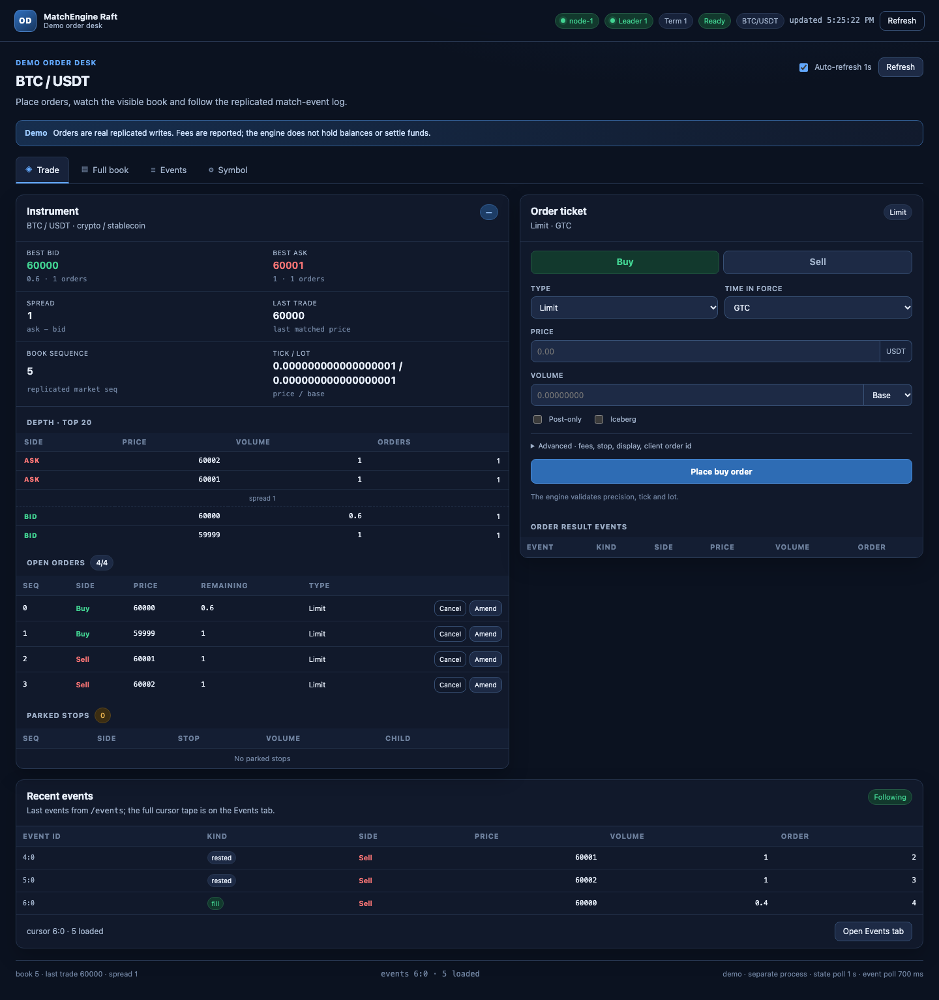

# Demo order desk

A standalone order-entry WebUI for a running `matchengine-raft` node. It runs as a **separate
process** in `demos/order_system/`; the engine binary is not modified.

The demo has two pieces:

- an Actix Web BFF (`demos/order_system/src/`) that calls one or two engines' public HTTP APIs through the
  leader-aware `MatchEngineClient`, and computes demo-side freeze/settlement and linear-perpetual
  margin estimates in `demos/order_system/src/freeze.rs`,
- a dependency-free HTML/CSS/JavaScript UI (`demos/order_system/web/`) that reuses `web/console/app.css` and adds
  only the trading-desk layout.

The Spot and Perpetual products each use **their own engine process and order book**. One engine
process trades exactly one symbol, and the pair script's Spot EUR/USD uses
`fee_asset_policy = received` while the linear Perpetual BTC/USDT uses `quote`, so the two cannot
share a book.



## Run

The pair script builds both binaries, starts a Spot engine and a separate Perpetual engine, configures
Spot EUR/USD and Perpetual BTC/USDT, and then starts the demo:

```shell
./scripts/demo-pair.sh
```

Defaults: demo `127.0.0.1:24400`, Spot engine `127.0.0.1:24401` (gRPC `25401`), Perpetual engine
`127.0.0.1:24402` (gRPC `25402`), data in `/tmp/matchengine-raft-demo-pair`. Override them with
`DEMO_ADDR`, `SPOT_ADDR`, `PERP_ADDR` and `DEMO_PAIR_DATA_DIR`. Ctrl-C stops the demo and both
engines; an explicit `DEMO_PAIR_DATA_DIR` is reused rather than wiped.

Open <http://127.0.0.1:24400/demo/>.

For a Spot-only desk, start and initialize one engine first:

```shell
cargo run --bin matchengine-raft -- \
  --id 1 \
  --http-addr 127.0.0.1:24301 \
  --data-dir /tmp/matchengine-raft-demo \
  --instance-prefix demo \
  --snapshot-interval-ms 0

curl -s -X POST http://127.0.0.1:24301/init \
  -H 'Content-Type: application/json' -d '[]'
```

Then start the demo process with only the Spot backend:

```shell
cargo run --manifest-path demos/order_system/Cargo.toml -- \
  --addr 127.0.0.1:24300 \
  --engine 127.0.0.1:24301 \
  --engine-id 1
```

- `--addr`: demo WebUI/BFF address.
- `--engine`: HTTP API address of the Spot engine node.
- `--engine-id`: that node's Raft id.
- `--perp-engine`: optional HTTP API address of a **second** engine for the Perpetual product. It
  must differ from `--engine`; omit it to disable the Perpetual view.
- `--perp-engine-id`: the perpetual node's Raft id (default 1).

Each engine must already be initialized and have a leader before its product accepts orders. The
demo can start earlier; it shows a "no leader" banner per backend. Point each flag at a leader for
the freshest book; if pointed at a follower, writes/events still forward, but local `/read` views
may lag.

## Demo flow

1. **Symbol** — review or configure the selected product's symbol before its first accepted order.
   Spot and Perpetual have independent configurations and lock separately.
2. **Trade** — choose **Spot** or **Perpetual**; the product selects its own backend and book. Place
   a limit/market order, watch that book's depth/open orders, and see the write result and its
   immediate events. The ticket previews the estimated freeze before submit; clicking an order
   shows the estimated freeze plus the maker/taker deliveries, fees and funding rule, or the
   perpetual leverage, position, notional, margin and fee.
3. **Full book** — press **Refresh full book** to load the active product's resting orders,
   aggregated price levels and parked stops, with each order's estimated freeze. This is a manual
   debug view; it is not part of the 1 s poll.
4. **Events** — follow the active backend's replicated `/events` cursor, filter by kind/side/order,
   click an event for its raw JSON, pause/resume, and reset the cursor. Cursors are stored per
   product, node and symbol. A retained-window gap is reported instead of silently skipped.

Fee fields take decimal rate fractions, not basis points: `0.001` = 10 bps = 0.1%, and
`0.002` = 20 bps = 0.2%. The maker side pays the maker rate; the taker side pays the taker rate.

## Freeze and settlement estimates

The engine is balance-agnostic: it reports fills and fees but holds no accounts, freezes or
balances. The desk therefore estimates what an order system following
[`docs/FEE_DEDUCTION.md`](../../docs/FEE_DEDUCTION.md) §6.6 would reserve and settle:

- the frozen asset and amount for every open order, parked stop and ticket preview,
- the assets each side of a fill delivers and receives, plus the fee amount, fee asset, signed rate
  and how clearing funds it,
- an aggregate freeze per asset across the open book.

Estimates use exact `Fixed` arithmetic, round up to asset precision/lot, and are computed by the BFF
from the replicated `SymbolConfig`, the order fields and the entered fee rates. The ticket preview
uses the worse of the maker/taker rates for a restable limit order because it may rest or cross;
market, IOC/FOK and stop tickets use the taker rate only. A market order with no price or stop
price uses the last trade as its reference; without one it shows no estimate and a reason. Every
figure is labelled a demo estimate — it is not engine state and the engine never enforces it.

**Perpetual overlay.** The **Perpetual** product is a demo-only linear quote-margined overlay that
runs against the second engine's own book (BTC/USDT in `scripts/demo-pair.sh`). Buy opens a long,
sell opens a short, and leverage is an integer `1..=100` (default 10). The preview and order detail
show:

```text
notional       = max(quote_amount, base_amount * reference_price)
initial_margin = notional / leverage
fee            = notional * selected_rate
freeze         = ceil_quote(initial_margin + fee)     // buffer = 0
```

A perpetual backend requires `fee_asset_policy = quote`; on a `received`/`base` symbol the preview
shows a reason and the write returns `400` before Raft. That is why the pair script configures Spot
EUR/USD as `received` but Perpetual BTC/USDT as `quote`. Resting perp orders use maker economics;
the ticket preview uses the worse of maker/taker. The perpetual engine still matches an ordinary
cash order for its configured symbol — it has no product, leverage or margin field, and the demo
tracks no position, PnL, funding, liquidation, maintenance margin or contract multiplier. No spot
delivery legs are shown for a perpetual. Product/leverage tags live in demo-process memory keyed by
the backend's order sequence, so they survive a page reload but not a demo restart; after that,
still-resting perp orders display as Perpetual with unknown leverage and no estimate. See
[`docs/FEE_DEDUCTION.md`](../../docs/FEE_DEDUCTION.md) §6.6.3 for the general derivative policy.

## Safety

- The engine and demo listeners are plaintext and unauthenticated; run them on loopback or a
  trusted private network behind a gateway.
- Demo writes require an `X-Demo-Action` header (the UI sends `submit`); it is a CSRF-style
  guard, not authentication.
- Orders are real replicated writes. The engine holds no balances, accounts or freeze state; it
  reports fill fees, and the desk's freeze/settlement figures are clearly labelled estimates. Reset
  a demo by restarting the engine with a fresh `--data-dir`.

## Checks

```shell
cargo test --manifest-path demos/order_system/Cargo.toml
cargo clippy --manifest-path demos/order_system/Cargo.toml --all-targets -- -D warnings
cargo fmt --manifest-path demos/order_system/Cargo.toml -- --check
```
