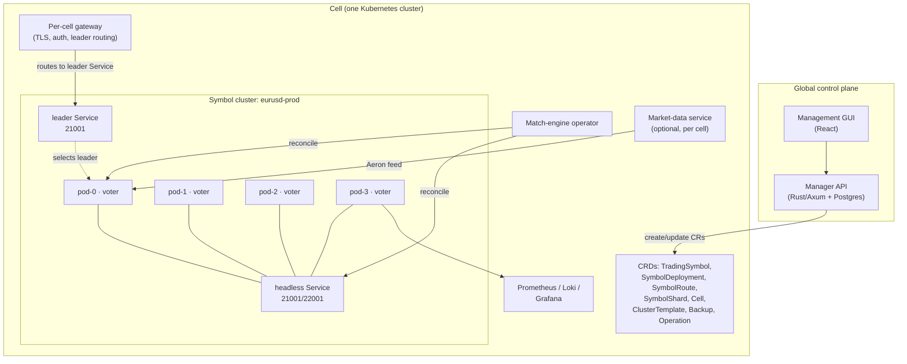

# Kubernetes deployment template and configuration control plane

Status: **proposed design** — no production operator, CRDs or management GUI exist yet. A
runnable reference demo (manager API/GUI, validator, renderer and reconcile planner) lives in
[`demos/k8s_control_plane/`](../demos/k8s_control_plane/README.md).
Last updated: 2026-11-14.

Related documents: [`AGENTS.md`](../AGENTS.md), [`docs/OPERATIONAL_CONSOLE.md`](./OPERATIONAL_CONSOLE.md),
[`docs/STORAGE.md`](./STORAGE.md), [`docs/PERFORMANCE.md`](./PERFORMANCE.md),
[`docs/MARKET_DATA_WEBSOCKET.md`](./MARKET_DATA_WEBSOCKET.md), [`docs/API.md`](./API.md),
[`docs/KUBERNETES_LOCAL_TESTING.md`](./KUBERNETES_LOCAL_TESTING.md),
[`docs/kubernetes-console-architecture.html`](./kubernetes-console-architecture.html) (interactive diagram).

## 1. Summary

The engine is a single-symbol, Raft-replicated process. Supporting hundreds of trading symbols
therefore means running hundreds of independent Raft clusters. Doing that by hand with shell
scripts does not scale: each cluster needs four (or more) stable pods, per-node durable storage,
a one-time bootstrap, symbol configuration, leader-aware routing, backups, upgrades and health
monitoring.

This document proposes:

1. A **Kubernetes deployment template** for a **SymbolShard**: one StatefulSet with four pods,
   each running one or several single-symbol engine processes. One process serves one symbol;
   packing several processes per pod does not merge their Raft groups. Each process keeps its own
   Raft group, WAL, snapshot, state machine, event window, configuration, ports and leader; the
   pod shares the node, PVC and lifecycle.
2. A **per-cell Kubernetes operator** driven by CRDs (`TradingSymbol`, `SymbolDeployment`,
   `SymbolRoute`, `SymbolShard`, `ClusterTemplate`, `Cell`, `Backup`, `Operation`). The operator is
   the only component that mutates workload objects and is the only component that calls the
   engine's bootstrap and membership endpoints.
3. A **configuration manager** (Rust API + React GUI) that owns the global symbol catalog,
   placement, templates, approval and audit, and projects desired state into each cell as CRs.
4. A **cell model** for horizontal scale: each cell is one Kubernetes cluster with its own
   operator, gateway and observability stack. A global manager federates cells.
5. A **multi-process pod template**: one pod hosts N engine processes, one per symbol. The default
   is one container per engine process, so each process keeps its own CPU/memory limits, probes,
   HTTP/gRPC ports, WAL, Raft group and event window. A supervisor-container mode can spawn
   processes dynamically when add/remove without a pod restart matters. The engine's
   one-symbol-per-process model is unchanged: there is no multi-symbol Raft group and no
   multi-group engine refactor.

The primary unit is a **SymbolShard**: four pods, each running N single-symbol engine processes.
Hot symbols get a dedicated shard (`N=1`); low-volume symbols share a packed shard (`N=10–20`).
Packing cuts pod, IP and scheduler overhead, but each process still reserves its own memory and
listeners; size per-process requests honestly and keep hot symbols dedicated. The design keeps
existing engine semantics: one symbol per process, the gRPC port is the HTTP port + 1000,
`BasicNode.addr` is the HTTP address, symbol configuration is replicated and locked after the
first accepted order, and the public edge is plaintext behind a trusted gateway.

## 2. Goals and non-goals

### Goals

- Create a production-ready match-engine cluster for a new symbol in minutes, not hours.
- Manage 100–1,000 symbols across one or more Kubernetes clusters/regions, using dedicated and
  packed shards.
- Pack 10–20 single-symbol engine processes into each pod of a four-pod shard, cutting pod count and
  scheduling/IP overhead while keeping per-process isolation and resource limits.
- Keep well-known/hot symbols in dedicated shards (one process per pod) with predictable latency,
  quota and upgrade blast radius.
- Make bootstrap, symbol configuration, placement, scaling, upgrades, snapshots and restores
  repeatable and auditable.
- Provide a GUI for operators to inventory, place, create, inspect and operate shards and symbols
  without editing YAML by hand.
- Keep the data plane independent of the control plane: an operator or manager outage must not
  stop matching, and the engine must keep serving while the GUI is down.
- Preserve Raft safety: never initialise a symbol process twice, never run a mixed-version shard
  unless the release explicitly supports it, and never expose Raft ports to untrusted networks.

### Non-goals

- Multi-symbol Raft groups or a multi-group engine refactor. Each engine process remains
  single-symbol; packing is multiple processes per pod, not one process with multiple books.
- Per-process CPU/memory sharing inside one container by default. The container-per-process mode
  keeps per-process limits; the optional supervisor mode trades some isolation for dynamic density.
- Cross-tenant packing. A packed shard is scoped to one tenant; hot symbols are isolated.
- A public trading API or public market-data distribution. The gateway and the separate
  market-data system remain the public edge.
- Replacing Prometheus/Grafana/Loki. The manager links to them and provides operational state.
- A full GitOps implementation. The design is GitOps-compatible; the first version may write CRs
  directly.

## 3. Engine constraints that shape the design

| Constraint | Consequence for Kubernetes |
|---|---|
| Current engine: one symbol per process | The primary unit is a **SymbolShard**: four pods, each running N single-symbol engine processes. Direct shard (`N=1`) for hot symbols; packed shard (`N=10–20`) for low-volume symbols. The default is one container per process; an optional supervisor container can spawn processes dynamically. |
| `BasicNode.addr` is the HTTP API address; Raft gRPC is `host:port + 1000` | Each process advertises its own pod DNS at its own HTTP port; peers use `<pod>.<headless>:<httpPort>` and `<httpPort+1000>`. Allocate a unique port per process slot; never share a port in the pod network namespace. |
| Each process has its own listener, WAL, state machine and Raft group | No group ID or transport change is needed. The port identifies the process; `/init`, `/add-learner` and `/change-membership` are called separately for each symbol process. |
| No advertise-vs-bind split in the binary today | Bind to the pod's stable DNS name (it resolves to the pod IP), or add `--advertise-http-addr` / `--advertise-raft-addr` as a hardening change. See §13. |
| Four voters are recommended; `min_voters = 4` when WAL fsync is unset | Default to four voters per shard and a PDB that tolerates one pod disruption. Every symbol process replicates across the same four pods, on that symbol's port. `min_voters` checks the **configured membership**, not live voters: a 4-voter shard with 3 reachable voters still accepts writes, while a 3-voter membership is rejected at `/init`/`/change-membership`. |
| Symbol configuration is replicated and locked after the first accepted order | Treat each symbol process's configuration as immutable after activation. Changes require a new process/generation and a controlled client cutover. |
| No mixed-version rolling upgrade (older peers return `Unimplemented` for PreVote) | A rolling update that changes the wire/snapshot version is unsafe. Same-version restarts (same wire v7 / snapshot v11, including digest-only rebuilds) may roll one pod at a time with leader transfer. The operator uses `strategy: auto`: rolling when the target release is wire/snapshot-compatible, stop-the-world otherwise. Packing increases the blast radius, so shards are kept small. |
| Snapshot v11 / wire v7; older snapshots are rejected | Store snapshot/wire versions per process and block image changes that cross an incompatible boundary. |
| `/metrics` returns JSON, not Prometheus text; logs are text via `env_logger` | Scrape through a small JSON→Prometheus bridge or add a text endpoint before using `ServiceMonitor`/`PodMonitor`; ship logs through a parser or add JSON logging. |
| A follower `/write` returns `500` today; `client_order_id` dedupes `Place` only | The gateway routes writes through its per-symbol leader map and retries on 5xx; retries of `Cancel`/`Amend` are at-least-once. A typed `503` plus leader hint is an engine change (§13). |
| HTTP/gRPC are plaintext and unauthenticated by design | NetworkPolicy, private services and a gateway that owns TLS/client authentication. Never expose engine ports with `LoadBalancer`/`NodePort`. |
| Readiness waits for state-machine recovery; `/ready` requires a known leader | Use a generous `startupProbe` per container; expose per-symbol readiness and do not use `/ready` as the liveness probe. |
| `local_lease` reads assume bounded clock drift | Run NTP/chrony on nodes; otherwise set `--read-policy read_index` for that cell. Pack processes with the same read policy. |
| Each process keeps its book, event window and snapshot buffers in memory | Packed-shard memory is the sum of the per-process requests/limits; overcommitting memory is not safe. Pack cold symbols with small requests, keep hot symbols dedicated. |
| Admission limits are per process (`--max-inflight-writes`) | Tune per container; per-container CPU/memory limits prevent one busy symbol from starving its siblings; expose `/admission/status` and alert on rejects. |
| A pod/node failure affects every process in the pod | Every symbol loses one of four voters, which quorum tolerates. A bad pod image/disk affects all co-located symbols; keep hot symbols in dedicated shards. |
| Kubernetes has per-node pod/IP and API-server limits | Packing reduces pods from `4 × symbols` to `4 × shards`; 300 symbols at 20 processes per pod is 60 pods (1,200 processes/containers). See §9. |
| Containers per pod are practically bounded (kubelet/CRI/log/probe overhead) | Target 10–20 containers per pod, hard-cap around 30. The pod's CPU/memory request is the sum of its containers; plan node sizes accordingly. |

## 4. Architecture

### 4.1 Topology



### 4.2 Components

**Cell.** One Kubernetes cluster (or a dedicated node pool) with its own operator, gateway,
storage classes and observability. Cells isolate failure domains and the Kubernetes API server
load. A region can contain one or more cells.

**Operator.** A Kubernetes controller deployed once per cell. It watches the match-engine CRDs in
that cell and reconciles them into StatefulSets, Services, PDBs, NetworkPolicies and (once a text
metrics endpoint or bridge exists) PodMonitors. It is the only component allowed to call `/init`,
`/add-learner`, `/change-membership`, `/console/api/actions/*` and the symbol `ConfigureSymbol`
write. It uses a Kubernetes `Lease` so only one replica reconciles at a time.

**Manager API + GUI.** The global configuration manager. It stores the symbol catalog, templates,
approvals, operations and audit history in Postgres, and projects desired state into each cell as
CRs. It never talks to engine pods directly during normal operation; it reads CR status and
metrics. It is horizontally scalable; write operations use a database lease/leader election.

**Gateway.** A stateless per-cell service that terminates TLS, authenticates clients, rate-limits,
and routes each symbol's writes/reads to the current leader. It watches `SymbolRoute` and each
shard's status for the per-symbol `leaderAddr`. Routing rules:

- `/write`, `/write_batch` and `/linearizable_read` go to the leader for that symbol;
  `/read` is local and may go to any replica.
- A follower `/write` returns `500` today, not a typed redirect. The gateway must consult its
  leader map first and retry 5xx responses after refreshing the map; it must not blindly retry
  non-idempotent requests.
- Only `Place` carries `client_order_id` dedupe. A retried `Cancel`/`Amend` is at-least-once and
  the order system must reconcile it.
- The gateway routes only symbols present in `SymbolRoute` (an allowlist) and never proxies
  `/init`, `/console`, `/metrics` or other admin paths.

On `NotLeader`/`503` (once the engine returns a typed redirect) it refreshes the leader and
retries; writes that must not duplicate carry `client_order_id` so retries are safe.

**Market-data service.** The existing standalone market-data system, deployed per cell or per
symbol set. It consumes the engine's Aeron feed and serves the Binance-compatible WebSocket.
It is managed by the same platform but is outside the match-engine CRD for the first version.

### 4.3 Why an operator and CRDs instead of generated YAML

- A `kubectl apply` of generated YAML cannot safely coordinate bootstrap, membership changes,
  leader transfer, snapshot-before-upgrade and status. The operator can.
- CRs give the GUI, GitOps and the operator one desired-state contract. Raw YAML would fork into
  many slightly different templates.
- CR status is the natural place for node roles, lag, applied indexes, conditions and operation
  progress that the GUI needs.
- The operator can enforce invariants (one init, one leader label, image compatibility) that a
  template cannot.

### 4.4 Packing multiple engine processes into a pod

A four-pod Raft cluster per symbol is wasteful when most symbols are quiet, and Kubernetes has real
limits: pods per node, pod IPs per node, API-server/etcd object counts and scheduler overhead. The
primary unit is a **SymbolShard**: four pods, each running N single-symbol engine processes. The
engine process model does not change: one symbol per process, one Raft group per process, one
WAL/snapshot/state machine per process. Packing is about the pod, not about merging Raft groups.

Each process keeps:

- its own Raft group, log store, snapshot, state machine, book, sequence and event window;
- its own replicated symbol configuration and config lock;
- its own HTTP and gRPC ports, readiness and metrics;
- its own leader (leaders may differ across symbols on the same pod).

The pod shares the node, network namespace, PVC, scheduler slot and lifecycle. There are two
packing modes:

| Mode | How | Isolation | Dynamic add/remove | Recommendation |
|---|---|---|---|---|
| **Containers** | N containers per pod, one engine process per container | Per-container CPU/memory limits and probes | Add/remove a container requires a StatefulSet rolling update (one pod at a time) | Default; simplest, no engine change |
| **Supervisor** | One or a few containers per pod run a small supervisor that spawns/stops N engine processes | Pod/container-level limits; no per-process cgroup unless the supervisor manages cgroups | Yes: start/stop a process without a pod restart | Optional for dense, dynamic packed shards |
| **Multi-group engine** | One process hosts N Raft groups | N/A | Yes | Not chosen: requires an engine refactor and couples failure/config domains |

#### Port allocation

Containers in a pod share one network namespace, so every process needs a unique port. Use a
deterministic slot map:

| Slot | Symbol example | HTTP | Raft (HTTP + 1000) | Data directory |
|---:|---|---:|---:|---|
| 0 | eurusd | 21001 | 22001 | `/data/eurusd` |
| 1 | gbpusd | 21002 | 22002 | `/data/gbpusd` |
| 2 | usdjpy | 21003 | 22003 | `/data/usdjpy` |
| … | … | … | … | … |

The manager allocates a free slot when a symbol is placed and records `slot`, `httpPort` and the
observed `leaderAddr` in `SymbolDeployment.status`. The gateway routes a symbol to that
`leaderAddr`. Each process is initialised separately with the same four pod FQDNs but
that symbol's HTTP port:

```json
[[0,"fx-eu-01-0.fx-eu-01-headless.match-eu-1.svc.cluster.local:21001"],
 [1,"fx-eu-01-1.fx-eu-01-headless.match-eu-1.svc.cluster.local:21001"],
 [2,"fx-eu-01-2.fx-eu-01-headless.match-eu-1.svc.cluster.local:21001"],
 [3,"fx-eu-01-3.fx-eu-01-headless.match-eu-1.svc.cluster.local:21001"]]
```

for `eurusd`, and the same with `21002` for `gbpusd`. The Raft gRPC transport is the existing
per-process service on `httpPort + 1000`; no group ID or wire change is needed.

#### Shared vs isolated

| Concern | Shared in a packed pod | Isolated per process |
|---|---|---|
| CPU / memory | Pod scheduling slot | Per-container requests/limits in containers mode; supervisor mode shares its container limit |
| WAL / snapshot disk | One PVC, sub-directory per symbol | Per-symbol WAL/snapshot, snapshot scheduling, quota/alerts |
| Failure | Node/pod loss takes one voter of every hosted symbol | A container crash restarts only that symbol; other containers keep serving |
| Upgrade | One pod template/image per shard; a rolling update restarts every container in a pod | Dedicated shards for symbols that need independent upgrade windows |
| Tenancy | One tenant per shard | Never mix tenants in a packed pod |
| Leader | Four pods shared by every symbol | Each process elects its own leader; the gateway keeps a per-symbol leader map |
| Listener / runtime | Pod network namespace, node | One HTTP/gRPC listener and Tokio runtime per process |

#### Sizing and density

- **Dedicated**: one process per pod (four pods per shard) for a hot symbol; guaranteed QoS,
  independent upgrade window, no noisy neighbour.
- **Packed**: 10–20 processes per pod (40–80 processes per four-pod shard) for low-volume symbols
  of one tenant. Start at 10–15 and measure; container count, pod total CPU/memory, log volume and
  probe churn bind before the scheduler's pod limit.
- Containers mode gives each process its own request/limit. A pod's total request is the sum of
  its containers, so a 16-container pod at `0.25 CPU / 512 MiB` requests `4 CPU / 8 GiB`. The node
  must fit that pod; packing into a pod does not make the CPU/memory disappear.
- Every process sizes its Actix workers and Tokio runtime from `available_parallelism()`, which
  follows the container CPU quota/limit. Without a CPU limit a process may start one worker per
  host core; 20 unlimited containers then multiply that by 20. Always set a per-container CPU
  limit (`500m`–`2`) so each process gets a bounded worker pool.
- Each process opens three gRPC channels per peer (replication, heartbeat, snapshot), so a
  20-process pod can hold up to 180 long-lived HTTP/2 connections to its three peers, plus its own
  listeners. Watch `nofile`/conntrack limits and the node's connection budget.
- All processes share one PVC: 20 WALs, snapshots and fsyncs compete for the same IOPS. Use local
  SSD/NVMe, cap concurrent snapshot encodes, and treat a disk-latency alert as shard-wide.
- Supervisor mode gives the pod one larger limit and shares it across processes; it can pack more
  cheaply but cannot guarantee per-symbol CPU/memory and is more exposed to a noisy neighbour.
- Four-voter replication still costs four copies of every symbol's WAL/snapshot and four votes per
  symbol. Packing saves pod/IP/scheduler overhead, not replication factor or per-process memory.
- Do not put a symbol that can burst into a large share of the pod's CPU into a packed pod; promote
  it to a dedicated shard.

#### Add, remove and migrate

- **Containers mode:** add a container to the shard's pod template. The operator rolls one pod at
  a time (quorum stays 3/4 for every symbol); when all four pods have the new container, initialise
  that symbol's process and apply its config. Existing symbols restart one voter at a time. Remove
  in reverse: drain the symbol, stop its process, remove the container, retain data.
- **Supervisor mode:** the supervisor registers/starts a new engine process on all four pods and
  the operator initialises it; no pod template change and no restart of existing symbols.
- **Promotion/demotion:** add the process to the target shard (containers or supervisor), add the
  target four pod/port pairs as learners to the symbol's Raft group, wait for catch-up, change
  membership to the target addresses, then remove the source process. The source group stays
  available until the target has quorum. The symbol's data is transferred by Raft snapshot install,
  not by copying files through the manager.
- **Cross-cell:** create the process in the target cell and use a gateway cutover; avoid
  cross-region Raft membership unless the latency budget explicitly allows it.

#### Failure and upgrade blast radius

Packing trades isolation for density. A pod/node failure takes one voter of every symbol hosted
there (quorum tolerates it), while a container crash affects only that symbol. A bad pod image,
node disk or stop-the-world shard upgrade affects every symbol in the shard. Mitigate with:

- dedicated shards for hot/critical symbols;
- tenant-scoped packed shards and 10–20 containers per pod;
- per-container CPU/memory limits and probes (containers mode);
- a supervisor that restarts only the failed process (supervisor mode);
- upgrade waves by shard, with the number of affected symbols shown in the GUI;
- a tested migration path to evacuate a symbol from a failing shard.

## 5. Kubernetes template: SymbolShard

### 5.1 Object graph

The template is identical for a dedicated shard (`N=1`) and a packed shard (`N>1`). The examples
below use a dedicated `me-eurusd-prod` for clarity; a packed shard is named `fx-eu-01` and its
per-symbol slots are rendered from `SymbolDeployment` objects (see §5.10).

For a dedicated shard named `me-eurusd-prod` in namespace `match-eu-1`:

| Object | Purpose |
|---|---|
| `StatefulSet/me-eurusd-prod` | Four engine pods; each pod runs every engine process in the shard (one container per process in containers mode). Stable ordinals, per-pod PVC, `OnDelete` updates. |
| `Service/me-eurusd-prod-headless` | `clusterIP: None`, `publishNotReadyAddresses: true`; stable pod DNS for Raft. |
| `Service/me-eurusd-prod-leader` | Dedicated shards only: selects the pod labelled `matching.io/role=leader`. Packed shards use each deployment's `status.leaderAddr`. |
| `Service/me-eurusd-prod-metrics` | ClusterIP for a per-pod metrics bridge; the engine's `/metrics` is JSON and cannot be scraped directly by Prometheus. |
| `PodDisruptionBudget/me-eurusd-prod` | `minAvailable: 3` (four voters). |
| `NetworkPolicy/me-eurusd-prod` | Allow peer Raft, gateway/manager HTTP, monitoring; deny the rest. |
| `PodMonitor` | Optional; only after a Prometheus text endpoint or a per-pod JSON→Prometheus bridge exists. |
| `ConfigMap/me-eurusd-prod-shard` | Rendered slot/port map for a packed shard (or the supervisor's process list); a cache derived from `SymbolDeployment`, not the source of truth and not the replicated symbol configuration. |
| `SymbolShard` | Capacity, pod template and observed status (see §6). |
| `SymbolDeployment` | One symbol generation's placement (shard, slot, ports, image); the single owner of slot/port (see §6.7). |
| `SymbolRoute` | Gateway routing intent: symbol → cell/gateway and active generation (see §6.7). |
| `TradingSymbol` | The immutable symbol definition and config hash. |

### 5.2 Naming and labels

Names must be ≤63 characters and DNS-safe. Use a slug and, if needed, a short hash:

```
me-<symbol-slug>-<env>[-<generation>]
e.g. me-eurusd-prod, me-btcusdt-prod, me-aaa...-prod-g2
```

Labels used by every object:

```yaml
app.kubernetes.io/name: match-engine
app.kubernetes.io/instance: me-eurusd-prod
matching.io/symbol: eurusd
matching.io/tenant: fx
matching.io/cell: eu-1
matching.io/cluster-id: eu-1-prod
matching.io/environment: prod
matching.io/cluster: me-eurusd-prod
matching.io/role: voter        # on pods; leader is added dynamically
```

Do not put high-cardinality values (ordinal, pod name) in Prometheus labels beyond the pod target.

### 5.3 StatefulSet example

This is the shape the operator renders. Placeholders are deliberately obvious.

```yaml
apiVersion: apps/v1
kind: StatefulSet
metadata:
  name: me-eurusd-prod
  namespace: match-eu-1
  labels:
    app.kubernetes.io/name: match-engine
    matching.io/symbol: eurusd
    matching.io/cell: eu-1
spec:
  serviceName: me-eurusd-prod-headless
  replicas: 4
  podManagementPolicy: Parallel
  updateStrategy:
    type: OnDelete          # the operator performs leader-aware, one-pod-at-a-time changes
  selector:
    matchLabels:
      app.kubernetes.io/name: match-engine
      matching.io/cluster: me-eurusd-prod
  template:
    metadata:
      labels:
        app.kubernetes.io/name: match-engine
        matching.io/cluster: me-eurusd-prod
        matching.io/symbol: eurusd
        matching.io/role: voter
    spec:
      automountServiceAccountToken: false
      terminationGracePeriodSeconds: 60
      securityContext:
        runAsNonRoot: true
        runAsUser: 10001
        runAsGroup: 10001
        fsGroup: 10001
        fsGroupChangePolicy: OnRootMismatch
        seccompProfile: { type: RuntimeDefault }
      affinity:
        podAntiAffinity:
          requiredDuringSchedulingIgnoredDuringExecution:
            - labelSelector:
                matchLabels:
                  matching.io/cluster: me-eurusd-prod
              topologyKey: kubernetes.io/hostname
      topologySpreadConstraints:
        - maxSkew: 1
          topologyKey: topology.kubernetes.io/zone
          whenUnsatisfiable: ScheduleAnyway   # opt into DoNotSchedule only when every node has a zone label
          labelSelector:
            matchLabels:
              matching.io/cluster: me-eurusd-prod
      containers:
        - name: engine
          image: registry.example.com/matchengine-raft:1.4.0-nonroot
          imagePullPolicy: IfNotPresent
          args:
            - --id
            - $(POD_ORDINAL)            # 0..3; see §5.5 for the 1-based alternative
            - --http-addr
            - $(POD_FQDN):21001
            - --data-dir
            - /data
            - --instance-prefix
            - me-eurusd-prod
            - --snapshot-interval-ms
            - "1800000"
            - --read-policy
            - local_lease
            - --max-inflight-writes
            - "1024"
          env:
            - name: POD_NAME
              valueFrom: { fieldRef: { fieldPath: metadata.name } }
            - name: POD_NAMESPACE
              valueFrom: { fieldRef: { fieldPath: metadata.namespace } }
            - name: POD_ORDINAL
              valueFrom:
                fieldRef:
                  fieldPath: metadata.labels['apps.kubernetes.io/pod-index']
            - name: POD_FQDN
              value: "$(POD_NAME).me-eurusd-prod-headless.$(POD_NAMESPACE).svc.cluster.local"
            - name: RAFT_WAL_FSYNC_MS
              value: "0"                # every append; use unset for the no-fsync profile
            - name: RAFT_CORE_WORKERS
              value: "0"
            - name: MAX_EVENTS
              value: "262144"
          ports:
            - { name: http, containerPort: 21001 }
            - { name: raft, containerPort: 22001 }
          resources:
            requests: { cpu: "2", memory: 4Gi }   # Guaranteed QoS for a dedicated shard
            limits:   { cpu: "2", memory: 4Gi }
          startupProbe:
            httpGet: { path: /health, port: http }
            periodSeconds: 5
            failureThreshold: 60        # recovery can take minutes on a large WAL
          readinessProbe:
            httpGet: { path: /ready, port: http }
            periodSeconds: 2
            failureThreshold: 5
          livenessProbe:
            httpGet: { path: /health, port: http }
            periodSeconds: 10
            failureThreshold: 6
          securityContext:
            allowPrivilegeEscalation: false
            readOnlyRootFilesystem: true
            capabilities: { drop: ["ALL"] }
          volumeMounts:
            - { name: data, mountPath: /data }
            - { name: tmp, mountPath: /tmp }
      volumes:
        - name: tmp
          emptyDir: {}
  volumeClaimTemplates:
    - metadata: { name: data }
      spec:
        accessModes: ["ReadWriteOnce"]
        storageClassName: fast-ssd
        resources: { requests: { storage: 50Gi } }
```

Notes:

- This example is a dedicated shard: one engine container per pod. A packed shard adds one
  container per symbol to the same pod, each with its own HTTP/gRPC ports and data directory; see
  §5.11.
- Every engine process uses the pod ordinal as its Raft node ID. Each process is an independent
  single-symbol engine; the port distinguishes them.
- `podManagementPolicy: Parallel` starts all four pods together, which is required for a
  four-voter `/init`.
- `updateStrategy: OnDelete` prevents Kubernetes from restarting a second pod before the operator
  has verified that the first one is caught up. The operator deletes pods explicitly.
- The liveness probe must not be `/ready`: a follower in a healthy cluster is ready, but a leader
  election or a bootstrap can make `/ready` fail temporarily; restarting pods during an election
  makes it worse.
- The container runs as UID/GID `10001`, not root. The lab image in `docker/linux.Dockerfile`
  runs as root, so build a separate non-root image for Kubernetes (create the user, `chown` the
  data mount, `USER 10001`); `fsGroup` makes the PVC writable. If the image cannot be changed yet,
  omit `runAsNonRoot`/`runAsUser` for a test only and treat it as a blocker for production.
- `readOnlyRootFilesystem: true` needs the writable `/tmp` `emptyDir`; the engine writes only under
  `--data-dir` and `/tmp`.
- Set requests equal to limits (Guaranteed QoS) for a dedicated, latency-sensitive shard. Packed
  shards may use lower requests and higher limits (Burstable) for bursty cold symbols, but then the
  node must have headroom.
- Zone spread is advisory (`ScheduleAnyway`) by default because a cluster without
  `topology.kubernetes.io/zone` labels would otherwise leave every pod `Pending`. Switch to
  `DoNotSchedule` only after every node carries the zone label.
- Pin the image by digest for production (`image: ...@sha256:...`), not by a mutable tag.
- `apps.kubernetes.io/pod-index` requires Kubernetes 1.28+. On older clusters, derive the ordinal
  from `metadata.name` in a tiny entrypoint and pass `--id` explicitly.

### 5.4 Services

```yaml
apiVersion: v1
kind: Service
metadata:
  name: me-eurusd-prod-headless
spec:
  clusterIP: None
  publishNotReadyAddresses: true
  selector:
    matching.io/cluster: me-eurusd-prod
  ports:
    - { name: http, port: 21001, targetPort: http }
    - { name: raft, port: 22001, targetPort: raft }
---
apiVersion: v1
kind: Service
metadata:
  name: me-eurusd-prod-leader
spec:
  selector:
    matching.io/cluster: me-eurusd-prod
    matching.io/role: leader
  ports:
    - { name: http, port: 21001, targetPort: http }
```

The headless Service must publish not-ready addresses. Otherwise a pod's own DNS name does not
resolve until it is ready, but it cannot become ready until the cluster is initialised, which
requires the other pods' DNS names. This is the classic bootstrap deadlock.

The Service's port list is illustrative and cannot express a range. A packed pod's per-process
ports (`21002/22002`, `21003/22003`, …) are reached through the same pod DNS name plus the port;
peers do not go through the Service's port mapping. The operator may generate one Service port per
process for discoverability, but the NetworkPolicy range is what actually permits the traffic.

The leader Service is a convenience for a **dedicated** shard. The operator labels exactly one pod
with `matching.io/role=leader` after reading `/metrics` (`current_leader`) or the console cluster
view, and removes the old label first. Endpoint updates are eventually consistent; the gateway
must still retry on `NotLeader`.

A packed shard has one leader per symbol, so a single leader Service cannot represent it. The
operator writes `SymbolDeployment.status.leaderAddr` for every process (and aggregates it in
`SymbolShard.status.symbols[]`); the gateway routes each symbol to that address and refreshes the
map when a process's leader changes. Keep the leader Service only for dedicated shards (or for a
shard that intentionally co-locates all leaders, which Raft does not guarantee).

### 5.5 Stable addresses and node identity

Each pod advertises its stable DNS name:

```
me-eurusd-prod-0.me-eurusd-prod-headless.match-eu-1.svc.cluster.local:21001
```

`raft_addr_from_http` turns this into `...:22001`. Both the Actix HTTP listener and the gRPC
listener bind to that name, which resolves to the pod IP inside the pod. This is stable across
pod restarts and rescheduling as long as the StatefulSet name and Service name do not change.

All engine processes in a packed pod share the pod address but not ports. Each process advertises
its own `<pod>.<headless>:<httpPort>` (for example `:21001`, `:21002`, …) and its Raft listener is
`<httpPort> + 1000`. Each process is an independent Raft group; membership and leaders are per
symbol. Different processes on the same pod may elect different leader pods, so the gateway routes
by symbol to `SymbolDeployment.status.leaderAddr` (for example `<pod>:<httpPort>`).

Two cautions:

- The DNS name must resolve before the listeners bind. `publishNotReadyAddresses` makes the
  headless Service publish the pod IP immediately, so this is normally true; if the container
  starts before the endpoint is programmed, the process exits and kubelet restarts it.
- Node IDs: the example uses the StatefulSet ordinal `0..3`. The engine accepts `u64`, so `0` is
  expected to work; verify this in the first spike. If the team prefers `1..4`, ship a tiny
  entrypoint that maps `HOSTNAME`'s ordinal to `ordinal + 1`. Do not use random node IDs.

The hardening change in §13 is to add an explicit advertised address:

```
--http-addr 0.0.0.0:21001
--advertise-http-addr me-eurusd-prod-0...:21001
--raft-addr 0.0.0.0:22001
--advertise-raft-addr me-eurusd-prod-0...:22001
```

This removes the DNS-at-bind dependency and makes Service DNS, pod DNS and external DNS explicit.
Until it exists, the FQDN-as-bind-address form above is the recommended template.

### 5.6 Storage and durability

- One PVC per pod, `ReadWriteOnce`, `volumeBindingMode: WaitForFirstConsumer`, local SSD or
  premium block storage. Do not share a PVC between voters.
- A packed shard stores one sub-directory per symbol under the pod's data directory. The engine
  writes `<data-dir>/<instance-prefix>-<id>/{log,snapshot}`, so run each process with
  `--data-dir /data --instance-prefix <symbol>` to get `/data/eurusd-0/...`,
  `/data/gbpusd-0/...`. Do not add a second per-symbol directory (`/data/eurusd/eurusd-0`). Give
  each symbol its own quota/alerts for WAL and snapshot bytes, and cap concurrent snapshot encodes
  (one or two at a time) so one cold symbol cannot stall the shard.
- A full disk is a shard-wide failure, not a symbol-local one. Alert at 80%, reserve headroom for
  the largest symbol, and keep a tested evacuation path (§7.7).
- All processes on the PVC share its IOPS. Size the volume for the sum of WAL appends, fsyncs and
  snapshot writes; a periodic or every-append fsync policy multiplies IOPS. Prefer local NVMe,
  keep fsync mode consistent across the shard, and treat write-latency alerts as shard-wide.
- Size from the snapshot/WAL retention: `MAX_EVENTS`, snapshot interval, and daily write volume.
  Start at 50 GiB and monitor; the snapshot stream is capped at 256 MiB and the WAL is segmented.
- `RAFT_WAL_FSYNC_MS` is a per-shard policy:
  - unset (no fsync): fastest; requires four voters; a node loss can lose the unsynced tail and
    Raft catches the node up from peers.
  - `0`: fsync every append; durable on the pod's PVC; lower throughput.
  - `N > 0`: periodic fsync; a middle ground for cost-sensitive symbols.
- Back up the whole process directory, not just `snapshot/current.snap`: the snapshot file plus
  the WAL segments plus `log/state` (vote and `last_purged`) are required for a consistent
  restore. See §7.5 for group snapshots and the write-quiesce step.
- Never run two pods with the same node ID against the same data directory. The StatefulSet
  ordinal + per-pod PVC enforces this.

### 5.7 Scheduling, availability and disruption

- `podAntiAffinity` by `kubernetes.io/hostname` prevents two voters of one cluster from sharing a
  node.
- Topology spread by zone. Four voters across four zones tolerates one zone loss. With only three
  zones, four voters distribute as 2/1/1 and losing the 2-voter zone loses quorum; use five
  voters (2/2/1) for critical symbols, or accept the risk and document it. Keep the constraint
  advisory (`ScheduleAnyway`) unless every node has a `topology.kubernetes.io/zone` label; a
  required constraint on an unlabeled cluster leaves pods `Pending`.
- `PodDisruptionBudget` `minAvailable: 3` allows one voluntary disruption. Never let a node drain
  take two voters of the same cluster at once.
- Use a dedicated node pool with guaranteed QoS and NTP/chrony for low-latency cells. Avoid
  co-locating the gateway and the engine on the same small node pool if it causes CPU contention.
- `PriorityClass` for match engines above batch workloads, but below system-critical components.
- `terminationGracePeriodSeconds` must exceed the engine's shutdown path. The operator transfers
  leadership before deleting a leader pod.

```yaml
apiVersion: policy/v1
kind: PodDisruptionBudget
metadata:
  name: me-eurusd-prod
spec:
  minAvailable: 3
  selector:
    matchLabels:
      matching.io/cluster: me-eurusd-prod
```

For five-voter clusters, `minAvailable: 4` keeps quorum during a voluntary disruption; for
four voters `minAvailable: 3` allows exactly one pod at a time.

### 5.8 NetworkPolicy

```yaml
apiVersion: networking.k8s.io/v1
kind: NetworkPolicy
metadata:
  name: me-eurusd-prod
spec:
  podSelector:
    matchLabels:
      matching.io/cluster: me-eurusd-prod
  policyTypes: ["Ingress", "Egress"]
  ingress:
    - from:
        - podSelector:
            matchLabels:
              matching.io/cluster: me-eurusd-prod   # Raft peers
      ports:
        - { protocol: TCP, port: 22001, endPort: 22030 }
    - from:
        - namespaceSelector:
            matchLabels:
              matching.io/role: gateway
        - namespaceSelector:
            matchLabels:
              matching.io/role: observability
        - namespaceSelector:
            matchLabels:
              matching.io/role: control-plane
      ports:
        - { protocol: TCP, port: 21001, endPort: 21030 }
    - from:                                   # engine console peer aggregation
        - podSelector:
            matchLabels:
              matching.io/cluster: me-eurusd-prod
      ports:
        - { protocol: TCP, port: 21001, endPort: 21030 }
  egress:
    - to:
        - podSelector:
            matchLabels:
              matching.io/cluster: me-eurusd-prod
      ports:
        - { protocol: TCP, port: 22001, endPort: 22030 }
    - to:                                    # object storage for the backup agent
        - ipBlock:
            cidr: 10.0.0.0/8                 # replace with the S3 prefix list / VPC endpoint
      ports:
        - { protocol: TCP, port: 443 }
    - to:                                    # DNS, scoped to kube-system
        - namespaceSelector:
            matchLabels:
              kubernetes.io/metadata.name: kube-system
      ports:
        - { protocol: UDP, port: 53 }
        - { protocol: TCP, port: 53 }
    - to:                                    # engine console peer aggregation
        - podSelector:
            matchLabels:
              matching.io/cluster: me-eurusd-prod
      ports:
        - { protocol: TCP, port: 21001, endPort: 21030 }
```

The engine console's cluster view probes each peer's `/console/api/node` over HTTP. Without the
last ingress/egress pair, the console shows every peer as unreachable even while Raft is healthy;
this was observed on the OrbStack L0 tier. The rule stays inside the shard's own trust boundary:
external HTTP is still limited to the gateway, observability and control-plane namespaces.

Do not add an ingress rule for the Raft port from the gateway or the public internet. The
headless Service is for peers, the operator and monitoring. The gateway uses each symbol's leader
pod and HTTP port (`21001`–`21030`); the ranges above are sized for the maximum number of
processes per pod. Prometheus scrapes *into* the pod, so no metrics egress rule is needed (the old
`9090` rule was backwards). NetworkPolicy enforcement depends on the CNI; verify that the cell's
CNI enforces it.

If the engine publishes Aeron over multicast, add a UDP egress/ingress rule for the channel's
port and keep IPC traffic inside the pod. Do not open Aeron to the public network.

### 5.9 Probes and lifecycle

- `startupProbe`: `/health`, up to 5 minutes. Large WAL replays and snapshot installs can take
  longer than a normal liveness window.
- `readinessProbe`: each container probes its own `/ready` on its HTTP port. A container is not
  ready during bootstrap or a long election. Pod readiness aggregates all containers; because the
  headless Service uses `publishNotReadyAddresses`, Raft DNS remains available. The gateway must
  use the per-symbol `SymbolRoute`/`SymbolDeployment.status` and retry on `NotReady`/`NotLeader`;
  it must not infer a symbol's readiness from the pod-level Ready condition alone.
- `livenessProbe`: `/health` with a generous threshold. Consider making it a TCP probe if `/health`
  reports transient WAL/state-machine states that should not trigger restarts.
- `preStop`: the operator performs the leader transfer before deletion. A preStop hook can be a
  backstop, but it must be idempotent and bounded; do not block shutdown indefinitely.
- On SIGTERM the engine shuts down HTTP, gRPC, Raft and the dedicated runtime. Keep the grace
  period longer than the observed shutdown time.

### 5.10 Slot/port assignment and add/remove

The shard's ConfigMap is a rendered cache of the process slots derived from `SymbolDeployment`
objects; it must not contain the replicated symbol configuration, which is applied through Raft
and locked by each process. `SymbolDeployment` is the single owner of slot/port (§6.7).

```yaml
apiVersion: v1
kind: ConfigMap
metadata:
  name: fx-eu-01-shard
data:
  shard.yaml: |
    shard: fx-eu-01
    processes:
      - { name: eurusd, slot: 0, httpPort: 21001 }
      - { name: gbpusd, slot: 1, httpPort: 21002 }
      - { name: usdjpy, slot: 2, httpPort: 21003 }
```

- The manager allocates a free slot and its ports when a symbol is placed, and writes it to
  `SymbolDeployment.spec.placement`. The operator validates uniqueness and rejects a deployment
  with no slot/port. Slots are not reused while the old symbol's data is retained.
- A shard with no bound `SymbolDeployment` is a **reserved shard**. It owns its four pods'
  capacity, port range, image and storage settings. In containers mode it renders only the derived
  ConfigMap, PDB and NetworkPolicy; the Services, leader Service and StatefulSet materialize when
  the first deployment is bound. In supervisor mode it also renders the supervisor StatefulSet
  with an empty `processes.json`, so the pods are pre-warmed and the first placement starts a
  child without recreating a pod.
- **Zero-impact additions.** A pod's container list is immutable. Adding a container in
  containers mode therefore requires recreating every pod in the shard, which restarts every
  engine one voter at a time. That is quorum-safe and the PVC retains data, but it is not a
  no-restart operation. The manager rejects additions to a non-empty containers shard unless the
  request sets `allowRestart: true`. Use supervisor mode for repeated zero-impact placement; an
  empty/new containers shard is zero-impact for its first placement only.
- **Containers mode:** adding a symbol creates a `SymbolDeployment` and updates the StatefulSet pod
  template with a new container. The operator rolls one pod at a time (each symbol loses one voter;
  quorum stays 3/4), then initialises the new process on all four pods and applies its config.
  Removing is the reverse after the gateway drains the symbol; the last active engine in a shard
  can be stopped without restarting another engine, then its StatefulSet/pods are pruned and the
  PVC is retained.
- **Supervisor mode:** the supervisor reads the bound `SymbolDeployment` objects (or a rendered
  ConfigMap cache) and starts/stops engine processes on all four pods without a pod-template
  change; the operator initialises/removes each process.
- **Graceful shutdown:** `POST /api/v1/symbols/{symbol}/shutdown` sets the deployment and route to
  `Disabled` and returns the stop plan. In supervisor mode the operator applies the updated
  `processes.json`; the supervisor sends SIGTERM to that child while the other children keep
  running. In containers mode a non-empty shard is rejected unless the request sets
  `allowRestart: true`, because removing a container recreates the pods. The deployment record,
  route, slot/ports and PVC stay; disabled records are omitted from rendered workloads and
  reconcile observations but still count against `freeSlots`.
- **Re-enable:** `POST /api/v1/symbols/{symbol}/start` sets the same deployment and route back to
  `Active` (status `Pending`) without allocating a new generation, slot or port. In supervisor mode
  the updated ConfigMap starts that child on all four pods; in containers mode the workload is
  re-materialized or rolled with the same `allowRestart` guard. The engine recovers its retained
  WAL/snapshot and rejoins its group, so `/init` and `ConfigureSymbol` are not repeated; the route
  is published only after `/ready`.
- **Migration/promotion:** create a shadow `SymbolDeployment` on the target shard, add the four
  target `pod:httpPort` addresses as learners to the symbol's Raft group, wait for catch-up, change
  membership to the target addresses, switch `SymbolRoute.spec.activeDeploymentRef`, then drain the
  source process. The port is the process identity; no group ID is involved.

### 5.11 Packed pod: multiple engine containers

This is the primary packing shape. Each container is the existing single-symbol engine:

```yaml
      containers:
        - name: eurusd
          image: registry.example.com/matchengine-raft@sha256:...
          args:
            - --id
            - $(POD_ORDINAL)
            - --http-addr
            - $(POD_FQDN):21001
            - --data-dir
            - /data
            - --instance-prefix
            - eurusd
            - --max-inflight-writes
            - "64"
          ports:
            - { name: eurusd-http, containerPort: 21001 }
            - { name: eurusd-raft, containerPort: 22001 }
          resources:
            requests: { cpu: "250m", memory: 512Mi }
            limits:   { cpu: "1", memory: 1Gi }
          readinessProbe:
            httpGet: { path: /ready, port: 21001 }
          volumeMounts:
            - { name: data, mountPath: /data }
        - name: gbpusd
          image: registry.example.com/matchengine-raft@sha256:...
          args:
            - --id
            - $(POD_ORDINAL)
            - --http-addr
            - $(POD_FQDN):21002
            - --data-dir
            - /data
            - --instance-prefix
            - gbpusd
            - --max-inflight-writes
            - "64"
          ports:
            - { name: gbpusd-http, containerPort: 21002 }
            - { name: gbpusd-raft, containerPort: 22002 }
          resources:
            requests: { cpu: "250m", memory: 512Mi }
            limits:   { cpu: "1", memory: 1Gi }
          readinessProbe:
            httpGet: { path: /ready, port: 21002 }
          volumeMounts:
            - { name: data, mountPath: /data }
```

- All containers share `POD_FQDN` and the pod network namespace; ports must differ.
- The pod's CPU/memory request is the sum of its containers. Set low requests for cold symbols and
  let bursts use the limits; keep memory requests realistic. A packed pod is normally Burstable,
  not Guaranteed.
- If market data is enabled, give every process a unique `--market-data-aeron-stream-base`
  (`2001 + 7 * slot`) because one process owns streams `base..base+6`; see §9.4.
- One PVC per pod, one data sub-directory per process. A container crash restarts only that
  process; a pod/node failure affects one voter of every hosted symbol.
- Probes are per container. Pod Ready is the AND of its containers; the headless Service still
  publishes not-ready addresses, and the gateway uses `SymbolDeployment.status.leaderAddr`.
- To add a symbol in this mode, create its `SymbolDeployment`; the operator adds a container and
  rolls one pod at a time. Existing symbols restart one voter at a time but keep quorum.

### 5.12 Supervisor container: dynamic processes

For dynamic add/remove and denser packing, the reference supervisor
(`src/bin/match_supervisor.rs`) runs as the pod's only container:

- It polls the shard ConfigMap's `processes.json`, spawns one `matchengine-raft` process per
  symbol with `--id <pod ordinal>`, `--http-addr <podFqdn>:<httpPort>`, `--data-dir /data` and
  `--instance-prefix <symbol>`, and reaps/restarts failed children with backoff.
- Adding a symbol updates the ConfigMap only. The supervisor starts the new child on all four
  pods; existing children keep their PIDs, listeners and data directories. Removing a symbol
  (a `Disabled` deployment omitted from `processes.json`) sends SIGTERM to that child, waits up to
  30 seconds and retains its data directory for the retention window. The other children are not
  signalled.
- `/health` is a liveness probe that stays green while the supervisor is alive, so a starting
  child cannot restart the whole pod. `/ready` aggregates every desired child's `/ready`; pod
  readiness can be temporarily false while a new child starts, but the gateway uses per-symbol
  `SymbolDeployment.status`, not pod-level readiness.
- The supervisor exposes `/processes` for PID/port/uptime diagnostics. Child stdout/stderr are
  inherited; a production supervisor should add log rotation and optional cgroup isolation.
- There is no engine change: each spawned process is the existing single-symbol binary.
- Trade-off: processes share the supervisor's container CPU/memory limit; there is no per-process
  cgroup isolation unless the supervisor manages cgroups. Use one supervisor per batch of 5–10
  processes if you need coarse isolation.
- The StatefulSet pod template is stable across add/remove. Only the ConfigMap cache changes;
  `SymbolDeployment` remains the source of truth and the operator writes the cache.
- The supervisor has tests for config parsing and PID stability across add/remove; production
  hardening should add crash, readiness-aggregation and log-rotation tests.

## 6. CRDs and data model

The global manager's cluster holds the catalog CRDs (`TradingSymbol`, `Cell`, `ClusterTemplate`).
Each cell holds the runtime CRDs (`SymbolDeployment`, `SymbolRoute`, `SymbolShard`, `Backup`,
`Operation`) plus a namespaced projection of the `TradingSymbol` it is allowed to run. The manager
projects a symbol into a cell and a shard; the cell operator never reaches back into the
management cluster.

There are two placement facts, and each has exactly one owner:

| Fact | Owner | Everyone else |
|---|---|---|
| Which shard/slot/ports a symbol generation uses | `SymbolDeployment.spec` (written by the manager) | `SymbolShard` renders it; the operator reports status |
| Which generation the gateway sends traffic to | `SymbolRoute.spec` (written by the manager) | The gateway watches it; the operator reports status |
| Observed leader, readiness, lag | `SymbolDeployment.status` / `SymbolShard.status` (written by the operator) | Manager and gateway read it |

`TradingSymbol` carries no placement, and `SymbolShard.spec` carries no process list. That
removes the old ambiguity where both objects could declare a slot/port.

### 6.1 `TradingSymbol`

Cluster-scoped in the management cluster (global catalog), or projected as a namespaced CR into
each cell. The symbol definition is immutable after activation; placement lives in
`SymbolDeployment` (§6.7).

```yaml
apiVersion: matching.example.com/v1alpha1
kind: TradingSymbol
metadata:
  name: eurusd
spec:
  symbolId: 0
  base: { code: EUR, class: fiat, decimals: 2 }
  quote: { code: USD, class: fiat, decimals: 2 }
  priceDecimals: 5
  priceTick: "0.00001"
  baseLot: "0.01"
  feeAssetPolicy: received
  stp: off
  owner: fx-team
  generation: 1
status:
  phase: Active
  configLocked: true
  configHash: "sha256:..."
  appliedBy: eurusd-g1
```

`symbolId` is a `u32`; the engine only requires it to be consistent within a process. Prefer a
**cell-unique** value per symbol anyway, because the market-data feed, gateway logs and GUI all
use it as a key. `symbolId: 0` in every process is legal but makes downstream data harder to join.

Valid enum values (the CRD should enforce them):

- `base.class` / `quote.class`: `fiat`, `stablecoin`, `crypto`, `equity`, `etf`, `unknown`.
- `feeAssetPolicy`: `received` (buyer base, seller quote), `quote`, `base`. ETF/equity bases are
  forced to `quote`.
- `stp`: `off` (default), `cancel_resting`, `cancel_aggressor`, `cancel_both`. `none` is not a
  valid value.

### 6.2 `SymbolShard`

One CR per four-pod shard. A dedicated shard hosts one symbol; a packed shard hosts many. The
shard declares capacity and the pod template inputs; it does not declare which symbol owns which
slot (that is `SymbolDeployment`). A shard with no bound deployment is **reserved**:
`status.phase: Reserved`, zero processes. In containers mode it has no StatefulSet until the first
placement; in supervisor mode it runs idle supervisor pods with an empty process list, ready for
zero-impact additions. The manager creates one with `POST /api/v1/shards`; the first
`POST /api/v1/symbols` allocates slot 0 and materializes or starts the process.

```yaml
apiVersion: matching.example.com/v1alpha1
kind: SymbolShard
metadata:
  name: fx-eu-01
  namespace: match-eu-1
spec:
  cell: eu-1
  environment: prod
  class: packed              # dedicated | packed
  replicas: 4
  packing:
    mode: containers         # containers | supervisor
    maxProcessesPerPod: 20
  image: registry.example.com/matchengine-raft@sha256:...
  release:
    wireVersion: 7
    snapshotVersion: 11
    mixedVersionSafe: false   # same-version rolling is always allowed; see §7.4
  storage:
    className: fast-ssd
    size: 100Gi
  defaultProcessResources:
    requests: { cpu: "250m", memory: 512Mi }
    limits:   { cpu: "1", memory: 1Gi }
  raft:
    walFsync: every          # every | none | intervalMillis: 100
    readPolicy: local_lease
    snapshot:
      everyMinutes: 30       # maps to --snapshot-interval-ms; everyLogs is fixed at 100_000 today
  quotas:
    perProcess:
      maxEvents: 50000
      maxInflightWrites: 64
  network:
    httpBasePort: 21001      # Raft is always httpPort + 1000; the offset is not tunable
  upgrade:
    strategy: auto           # auto | rolling | stop-the-world
    maintenanceWindow: "Sun 02:00-03:00 UTC"
  backup:
    schedule: "0 */6 * * *"
    destination: s3://match-backups/eu-1/fx-eu-01/
  paused: false
status:
  observedGeneration: 3
  phase: Ready
  membersPerProcess: 4
  capacity:                  # per-pod totals derived from the bound deployments
    processes: 2
    cpuRequest: "500m"
    memoryRequest: 1Gi
    storageRequest: 100Gi
  symbols:
    - name: eurusd
      deploymentRef: eurusd-g1
      generation: 1
      slot: 0
      httpPort: 21001
      leaderPod: fx-eu-01-0
      leaderAddr: fx-eu-01-0.fx-eu-01-headless.match-eu-1.svc.cluster.local:21001
      ready: true
      appliedIndex: 184223
      lag: 0
      configHash: "sha256:..."
    - name: gbpusd
      deploymentRef: gbpusd-g1
      generation: 1
      slot: 1
      httpPort: 21002
      leaderPod: fx-eu-01-2
      leaderAddr: fx-eu-01-2.fx-eu-01-headless.match-eu-1.svc.cluster.local:21002
      ready: true
      appliedIndex: 99211
      lag: 0
      configHash: "sha256:..."
  nodes:
    - name: fx-eu-01-0
      id: 0
      ready: true
      processes: 2
    - name: fx-eu-01-1
      id: 1
      ready: true
      processes: 2
    - name: fx-eu-01-2
      id: 2
      ready: true
      processes: 2
    - name: fx-eu-01-3
      id: 3
      ready: true
      processes: 2
  conditions:
    - type: Bootstrapped
      status: "True"
    - type: QuorumHealthy
      status: "True"
    - type: ProcessesReady
      status: "True"
    - type: BackupCurrent
      status: "True"
```

A dedicated shard is the same CR with `class: dedicated` and one `SymbolDeployment` bound to it.
There is no separate single-symbol object; a one-symbol deployment is just a shard of size one.
`status.symbols` is observed, not desired: it is rendered from the deployments bound to the shard.

### 6.3 `ClusterTemplate`

Defaults for per-process resources, image, storage, raft settings and packing mode. The GUI uses
templates to create shards with consistent settings; the operator expands template defaults into
the CR before validation.

```yaml
apiVersion: matching.example.com/v1alpha1
kind: ClusterTemplate
metadata:
  name: prod-fx-packed
spec:
  replicas: 4
  packing: { mode: containers, maxProcessesPerPod: 20 }
  image: registry.example.com/matchengine-raft@sha256:...
  storage: { className: fast-ssd, size: 100Gi }
  defaultProcessResources:
    requests: { cpu: "250m", memory: 512Mi }
    limits:   { cpu: "1", memory: 1Gi }
  raft: { walFsync: every, readPolicy: local_lease }
  network: { httpBasePort: 21001 }   # Raft port is always +1000
```

### 6.4 `Cell`

Describes one Kubernetes cell: API endpoint, region, storage classes, capacity, gateway URL and
observability URLs. The global manager uses it to place symbols.

```yaml
apiVersion: matching.example.com/v1alpha1
kind: Cell
metadata:
  name: eu-1
spec:
  clusterId: eu-1-prod        # unique; stamped on every object, metric and log line
  region: eu-west
  kubeContext: eu-1
  namespaces: [match-eu-1]
  storageClasses: [fast-ssd]
  capacity:
    maxShards: 120
    maxProcesses: 9600
  gateway:
    url: https://match-eu-1.example.com
  observability:
    prometheus: https://prometheus-eu-1.example.com
```

### 6.5 `Operation` and `Backup`

Long-running work is an object, not a hidden goroutine:

```yaml
apiVersion: matching.example.com/v1alpha1
kind: Operation
metadata:
  name: upgrade-fx-eu-01-20261113
spec:
  shardRef: fx-eu-01
  kind: Upgrade            # AddSymbol | RemoveSymbol | MigrateSymbol | Scale | Upgrade
                           # | Snapshot | Backup | TransferLeader | Pause
  targetImage: registry.example.com/matchengine-raft@sha256:...
  strategy: auto           # auto | rolling | stop-the-world
  idempotencyKey: 7f3c...
  requestedBy: alice
  approvalRef: approval-20261113-02
  dryRun: false
status:
  phase: Running           # Pending | Running | Succeeded | Failed | Cancelled
  step: "drain pod-2"
  completedSteps: 3
  totalSteps: 12
  startedAt: "2026-11-13T10:00:00Z"
  finishedAt: null
  conditions: [...]
```

`restore` is deliberately not an Operation kind yet: there is no supported one-step cluster
restore tool (§7.5). A restore is a runbook/volume operation until that tool exists.

`Backup` records the group snapshot and, per process, the indexes, checksums and restore test:

```yaml
apiVersion: matching.example.com/v1alpha1
kind: Backup
metadata:
  name: fx-eu-01-20261113t0200z
spec:
  shardRef: fx-eu-01
  mode: volume-group       # volume-group | logical
  volumeGroupSnapshotClass: fast-ssd-vg
  destination: s3://match-backups/eu-1/fx-eu-01/
  quiesce: true
status:
  phase: Completed
  volumeGroupSnapshot: snapgroup-fx-eu-01-20261113
  processes:
    - name: eurusd
      snapshotIndex: 184000
      lastLogIndex: 184223
      lastPurged: 170000
      logStateSha256: "sha256:..."
      snapshotSha256: "sha256:..."
      walBytes: 12345678
      s3Prefix: s3://match-backups/eu-1/fx-eu-01/eurusd/
      restoreTestedAt: "2026-11-13T03:10:00Z"
    - name: gbpusd
      snapshotIndex: 99100
      lastLogIndex: 99211
      lastPurged: 90000
      logStateSha256: "sha256:..."
      snapshotSha256: "sha256:..."
      walBytes: 4567890
      s3Prefix: s3://match-backups/eu-1/fx-eu-01/gbpusd/
      restoreTestedAt: "2026-11-13T03:12:00Z"
```

The manager's Postgres stores the global catalog, approvals, audit events and a read cache; cell
CRs remain the desired-state contract for workloads.

### 6.6 Status conditions

| Condition | Meaning |
|---|---|
| `Bootstrapped` | Every engine process has completed `/init` exactly once and its membership matches the desired voters. |
| `Ready` | Every engine process reports `/ready` on its HTTP port and has a leader. |
| `QuorumHealthy` | A quorum is reachable for every process and no voter is beyond the lag threshold. |
| `ConfigApplied` | Every symbol's leader `/read symbol_config` hash matches its `TradingSymbol`. |
| `BackupCurrent` | A recent group snapshot (or per-process backup) exists and passed checksum/restore validation. |
| `UpgradeComplete` | All pods run the target image and every process is caught up. |
| `ProcessesReady` | The number of ready processes equals the number of `SymbolDeployment` objects bound to the shard. |
| `PlacementValid` | Slot/port pairs are unique, within `maxProcessesPerPod`, and each active deployment has exactly one active route. |
| `Paused` | Reconciliation of data-plane changes is suspended. |

### 6.7 `SymbolDeployment` and `SymbolRoute`

`SymbolShard` describes pods and capacity; it must not also declare which symbol owns which slot.
Two CRs own placement and routing so that every fact has exactly one writer:

```yaml
apiVersion: matching.example.com/v1alpha1
kind: SymbolDeployment
metadata:
  name: eurusd-g1
  namespace: match-eu-1
spec:
  symbolRef: eurusd
  generation: 1
  shardRef: fx-eu-01
  placement:
    slot: 0                  # the only place slot/httpPort are declared
    httpPort: 21001
  image: registry.example.com/matchengine-raft@sha256:...
  configHash: "sha256:..."
  desiredState: Active       # Active | Shadow | Draining | Disabled
status:
  phase: Ready               # Pending | Bootstrapped | Ready | Degraded | Failed
  leaderPod: fx-eu-01-0
  leaderAddr: fx-eu-01-0.fx-eu-01-headless.match-eu-1.svc.cluster.local:21001
  ready: true
  appliedIndex: 184223
  lag: 0
  bootstrappedAt: "2026-11-13T09:00:00Z"
  conditions: [...]
---
apiVersion: matching.example.com/v1alpha1
kind: SymbolRoute
metadata:
  name: eurusd
  namespace: match-eu-1
spec:
  symbolRef: eurusd
  cellRef: eu-1
  activeDeploymentRef: eurusd-g1
  previousDeploymentRef: null   # set only during a cutover
  state: Active                 # Active | Shadow | Cutover | Draining | Disabled
status:
  phase: Active
  observedGeneration: 4
  activeDeploymentRef: eurusd-g1
  leaderAddr: fx-eu-01-0.fx-eu-01-headless.match-eu-1.svc.cluster.local:21001
  lastCutoverAt: "2026-11-13T09:05:00Z"
```

Rules:

- **Placement owner:** `SymbolDeployment.spec.placement` is the single source for `slot` and
  `httpPort`. `TradingSymbol` has no placement and `SymbolShard.spec` has no process list. The
  operator derives the StatefulSet's containers and `SymbolShard.status.symbols[]` from the
  deployments whose `shardRef` matches.
- **Routing owner:** `SymbolRoute.spec.activeDeploymentRef` is the single source for which
  generation the gateway serves. `previousDeploymentRef` is non-null only during a cutover, so the
  gateway can drain the old generation while the new one takes traffic.
- **Uniqueness:** reject two deployments with the same `(shardRef, slot)` or
  `(shardRef, httpPort)`, and two active routes for one symbol. A slot is not reused while the old
  deployment's data is retained.
- **Writer split:** the manager writes `SymbolDeployment` and `SymbolRoute` desired state; the
  operator writes their status and the workload objects. The operator never invents a slot/port.
- **Image:** `SymbolDeployment.spec.image` is an optional override; empty inherits
  `SymbolShard.spec.image`. Both must be in the same wire/snapshot compatibility set, so a shadow
  deployment can test a digest without changing the whole shard.
- **Generations:** a config change creates a new `TradingSymbol` generation and a new
  `SymbolDeployment` (for example `eurusd-g2`). The old deployment moves to `Draining` only after
  the route cutover; both can coexist while the pod has headroom.
- **Shadow validation:** `desiredState: Shadow` starts a deployment with no route, so it can
  bootstrap and be verified before the cutover.
- **Gateway read path:** gateway → `SymbolRoute` → `activeDeploymentRef` → deployment
  `status.leaderAddr` (refresh on 5xx/`NotLeader`). It does not infer a leader from pod labels.
- **Deletion order:** disable/redirect the route, drain open orders, stop the process, remove the
  deployment, retain the data directory for the retention window.

`SymbolShard.status.symbols[]` remains useful as a per-pod aggregate for the GUI and for
capacity, but it is a projection: if it disagrees with `SymbolDeployment.status`, the deployment
wins.

## 7. Operator workflows

### 7.1 Create a shard and bootstrap its processes

A shard is created once with N single-symbol engine processes per pod; each process is an
independent Raft cluster on the same four pods.

1. The manager creates the `TradingSymbol` and, for each generation, a `SymbolDeployment` that
   names the target shard and the slot/ports. A dedicated shard has one deployment. The manager
   also creates the `SymbolRoute` in `Shadow`/`Active` state.
2. Operator renders the headless Service, metrics Service, PDB, NetworkPolicy, slot/port
   ConfigMap and a StatefulSet with one container per bound deployment (containers mode) or the
   supervisor (supervisor mode). It does not need a ServiceAccount token.
3. StatefulSet starts four pods with `podManagementPolicy: Parallel`. Each container/process
   binds its own FQDN and HTTP port. `/health` is 200; `/ready` is 503 until that process has a
   leader.
4. Operator waits for all four pods and every container to be healthy, and for DNS to resolve.
5. For **each process**, the operator posts the four voter addresses to
   `http://<pod-0>:<httpPort>/init` (the current single-symbol `/init` shape):
   ```json
   [[0,"fx-eu-01-0.fx-eu-01-headless.match-eu-1.svc.cluster.local:21001"],
    [1,"fx-eu-01-1.fx-eu-01-headless.match-eu-1.svc.cluster.local:21001"],
    [2,"fx-eu-01-2.fx-eu-01-headless.match-eu-1.svc.cluster.local:21001"],
    [3,"fx-eu-01-3.fx-eu-01-headless.match-eu-1.svc.cluster.local:21001"]]
   ```
   Use `21002` for the second process, `21003` for the third, and so on. The node ID is the pod
   ordinal and may repeat across processes; the port selects the Raft instance.
6. Wait for a leader per process (`/metrics` `current_leader` on that process's port) and for
   `/ready` on all four pods for that process. Processes may elect different leader pods.
7. Apply each process's configuration through its leader's `/write`:
   ```json
   {"ConfigureSymbol":{"config":{...}}}
   ```
   Verify with `/read symbol_config` and `/pretrade/status` on that port; record each hash.
8. Publish per-symbol leaders in `SymbolDeployment.status.leaderAddr` (and the aggregate
   `SymbolShard.status.symbols[]`). The gateway watches `SymbolRoute`, follows
   `activeDeploymentRef`, then reads `leaderAddr`. A dedicated shard may additionally label its one
   leader pod for a leader Service.
9. Set the shard `phase: Ready` when every bound process is ready; a partially ready shard stays
   `Degraded` and only the ready routes are served.

The operator must be idempotent: on restart it inspects each process's membership and metrics and
never calls `/init` for a process that is already initialised. A useful invariant is "`/init` is
only called when the process has no `bootstrappedAt` and its membership view is empty".

### 7.2 Symbol configuration

- The operator applies `TradingSymbol.spec` to the symbol process's leader before the first order.
  The symbol is marked `ConfigApplied` only after `/read symbol_config` on that process's HTTP port
  matches.
- After the first accepted order that process locks its configuration. The operator must never try
  to change price decimals, tick, lot, asset metadata or fee-asset policy in place.
- The GUI must show `configLocked: true` and explain that a change requires a new symbol
  generation/process and a client cutover. Fee **rates** live on orders/user tiers, not in the
  engine's symbol config; fee-schedule changes belong to the order system.
- For a new generation, create a new `SymbolDeployment` (in the same shard if a slot is free, or a
  new one) with a shadow route, validate it before cutover, then switch
  `SymbolRoute.spec.activeDeploymentRef`. The old and new processes can coexist temporarily if the
  pod has CPU/memory headroom; do not hot-edit the old snapshot.

### 7.3 Scale-out and membership changes

The StatefulSet replica count is not the Raft membership, and a shard has one membership per
symbol. The operator is responsible for both. Changing the pod count changes every process:

1. Add a pod by increasing the StatefulSet ordinal set (or creating a new ordinal).
2. For **each process**, call `POST /add-learner [id, "addr"]` on that process's leader (use the
   process's HTTP port; the peer address is `<pod>.<headless>:<httpPort>`); wait for the learner to
   catch up.
3. For each process, call `/change-membership [id0, id1, ...]` with the new voter set.
4. Only then delete the removed pod and its PVC (after a retention window).

Never scale down by simply setting `replicas` lower; that removes a voter from every process
without a membership change. The operator should reject a direct replicas edit unless it is part of
a membership `Operation` that records the new voter set. For the default four-voter shard, there is
no routine scale out; the main use is replacing a failed node and growing to five voters for zone
tolerance. Adding or removing a **process/symbol** does not change the pod count; see §7.7.

### 7.4 Upgrades (critical)

The engine has **no mixed-version rolling upgrade**: an older peer cannot answer the PreVote RPC,
so a rolling update that changes the wire/snapshot version can break elections. A shard runs one
image, so this applies to every process in the shard. Same-version restarts are different: moving
from one pod to a replacement pod (or rebuilding the same digest) keeps every peer on wire v7 /
snapshot v11 and is safe with leader-aware, one-pod-at-a-time restarts.

The operator uses `strategy: auto` and decides per target release:

| Change | Strategy |
|---|---|
| Same image digest, or a rebuild that keeps wire v7 / snapshot v11 | `rolling`: transfer leadership for every process on the pod, delete/restart one pod, wait for `/ready`, applied index and membership, then continue |
| New wire or snapshot version, or a release that does not support mixed-version peers | `stop-the-world` per shard (or a new shard/generation) |
| Storage-format change, symbol config change | New generation/process + route cutover; never in-place |

`release.mixedVersionSafe: true` would mean a future release can tolerate peers on a different
version; it does not gate same-version rolling. Until that lands, an image change that crosses
`wireVersion`/`snapshotVersion` is stop-the-world. Read the target versions from signed image
metadata or the release catalog, not from the tag.

Stop-the-world procedure:

1. Acquire the shard operation lock and verify a recent backup.
2. Trigger and verify a snapshot for every process (respect the snapshot-concurrency cap).
3. Transfer leadership off the pods being stopped for every process (or stop all pods together
   for an in-place image update).
4. Stop the pods, update the image, restart.
5. Wait for every process to recover and become ready; verify applied indexes and memberships.
6. Repeat in maintenance windows/waves across shards.

Packing increases the blast radius: a shard upgrade is a stop-the-world event for every symbol it
hosts. Prefer smaller packed shards and dedicated shards for hot symbols, and show the number of
affected processes/symbols before starting.

Rollback: an image rollback is safe only before the new binary writes a new-format WAL entry or
snapshot. After that, the old binary cannot read the data; roll back by restoring the pre-upgrade
volume group snapshot (§7.5), which loses every write after that snapshot. Record the compatibility
boundary, the last pre-upgrade snapshot and the rollback deadline in the `Operation`.

For incompatible versions, prefer a planned migration: a new shard/generation with the new image
and a state migration/cutover, not an in-place update. The manager should show upgrade waves,
per-shard downtime and a tested rollback plan.

### 7.5 Snapshots and backups

A shard backup has two layers:

1. **Volume group snapshot (primary).** Quiesce the shard's write path (pause the gateway route or
   cut over to another generation), wait for in-flight writes to drain, trigger one CSI
   `VolumeGroupSnapshot` covering all four PVCs, then resume. A group snapshot is one operation
   across the group (cross-volume consistency still depends on the CSI driver); four independent
   `VolumeSnapshot`s are only crash-consistent per volume and may capture different log indexes. If
   the driver has no group snapshot, quiesce writes and accept that the volumes may not be perfectly
   aligned, or use per-process logical backups.
2. **Per-process logical export (portable).** For each process, trigger a snapshot, then copy
   `snapshot/current.snap`, the WAL segments and `log/state` (vote and `last_purged`). `log/state`
   is required: a snapshot plus WAL without it is not a complete process directory. Upload with
   sha256 and indexes; this is for cross-cluster replay and investigation, not a one-step cluster
   restore.

Details:

- Cap snapshot concurrency (one or two processes at a time) so a large cold symbol cannot stall
  the shard. Each `Backup` record carries per-process log/snapshot indexes, `lastPurged`, checksums
  and a restore-test timestamp (§6.5).
- The operator triggers a snapshot through the console action or a dedicated admin API, per
  process/port. A `backup-agent` sidecar with the PVC mounted uploads after the files settle.
- **RPO:** with no fsync, a whole-cluster crash can lose the unsynced tail, so RPO is greater than
  zero even though a single node loss loses nothing committed. With fsync every append (`0`),
  acknowledged writes are durable on each voter's PVC; restoring the last volume snapshot loses
  every write after that snapshot, so RPO = time since the last successful snapshot. Periodic fsync
  (`N > 0`) adds up to N ms.
- **Restore for a whole cluster (only supported full restore today):** restore all four PVCs from
  the same group snapshot, start the four pods with the same node IDs, and let Raft recover. Do not
  restore a subset of voters from an older snapshot while the others hold newer committed entries;
  Raft will not rewind committed log entries. Restore all four to the same point, or create a new
  cluster.
- **Logical snapshot restore:** a `current.snap` copy alone is not a complete cluster restore. A
  fresh Raft group initialised with `/init` has an empty log and does not know the snapshot's
  applied index; starting it from a copied state-machine file is not a supported migration. Until
  a dedicated restore/import tool exists, treat logical snapshots as data exports, not as a
  one-step restore.
- If a logical restore is required, the supported direction is to replay the deterministic order
  input into a new cluster (the replay examples in `tests/replay/` and `examples/replay_orders`)
  and verify the resulting book/events, or to add a restore tool as an engine change (§13).
- Test restores monthly; record the result in `Backup.status` and alert when it is stale.

### 7.6 Failure handling

| Failure | Operator/manager behaviour |
|---|---|
| Pod crash/restart | Kubelet restarts the pod; every engine process on it replays its WAL. Each symbol's readiness waits for its recovery; quorum remains via the other three pods. Per-symbol leaders are republished. |
| One process/container degraded | In containers mode, only that container restarts; the other symbols keep serving. In supervisor mode, the supervisor restarts the failed process. Mark only that symbol degraded and alert. |
| Noisy neighbour | A busy symbol exceeds its container request/limit or latency budget; throttle it, then promote it to a dedicated shard. Per-container limits bound the damage in containers mode; supervisor mode shares the container limit. |
| Node drain | PDB allows one pod. The operator transfers leadership for every process off the pod, waits for new leaders, then deletes the pod. |
| Node loss | Pod reschedules; PVC reattaches in the same zone. Each process elects a new leader if needed; the gateway refreshes its per-symbol map. |
| Zone loss | With four voters, a 2-voter zone loss breaks quorum for every symbol in the shard. Use four zones or five voters; alert on zone distribution. |
| Disk full | A WAL `ENOSPC` on the shared PVC affects every process in the shard. Mark the shard degraded, expand the PVC if allowed, or evacuate symbols. |
| Whole-pod/shard crash / bad image | Every symbol process in the shard is down; restart with the last known-good image. Hot symbols should not share this blast radius (dedicated shards). |
| Operator down | Engines keep serving; CRs persist; the operator reconciles on restart. |
| Manager down | GUI/API unavailable; engines keep serving; the operator continues. |
| Duplicate init | Prevented per process by status and membership checks; an `Init` operation is single-flight per process. |
| Bad symbol config | Validation + dry-run + canary; config is immutable after lock; roll back by routing to the previous process/generation. |
| Incompatible image | Release compatibility gate blocks the shard operation before pods are touched. |
| Leader routing stale | Gateway refreshes `SymbolRoute` → `SymbolDeployment.status.leaderAddr` on 5xx/`NotLeader`; `/write` on a follower returns `500` today. `client_order_id` makes `Place` retries safe; `Cancel`/`Amend` retries are at-least-once. |
| Metrics bridge down | Prometheus loses that pod's series; matching is unaffected. Alert on target-down and keep a direct `/metrics` JSON check in the smoke test. |

### 7.7 Add, remove, migrate and promote symbols

#### Reserved shards and new symbols

A cell can pre-create empty packed shards with a reserved HTTP/Raft port range and a
`maxProcessesPerPod` budget. An empty shard has `status.phase: Reserved` and no
`SymbolDeployment`. Containers mode renders only its ConfigMap, PDB and NetworkPolicy; supervisor
mode also runs idle supervisor pods with an empty process list. The first placement materializes
the Services and StatefulSet (containers) or starts a child (supervisor) without an existing
process to disturb.

The reference manager exposes six operations:

- `POST /api/v1/shards` creates an empty shard from a `SymbolShard` body.
- `POST /api/v1/symbols` creates a `TradingSymbol`, a `SymbolDeployment` and a `SymbolRoute`. The
  request names a target `shard`, or supplies a `cell` for auto-placement. Auto-placement chooses
  the most packed zero-impact shard with a free slot; choose a reserved or supervisor shard
  explicitly to isolate a symbol.
- `POST /api/v1/symbols/{symbol}/migrate` creates a shadow deployment in the target shard and
  returns the learner/catch-up/cutover/drain sequence. The source route stays active until the
  operator performs the cutover. The target follows the same zero-impact rule.
- `POST /api/v1/symbols/{symbol}/shutdown` gracefully disables one deployment and its route,
  retains the slot/ports and data directory, and returns the stop sequence. The default rejects a
  non-empty **containers** shard with `restart_required`; `allowRestart: true` permits the
  one-voter-at-a-time pod roll. A supervisor shard removes only that child from `processes.json`.
- `POST /api/v1/symbols/{symbol}/start` re-enables a `Disabled` deployment and route with the same
  slot, ports, generation and retained PVC. It returns the start sequence: resume the route
  (status stays `Pending`), start the supervisor child or materialize the workload, let the engine
  recover its own WAL/snapshot and rejoin the same group, then publish the route after `/ready`.
  No `/init` or `ConfigureSymbol` is required when the data directory is intact. Containers mode
  keeps the same restart guard (`restart_required` unless `allowRestart: true`).
- `POST /api/v1/shards/{shard}/drop` removes an idle shard and its dependent records. The body's
  `retainStorage` decides whether the operator keeps the PVCs (`true`, the default) so the shard
  can be recreated from its retained WAL/snapshot, or deletes them (`false`, irreversible). Every
  deployment in the shard must be `Disabled` first; symbols still used by a deployment in another
  shard are kept. The manager returns the prune and storage steps but does not call Kubernetes.

`allowRestart` defaults to `false`. A non-empty **containers**-mode shard is rejected with
`restart_required`, because adding or removing a container changes the StatefulSet pod template
and recreates every pod. `allowRestart: true` permits the one-voter-at-a-time roll: the PVC
retains data and quorum stays at 3/4, but every other engine restarts. **Supervisor** mode changes
only the ConfigMap; the supervisor starts or stops one child per pod and existing children keep
their PIDs and data. Use supervisor mode for ongoing zero-impact placement; an empty shard is safe
only for its first placement.

The manager allocates the lowest free slot and `httpBasePort + slot`, writes
`SymbolDeployment.spec.placement` and `SymbolRoute.spec.activeDeploymentRef`, and validates the
whole candidate catalog before committing. It does not apply Kubernetes objects or call the
engine; the operator materializes the rendered shard and executes the plan.

Adding a symbol does not require a new shard; it adds one engine process to the four existing pods.

- **Containers mode:** the manager creates a `SymbolDeployment` with the next free slot/ports; the
  operator adds a container to the StatefulSet pod template. It rolls one pod at a time (every
  existing process loses one voter, but quorum stays 3/4), then initialises the new process on all
  four pods (`/init` on its port), applies the symbol config and waits for ready. Preflight the
  pod's new total CPU/memory request; otherwise the rolling pods can stay Pending.
- **Supervisor mode:** the supervisor starts the new engine process on all four pods without a
  pod-template change; the operator then initialises/configures it. No existing symbol restarts.
- If the pod is already at `maxProcessesPerPod`, place the symbol in another shard or promote a hot
  symbol out first.

Graceful shutdown is the first step of removal. It marks
`SymbolDeployment.spec.desiredState=Disabled`, `SymbolRoute.spec.state=Disabled` and the status
phase `Disabled`, but keeps the deployment record, route, slot/ports and PVC. Disabled records are
excluded from rendered ConfigMaps and workloads and from reconcile observations, while their slot
still counts as used so `freeSlots` does not grow and a new process cannot reuse the port while the
data is retained. Actual deletion of the deployment record and PVC is a separate operator action
after the retention window. `POST /api/v1/symbols/{symbol}/start` reuses the retained record, slot
and data directory to bring the symbol back `Active`; a new generation is only needed for a config
or image change.

#### Dropping a shard and the storage decision

Drop a shard only after every deployment in it is `Disabled`. The manager rejects an active shard
with `409 shard_not_idle` and names the symbols that must be stopped first. Dropping an idle shard
never restarts an engine.

`POST /api/v1/shards/{shard}/drop` always removes the shard record, its deployments, and routes
whose active/previous deployment is in the shard. A symbol is removed only when no deployment in
another shard still references it, so a migration shadow is not deleted. The response lists the
removed objects and the predicted PVC names (`data-<shard>-0..N-1`).

The request body asks the storage question explicitly:

```json
{ "retainStorage": true }
```

- `true` (default, safe): the operator prunes the StatefulSet/Services/PDB/NetworkPolicy/ConfigMap
  but keeps the PVCs. Re-create a shard with the same name, replicas and storage class, re-add the
  same symbols/slots, then apply the manifests; the new pods bind the retained PVCs and recover
  their WAL/snapshot. Do not reuse the name for unrelated data.
- `false` (destructive): the operator also deletes the PVCs. The data cannot be recovered from the
  cluster; only an external backup can restore it. The GUI requires a typed shard-name confirmation.

Because the manager has no Kubernetes client, the drop response is a desired-state mutation plus an
operator sequence. It does not delete workloads or PVCs itself.

Promotion/demotion is a process-level Raft membership migration, not a data copy through the
manager:

1. Create a shadow `SymbolDeployment` on the target shard's four pods (container or supervisor),
   with a new local slot/port on the target; the target process starts empty.
2. Add the four target `pod:httpPort` addresses as learners to the source symbol's Raft group and
   wait for catch-up.
3. Change membership to the target voters.
4. Switch `SymbolRoute.spec.activeDeploymentRef` to the target deployment and keep the source as
   `previousDeploymentRef` until the target has served a successful read/write.
5. Drain and remove the old process/container; delete the source data after the retention window.

This is how a hot symbol moves from a packed shard to a dedicated shard (promotion) or back
(demotion). The operation is reversible until the final membership change; if the target fails,
remove its learners and keep the source. No group ID is involved: each process is addressed by its
pod and HTTP port.

## 8. Configuration manager API and GUI

### 8.1 Backend

Recommendation: **Rust + Axum** (same language as the engine), **kube-rs** for the Kubernetes API,
**sqlx + Postgres** for the catalog/audit/operation history, **OpenAPI** for the typed client, and
**SSE/WebSocket** for live status. Deploy 2–3 replicas behind a Service; writes use a PostgreSQL
advisory lock so only one replica performs a mutation at a time. Reads can be served by all.

The manager does not proxy trading traffic. It is a control plane only.

### 8.2 Authentication and authorization

- OIDC authorization-code + PKCE for the GUI; short-lived session cookies; CSRF protection.
- Role mapping from OIDC groups:
  - `viewer`: read-only.
  - `operator`: create/patch clusters, transfer leader, snapshot, backup, pause.
  - `release-manager`: image/upgrade operations and template changes.
  - `admin`: RBAC, cell registration, destructive deletion.
- Production destructive actions require a second approver (four-eyes) and a typed confirmation.
- The gateway exposes only the trading API for symbols in `SymbolRoute`; `/init`, `/console`,
  `/metrics`, `/events/status` and all admin actions are on a separate internal listener or
  namespace and are never routed from the public edge.
- The manager's engine-console proxy (`/api/v1/shards/{shard}/processes/{symbol}/pods/{pod}/console/`)
  is an operator-only path. It forwards only the console assets, its JSON APIs and the five guarded
  console actions; it never exposes `/init`, `/write`, `/read`, `/change-membership` or Raft RPCs.
  It must sit behind the same OIDC/RBAC and CSRF protection as the rest of the manager and never on
  the public trading edge.
- The operator uses a Kubernetes `Lease` for leader election, so two replicas never reconcile the
  same shard. The manager uses a PostgreSQL advisory lock for its own writes. Both stamp the
  cell's `clusterId` on every object, metric and audit row to prevent cross-cell confusion.
- The manager's Kubernetes service account can CRUD only the match-engine CRDs and read
  pods/services/events in registered namespaces. It cannot create arbitrary pods or secrets.
- Every mutation writes an audit row: actor, request ID, shard/symbol, before/after diff, reason,
  approval ID and operation ID.

### 8.3 API sketch

```
GET    /api/v1/cells
GET    /api/v1/symbols?cell=&shard=&phase=&q=&page=&pageSize=
POST   /api/v1/symbols                     create TradingSymbol + SymbolDeployment + SymbolRoute
GET    /api/v1/symbols/{symbol}
PATCH  /api/v1/symbols/{symbol}            only while unlocked; otherwise new generation
POST   /api/v1/symbols/{symbol}/promote    packed shard -> dedicated shard
POST   /api/v1/symbols/{symbol}/move       process migration to another shard
POST   /api/v1/symbols/{symbol}/shutdown   graceful stop; retain data/slot; allowRestart for a non-empty containers shard
POST   /api/v1/symbols/{symbol}/start      re-enable from retained data/slot; same restart guard
GET    /api/v1/symbols/{symbol}/deployments
POST   /api/v1/symbols/{symbol}/deployments   new generation/shadow deployment
GET    /api/v1/routes?cell=&state=
GET    /api/v1/routes/{symbol}
PATCH  /api/v1/routes/{symbol}             cutover: set activeDeploymentRef
GET    /api/v1/shards?cell=&class=&phase=
POST   /api/v1/shards
POST   /api/v1/shards/{shard}/drop       retainStorage=true keeps the PVCs; false deletes them
GET    /api/v1/shards/{namespace}/{name}
PATCH  /api/v1/shards/{namespace}/{name}
POST   /api/v1/shards/{namespace}/{name}/operations
       {kind: add-symbol|remove-symbol|migrate-symbol|scale|upgrade|snapshot|backup|transfer-leader|pause}
GET    /api/v1/operations/{id}
POST   /api/v1/operations/{id}/cancel
GET    /api/v1/templates
POST   /api/v1/templates
POST   /api/v1/dry-run                     validate, place, render manifests, no apply
GET    /api/v1/audit?actor=&shard=&symbol=&from=&to=
GET    /api/v1/stream                      SSE: shard/symbol status, operations, alerts
GET    /api/v1/health, /metrics
```

List endpoints use server-side pagination and label filters. Mutation endpoints require an
`Idempotency-Key`; responses include the `Operation` name. Updates use the CR's
`metadata.resourceVersion` for optimistic concurrency. `restore` is absent until a supported
restore tool exists; a restore request today returns `501` with the runbook reference.

The reference demo implements the local workflow subset: `POST /api/v1/shards`,
`POST /api/v1/shards/{shard}/drop`, `POST /api/v1/symbols`,
`POST /api/v1/symbols/{symbol}/migrate`, `POST /api/v1/symbols/{symbol}/shutdown` and
`POST /api/v1/symbols/{symbol}/start`. It resolves the namespace from the cell/shard and does not
implement approvals, pagination, operations or a Kubernetes client.

### 8.4 GUI

Recommended stack: **React 19 + TypeScript + Vite**, TanStack Query/Table, a component library
(Query/Table + a small design system), ECharts for capacity/health charts. Serve the built assets
from the manager or a static bucket; no CDN requirement if the deployment is private.

The reference demo's manager GUI is captured in
[`docs/kubernetes-control-plane.png`](./kubernetes-control-plane.png).

Screens:

1. **Overview** — cell map, shard/symbol counts, pod density, phase distribution, capacity headroom,
   noisy-neighbour alerts, recent operations.
2. **Shards** — searchable table: shard, class (dedicated/packed), processes, pods, containers per pod,
   vCPU/memory/disk, phase, version, max lag, last backup. Bulk select → upgrade/snapshot/pause.
3. **Shard detail** — four pod cards; every hosted symbol with its slot, HTTP port, leader pod,
   applied index/lag, config hash and readiness; resource usage; add/remove/migrate/promote/stop
   actions. Disabled rows stay visible as `stopped` with their slot and PVC retained. **Drop
   shard** is available only after every engine is stopped; its dialog asks whether to keep the
   PVCs (and therefore whether the shard can be brought up again).
   Each process row has an **Open console** link. The browser calls the manager's reverse proxy
   (`/api/v1/shards/{shard}/processes/{symbol}/pods/{pod}/console/`), which dials that pod's
   `/console/` and rewrites the console's absolute asset and API paths onto the proxy prefix. Only
   console assets, `/console/api/*`, the five guarded console actions, `/health` and `/events` are
   forwardable; `/init`, `/write`, `/read` and Raft RPCs are not. The operator therefore needs
   browser access only to the manager, while the manager needs network access to engine pods.
4. **Symbols** — table: symbol, tenant, cell/shard, placement mode, phase, leader pod/port, max lag,
   image, write QPS, p99, last backup. Bulk select → create/move/promote/export.
5. **Symbol detail** — config, deployments/generations, route state, slot/port, leader, membership,
   applied index/lag, snapshot/backup history, events, logs, operation timeline.
6. **Create wizard** — template, symbol definition, `SymbolDeployment` placement (`dedicated` or
   packed with a chosen shard/slot), `SymbolRoute` shadow/active choice, capacity preflight,
   rendered manifest diff, apply; live per-process bootstrap progress.
7. **Templates** — environment defaults, shard class defaults, image digests, storage, raft
   policies, per-symbol quotas.
8. **Releases/upgrades** — version matrix, compatibility flags, shard-wave planner, number of
   affected symbols (blast radius), progress, pause/resume, rollback.
9. **Operations** — queue, timeline, step logs, retry/cancel.
10. **Audit/approvals** — who changed what, diffs, approvals, exports.
11. **Alerts/SLO** — no leader, lag, disk, snapshot failures, admission rejects, certificate expiry.

Guardrails: disable "save" for immutable fields once `configLocked`; show the symbol count and
downtime for a stop-the-world shard upgrade; block placing a hot symbol in a packed shard without an
override; require a reason; never expose a raw `kubectl` console inside the GUI.

### 8.5 Validation and preflight

Before creating a shard or placing a symbol, the manager validates:

- Symbol fields: base/quote asset classes (`fiat`, `stablecoin`, `crypto`, `equity`, `etf`,
  `unknown`), decimals, tick/lot, fee-asset policy (`received`, `quote`, `base`), STP mode (`off`,
  `cancel_resting`, `cancel_aggressor`, `cancel_both`), uniqueness of the global slug and the
  cell-wide `symbolId`.
- Placement: `SymbolDeployment` shard class, tenant match, free slot, unique `(shardRef, slot)` and
  `(shardRef, httpPort)`, per-process resources, pod container count, pod total CPU/memory, and
  whether the symbol's expected burst fits a shared pod.
- Routing: exactly one `SymbolRoute` per symbol, one active deployment, and a `previousDeploymentRef`
  only during cutover.
- Capacity: cell shard limit, node CPU/memory/PVC request, storage class and zone availability,
  pod CIDR/IP headroom.
- Release: image digest exists, is signed, and is compatible with the cell's engine wire/snapshot
  version.
- Networking: gateway route slot, DNS name length, port assignment (Raft is always `httpPort+1000`).
- Policy: tenant quota, maintenance window, approval requirement, blast-radius class.

`POST /dry-run` renders the CRs and manifests and returns a diff plus a capacity report. The GUI
shows the diff before apply.

### 8.6 GitOps and audit

Production can run GitOps: the manager opens a PR against the cell's desired-state repository;
Argo CD/Flux applies the CRs; the operator reconciles. The GUI reads status back. For emergency
changes, the manager can write CRs directly with an audit reason and an approval. In both modes
the CR is the single desired-state contract.

## 9. Scaling to hundreds of symbols

### 9.1 Cell sharding

Do not put thousands of pods and every operator in one Kubernetes API server. Partition into
cells:

- Target 50–150 **shards** per cell (200–600 engine pods). At 20 low-volume symbols per packed
  shard, that is 1,000–3,000 symbols per cell.
- One operator per cell, with a workqueue and rate-limited status updates.
- One gateway per cell (or per region) with a symbol routing table.
- One Prometheus/Loki stack per cell, federated to a global view.
- Place shards and symbols on cells by tenant, region, latency and capacity; keep a symbol in one
  cell unless it is being migrated.

The global manager keeps a placement table and a `Cell` capacity record. Within a cell, moving a
symbol between shards is a process-level Raft membership migration (§7.7). Moving across cells is
usually a new process in the target cell plus a gateway cutover (cross-cell Raft membership is
possible but adds inter-region latency to every vote and append; treat it as a planned migration,
not routine placement).

### 9.2 Sizing worksheet

Default four voters per shard; one engine process per symbol per pod. Numbers are requests, not
limits; adjust for symbol volume, `MAX_EVENTS` and the hot/packed mix.

**Pure packing** (20 engine processes per pod, 4 pods per shard):

| Symbols | Shards | Pods | Engine processes/containers | Containers per packed pod |
|---:|---:|---:|---:|---:|
| 200 | 10 | 40 | 800 | 20 |
| 500 | 25 | 100 | 2,000 | 20 |
| 1,000 | 50 | 200 | 4,000 | 20 |

**Mixed** (hot symbols dedicated; the rest packed at 20 processes per pod):

| Symbols | Hot/dedicated | Packed shards | Pods | Processes | Unpacked pods (4/symbol) |
|---:|---:|---:|---:|---:|---:|
| 300 | 20 (80 pods) | 14 (56 pods) | 136 | 1,200 | 1,200 |
| 500 | 50 (200 pods) | 23 (92 pods) | 292 | 2,000 | 2,000 |
| 1,000 | 100 (400 pods) | 45 (180 pods) | 580 | 4,000 | 4,000 |

A packed pod with 20 low-volume processes at `250m` CPU / `512Mi` memory per container requests
5 vCPU / 10 GiB for the pod, so one four-pod shard requests 20 vCPU / 40 GiB. A 24-GiB laptop
cannot host that; use the 2–5-container overlay in
[`docs/KUBERNETES_LOCAL_TESTING.md`](./KUBERNETES_LOCAL_TESTING.md) for local tests and reserve
20-container shards for a larger Linux host. A dedicated pod requests whatever its single process
needs and should be Guaranteed; packed pods are normally Burstable. Measure with the engine's
per-process metrics and `docs/PERFORMANCE.md`; memory (order books, event windows, snapshot
buffers) usually binds before CPU, and a container limit that is too low causes OOM kills rather
than graceful throttling.

What packing buys and does not buy:

- **Buys:** fewer pods, pod IPs, scheduler slots, Kubernetes objects and PDB/Service churn.
- **Does not buy:** fewer engine processes or listeners, lower per-process memory, or a lower
  replication factor. There are still four engine processes and four copies of every symbol's
  WAL/snapshot; a 20-process pod still has 20 listeners, 20 Raft groups and 20 event windows.
- To utilize idle CPU, use low CPU requests for cold symbols and a higher limit for bursts, while
  keeping memory requests realistic. Do not overcommit memory.
- Container count per pod is practically 10–20, hard-cap around 30; kubelet/CRI, probe, log and
  restart overhead grows with every container.

Kubernetes object counts per cell (100 shards, ~2,000 symbols): ~100 StatefulSets, 100 headless
Services, 100 PDBs, 100 NetworkPolicies, 100 CRs, 400 pods, 400 PVCs, but **8,000
processes/containers** and up to 8,000 per-process metrics targets if every process exposes its own
port. Plan a metrics aggregator or per-pod scrape configuration; do not assume the pod count is the
monitoring target count.

### 9.3 Cost and lifecycle options

- **Hot symbols**: dedicated shard (one process per pod), local SSD, guaranteed QoS, continuous
  backup.
- **Warm symbols**: packed shard, smaller per-container requests, periodic fsync, less frequent
  backup.
- **Cold/hibernated symbols**: stop the symbol's engine process, snapshot to object storage, keep
  its data directory (or delete it after retention). Do not scale the whole packed shard to zero
  just to hibernate one symbol; that would take every co-located symbol down with it. A dedicated
  shard can be scaled to zero as a unit.
- **Config generations**: keep the old process/shard until open orders/positions are drained; route
  new sessions to the new generation. This temporarily adds processes to the pod; plan memory and
  disk headroom.

### 9.4 Market-data fan-out

The engine's market-data sink and the standalone market-data system are separate from the
matching cluster. For hundreds of symbols:

- One process owns seven Aeron streams, `base..base+6`, default base `2001`. A packed pod must give
  each process a unique base (`2001 + 7 * slot`) and a unique `--market-data-aeron-stream-base`;
  two processes with the same base collide because there is one exclusive publication per stream.
- Each process needs a distinct `--market-data-aeron-dir` if it starts its own embedded driver; with
  one external driver, processes may share the directory but still need unique stream IDs. Never
  run two embedded drivers on the same directory.
- Aeron IPC (`aeron:ipc`) is host-local and cannot cross pods. A market-data service in another pod
  needs multicast (`aeron:udp?endpoint=...`), or a per-pod sidecar that shares the process's
  `--market-data-aeron-dir` and republishes. Do not point processes at a shared driver directory
  and assume cross-pod IPC will work.
- Use a cell-unique `symbolId`; downstream consumers key trade/depth records by
  `(symbol_id, stream_id, market_seq, sub_seq)`. Duplicated IDs across packed processes make the
  feed ambiguous.
- The feed is leader-gated by default; each replica can publish (with duplicate keys) only as a
  test switch. One market-data service per cell can consume many streams; one per symbol is
  simpler but heavier.
- The WebSocket fan-out is the scaling bottleneck; scale market-data instances horizontally and
  shard symbols by connection.
- Do not put market-data fan-out on the match-engine pods' CPU budget.

## 10. Security and multi-tenancy

- **Network isolation**: engine services are ClusterIP only; no public ingress. NetworkPolicy
  allows Raft only from peers, HTTP only from gateway/control-plane/monitoring.
- **Gateway**: terminates TLS, authenticates clients, enforces per-symbol rate limits and payload
  limits (1 MiB JSON bodies, 128-byte `client_order_id`, 1–1000 event pages). It is the only
  public trading edge, routes only symbols in `SymbolRoute`, and never proxies `/init`, `/console`,
  `/metrics` or admin actions. The gateway itself has no cluster-admin credential.
- **mTLS**: optional service mesh or gateway-to-engine mTLS. The engine itself is plaintext by
  design; mTLS must be terminated by a sidecar/mesh if required.
- **Secrets**: External Secrets/Vault for S3, OIDC, image pull and gateway credentials. Never put
  secrets in CR specs or ConfigMaps.
- **Supply chain**: pin images by digest, sign with cosign, generate SBOMs, and use
  Kyverno/Gatekeeper to reject `latest`, privileged pods and hostPath mounts.
- **RBAC**: manager service account limited to match-engine CRs and read-only workload status;
  operator service account limited to its cell/namespaces; humans use OIDC groups, not
  kubeconfigs.
- **Tenant isolation**: namespace per tenant or cell, ResourceQuota/LimitRange, NetworkPolicy,
  separate gateway credentials. A packed shard is tenant-scoped; never mix tenants in one pod.
  Use dedicated shards for a tenant's hot symbols.
- **Audit**: Kubernetes audit logs + manager audit; include the operation ID and the approval ID.
- **DoS**: per-process `--max-inflight-writes` plus per-container CPU/memory limits, gateway quotas,
  connection limits and admission-rejection alerts. A single hot symbol must not starve its pod or
  cell.

## 11. Observability and SLOs

### Metrics

Each engine process exposes `/metrics` on its HTTP port, but it returns **JSON**
(`MetricsResponse`), not Prometheus text. Two supported shapes:

1. **Recommended engine change:** add `GET /metrics/prometheus` (text exposition format) and scrape
   it with a `PodMonitor` that has one `podMetricsEndpoint` per container port. This keeps one
   target per process.
2. **No engine change:** run a small per-pod exporter sidecar that polls each local process's
   `/metrics`, converts the JSON fields to text, and exposes one aggregated target per pod. Label
   series with `cell`, `shard`, `symbol`, `slot`, `pod`. This reduces targets but adds a sidecar per
   pod and a small scrape delay.

Do not deploy a `ServiceMonitor` against `/metrics` expecting text; the scrape will fail or record
garbage. Track:

- Per-symbol `current_leader`, leader changes, election duration.
- Per-symbol `last_log_index`, `last_applied`, follower lag (derived), snapshot index.
- WAL/state-machine health, snapshot age/size, disk usage.
- `data_metrics`, `server_metrics`, `transport_metrics`, admission admitted/rejected/in-flight.
- Process CPU/memory (container-level), gRPC transport sessions, market-data publish/drop counters.
- Per-process quota usage and rejected/throttled requests.

For 100 shards and 2,000 symbols, that is 400 pods but up to 8,000 process scrape targets. Use the
aggregator sidecar or a per-pod scrape configuration that fans out to each container port; do not
point a small Prometheus at 8,000 targets. Watch per-symbol label cardinality.

### Logs and events

- The engine uses `env_logger` today, so logs are **text** unless `RUST_LOG`-style records are
  parsed. Either run a collector that parses the text format (Vector/Promtail regex) or add a
  `--log-format json` option as an engine change (§13).
- Include cluster/symbol/node/log index fields once JSON logging exists; until then, put the pod and
  container names in the collector's labels.
- Ship via a node agent to Loki/Elastic; retain per tenant policy.
- Use `/events` for match events and the market-data feed for trade/depth history; do not use logs
  as the event source.
- Kubernetes events for scheduling/PVC/probe failures; the manager surfaces them in the cluster
  detail view.

### Alerts

- No leader for >30 s.
- Any voter lag > threshold for >2 min.
- Quorum at risk: fewer than 3 reachable voters (for 4).
- WAL `ENOSPC`/`EIO`, state-machine failure, snapshot failure.
- Disk >80%, PVC pending >5 min, pod restarts >N in 10 min.
- Admission rejects >1% for 5 min.
- Backup older than the policy or restore test failed.
- Certificate expiry <30 days.

### SLOs

Define per environment; example:

- 99.9% of symbols have a leader and quorum over a month.
- Write p99 < 20 ms within a cell (benchmark baseline in `docs/PERFORMANCE.md`).
- Leader election completes in <5 s; `/ready` recovery <60 s after a normal pod restart.
- 100% of shards have a verified backup within the last 24 h, with per-symbol indexes recorded.

## 12. Rollout plan

**Phase 0 — spike (1–2 weeks).** On OrbStack Kubernetes, run one four-pod dedicated shard with
stable DNS, bootstrap with four FQDNs, verify node ID 0 (or add the entrypoint), configure a symbol,
kill a pod and the leader, and exercise the restore runbook (§7.5). Confirm the
FQDN-as-bind-address approach, same-version rolling, and the mixed-version upgrade limitation.

**Phase 1 — static template (1–2 weeks).** Helm/Kustomize chart for one shard, with Services, PDB,
NetworkPolicy, probes, storage and a smoke-test Job. Add a multi-container packed variant (two
engine containers per pod) to validate CRD/operator assumptions before the engine change.

**Phase 2 — operator MVP (3–4 weeks).** CRDs, `StatefulSet`/Services/PDB/NetworkPolicy
reconciliation, per-process bootstrap, symbol config apply, leader/status map, backup trigger. Test
with 20–50 dedicated shards and a few 2–5-container packed shards in one cell.

**Phase 3 — packed pods and supervisor (3–5 weeks).** Render 10–20 containers per pod with
per-container resources/probes, validate rolling add/remove, then prototype the optional
supervisor container for dynamic process start/stop. No engine refactor: every process remains the
existing single-symbol binary. Test 20 processes per pod on Linux nodes and measure memory, CPU,
restart time and probe/log churn.

**Phase 4 — manager read-only + GUI inventory (2–3 weeks).** Global catalog, cell registration,
shard/symbol list/detail screens, placement view, live status, logs/metrics links, audit. No writes
yet.

**Phase 5 — write operations (3–4 weeks).** Create wizard, add/remove/migrate/promote symbol,
scale/membership, stop-the-world shard upgrade, backup and restore runbook, approvals, idempotency,
operation queue, audit. Canary in staging.

**Phase 6 — multi-cell and scale (ongoing).** Cell placement, 100+ shard load test, Prometheus
sharding, chaos (node/zone loss, noisy neighbour), DR game day, GitOps.

**Reference implementation.** [`demos/k8s_control_plane/`](../demos/k8s_control_plane/README.md)
implements the phase 1 renderer, the phase 2 bootstrap/membership/upgrade decisions (as a
reviewable plan rather than a controller) and a read-only manager API/GUI for phase 4, against an
in-memory or JSON catalog. It is a standalone demo crate: it does not watch Kubernetes, install
CRDs, run a controller or call the engine.

## 13. Required engine changes and open questions

### Recommended engine changes

1. **Advertised address vs bind address** — add `--advertise-http-addr` (and derive
   `--advertise-raft-addr`, or allow explicit override). This avoids binding to DNS names and
   makes Service/pod/external DNS explicit.
2. **Bootstrap/status API** — an idempotent per-process status endpoint (membership, leader,
   applied index, snapshot index) for the operator, instead of scraping `/metrics` and the console.
   A typed admin gRPC service would be better than the console JSON.
3. **Rolling upgrade support** — same-version rolling works today; add PreVote/version negotiation
   so a wire-compatible version change can also roll instead of using stop-the-world.
4. **Symbol config generation/migration** — a supported way to change locked symbol metadata, or
   an explicit "new generation + cutover" workflow. The current engine cannot hot-edit it.
5. **Node ID convention** — confirm `0..N-1` is supported; otherwise ship an ordinal-to-1-based
   entrypoint.
6. **Snapshot upload/restore hooks** — a stable admin command to trigger a snapshot and report its
   index/checksum, so the backup agent does not watch files.
7. **Graceful shutdown/leader transfer** — ensure SIGTERM and a preStop hook can hand off
   leadership within the grace period.
8. **Leader identity in status** — expose a stable leader address (or pod identity) for each
   process; `/metrics` `current_leader` is a node ID today.
9. **No engine change for packing** — each engine process stays single-symbol. The operator renders
   N containers/processes per pod with distinct HTTP/gRPC ports and data directories. The optional
   supervisor is a separate small component (not an engine refactor) with tests for process
   spawn/stop/restart, port allocation, log rotation, readiness aggregation and graceful shutdown.
10. **Snapshot log threshold** — expose the fixed `LogsSinceLast(100_000)` policy as a flag or CR
    field; today only the 30-minute timer is configurable.
11. **Restore/import tool** — a supported way to turn a logical snapshot (plus the Raft
    membership/state metadata) into a new cluster, or to replay order input into a fresh cluster
    with verification.
12. **Prometheus metrics endpoint** — `GET /metrics/prometheus` in text exposition format, so a
    `PodMonitor` can scrape each process without a bridge.
13. **Typed leader redirect** — return `503` with the current leader address for a follower
    `/write`, instead of today's `500`; the gateway can then refresh and retry deterministically.
14. **JSON log format** — a `--log-format json` (or equivalent) option so the collector does not
    have to parse `env_logger` text.
15. **Idempotency for `Cancel`/`Amend`** — today `client_order_id` dedupes only `Place`; extend it
    (or document a request key) so retries after a failover cannot duplicate a cancel/amend.

### Open questions

- Packed pod density: how many engine containers/processes per pod before kubelet/CRI, probe,
  log and memory overhead dominate; start at 10–15 and measure.
- Containers vs supervisor: per-container isolation and probes versus dynamic add/remove and
  lower pod-template churn; likely both, with containers as the default.
- Port allocation and range sizing (HTTP `21001+slot`, Raft always `+1000`); the offset is fixed
  in the engine, so only the base and the range are policy choices.
- Pod-level readiness aggregation: one unready symbol makes the pod Ready=false; decide how the
  gateway and operator use per-symbol status instead of pod readiness.
- Hot-symbol threshold: what write QPS/p99/queue depth triggers promotion to a dedicated shard.
- Noisy-neighbour policy: per-container CPU/memory limits, admission caps and eviction rules.
- Four voters in four zones vs five voters in three zones for critical symbols; cost vs zone
  tolerance.
- One namespace per tenant vs one per cell; quota and RBAC granularity.
- Manager push (direct CR writes) vs pull agent per cell; network and security constraints.
- GitOps as the production source of truth, or the manager database with Git as an audit export.
- Hibernation policy for low-volume symbols and how clients are notified.
- Whether market-data deployments are managed by the same CRD or a separate `MarketDataService`.
- Upgrade waves: same-version rolls are quick, but an incompatible upgrade is stop-the-world per
  shard; the manager must sequence hundreds of maintenance windows and show the number of affected
  processes. Define the blast-radius policy.
- Cross-cell symbol migration: new process plus cutover vs cross-cell Raft membership; default to
  the former.
- Tenant-level rate limits and noisy-neighbor isolation at the gateway.

## 14. Appendix

### A. Bootstrap and admin payloads

Each engine process is the existing single-symbol engine on its own HTTP/gRPC ports. The operator
calls the existing APIs on `http://<pod>:<httpPort>`:

```text
POST /init                 [[id, "pod-http-addr:httpPort"], ...]
POST /add-learner          [id, "pod-http-addr:httpPort"]
POST /change-membership    [id, id, ...]
POST /write                {"ConfigureSymbol":{"config":{...}}}
GET  /metrics              JSON (not Prometheus text): current_leader, membership, applied/log indexes
GET  /metrics/prometheus   proposed text endpoint; not implemented today
GET  /health, /ready, /pretrade/status
POST /console/api/actions/transfer-leader
POST /console/api/actions/snapshot
POST /console/api/actions/purge-log
POST /console/api/actions/runtime-config
```

Call them once per process, using that process's port (`21001` for slot 0, `21002` for slot 1, …).
The port identifies the process; there is no group ID or path prefix. A process with a non-empty
membership must never be initialised again.

If the optional supervisor is used, add a small admin surface of its own, for example:

```text
POST /admin/processes      {"name":"gbpusd","slot":1,"httpPort":21002}
DELETE /admin/processes/gbpusd
GET  /admin/processes      per-process pid/port/health
```

The supervisor must be idempotent and must not start a second process for a slot that is already
running.

### B. Proposed repository layout

```
deploy/
  helm/match-engine-operator/     # operator Deployment, RBAC, CRDs
  helm/match-engine-manager/      # manager API, GUI, Postgres, OIDC
  crds/                           # TradingSymbol, SymbolDeployment, SymbolRoute, SymbolShard,
                                  # Cell, ClusterTemplate, Backup, Operation
  examples/
    dedicated-shard/              # one symbol, four pods
    packed-containers/            # N containers per pod, one symbol each
    packed-supervisor/            # supervisor spawns N processes per pod
    cell-eu-1/                    # cell registration, templates, quotas
  kustomize/cells/eu-1/           # per-cell overlays
docs/KUBERNETES_CONTROL_PLANE.md  # this document
```

### C. Minimal static template (today, no operator)

For the first spike, a single StatefulSet with four replicas, the headless Service, the PDB and
the NetworkPolicy from §5 is enough. Bootstrap manually with the `/init` payload from §7.1 and
configure the symbol through the leader. This validates DNS, storage, probes and (with the
`market-data-aeron` feature) the market-data path before the operator exists.

### D. Glossary

- **Cell** — one Kubernetes cluster and its operator/gateway/observability stack.
- **SymbolShard** — one StatefulSet with four pods, each running one or more single-symbol engine
  processes. A dedicated shard has one process per pod; a packed shard has many.
- **Engine process** — the existing single-symbol `matchengine-raft` process with its own Raft
  group, log, snapshot, state machine, event window and HTTP/gRPC ports. Packing does not merge
  these processes.
- **Container mode** — one engine process per container (default).
- **Supervisor mode** — a small container that spawns/stops engine processes dynamically.
- **SymbolDeployment** — one symbol generation's placement (shard, slot, HTTP port, image); the
  single owner of slot/port.
- **SymbolRoute** — the gateway's routing intent for a symbol: cell, active deployment and optional
  previous deployment during cutover.
- **Placement** — the mapping of a symbol generation to a shard and a slot/port, recorded in
  `SymbolDeployment`.
- **Promotion/demotion** — moving a symbol's Raft group between a packed shard and a dedicated
  shard via membership migration.
- **Voter** — a Raft member that counts for quorum.
- **Learner** — a non-voting member catching up before promotion.
- **Generation** — an immutable symbol configuration version; changes create a new
  `SymbolDeployment` and a route cutover.
- **Stop-the-world upgrade** — stop all voters of a shard, update the image, restart, recover;
  brief downtime for every symbol in the shard but no mixed-version Raft group.
