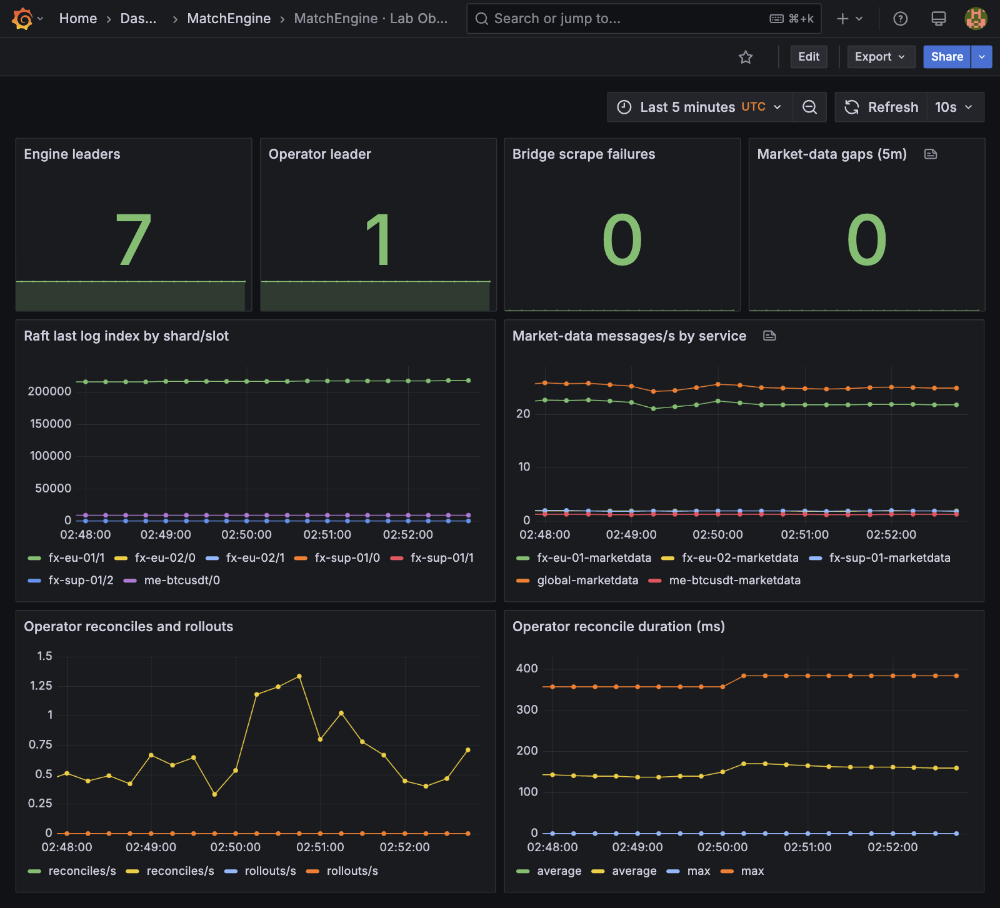
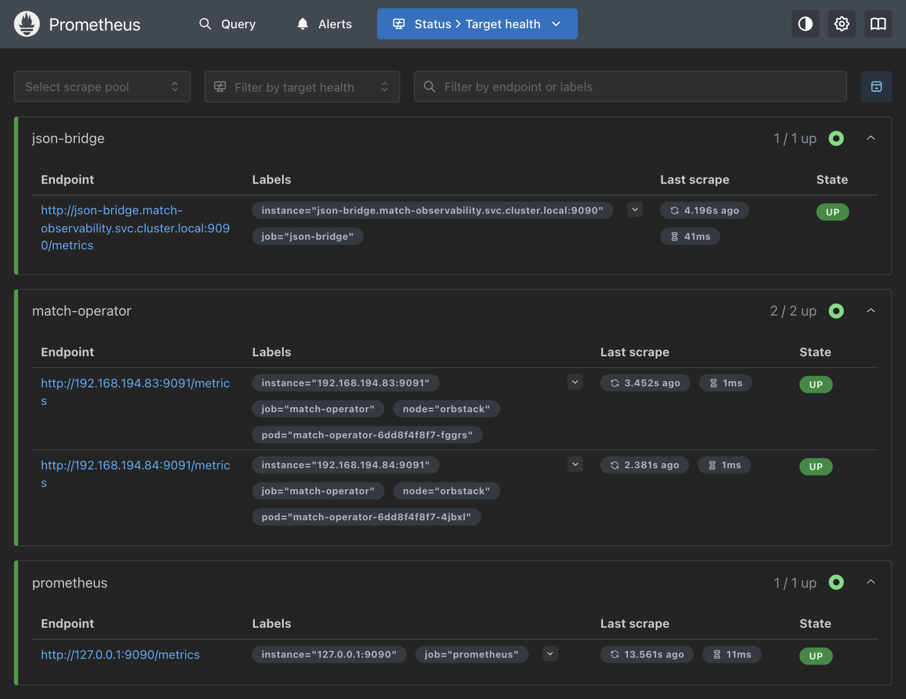
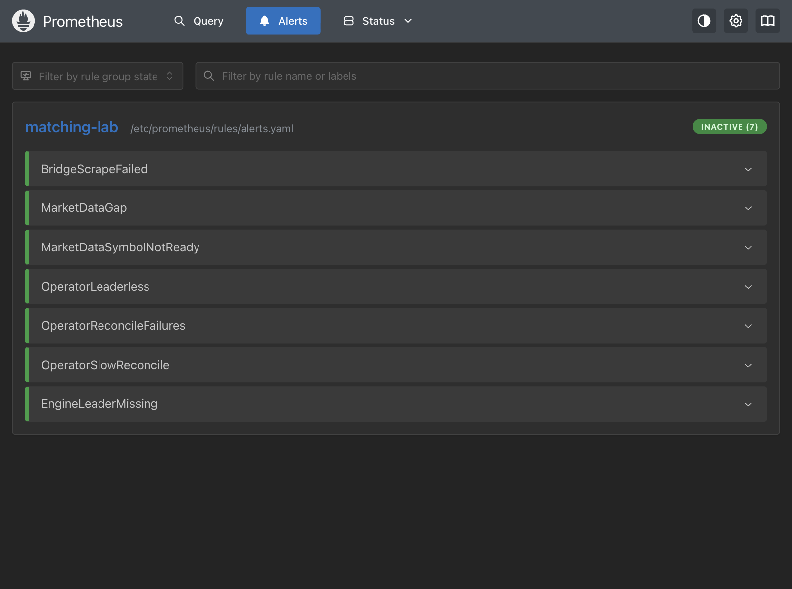

# OrbStack lab observability

The reference lab now has a complete metrics/logging plane. It separates two
concerns deliberately:

- **HPA CPU metrics come from `metrics-server`** (`metrics.k8s.io/v1beta1`).
  All five market-data HPAs and the one order-system HPA immediately report
  `cpu: N%/70%` and scale between their 1-replica floor and 2-replica ceiling.
- **Prometheus, Grafana and Loki are the evidence plane.** They scrape metrics,
  evaluate alerts and ship container logs; they are not on the HPA control
  path, so a Prometheus restart cannot freeze autoscaling.

Everything is lab-scale: one replica per component, 7-day retention, emptyDir
storage, plaintext hosts under `*.match-eu-1.example` and admin/admin Grafana.
Production needs Secret-backed credentials, TLS, three-dnode HA and real
retention/object storage; see §11 of
[`docs/KUBERNETES_CONTROL_PLANE.md`](./KUBERNETES_CONTROL_PLANE.md).

## Install

```shell
kubectl apply -f k8s_control_plane/deploy/metrics-server.yaml
kubectl apply -f k8s_control_plane/deploy/prometheus/bridge.yaml
kubectl apply -f k8s_control_plane/deploy/prometheus/prometheus.yaml
kubectl apply -f k8s_control_plane/deploy/prometheus/grafana.yaml
kubectl apply -f k8s_control_plane/deploy/prometheus/loki.yaml
```

Promtail copies only a small allowlist of pod labels (`app`, instance, cell, cluster, role, shard,
environment) plus `namespace`/`pod`/`container`; copying every pod label exceeds Loki's default 15
label-name limit on engine pods. Loki's lab `limits_config` also raises `ingestion_rate_mb` to 32 and
`ingestion_burst_size_mb` to 64 because the continuous replay and health/metrics probes generate
bursts above the 4 MB/s default. Both are lab-only settings in `deploy/prometheus/loki.yaml`.

The operator must be built from this revision so it serves its `/metrics`
endpoint, and `k8s_control_plane/deploy/operator.yaml` adds the
`match-operator-metrics` Service (port 9091):

```shell
docker build --platform linux/arm64 -f k8s_control_plane/Dockerfile \
  -t matchengine-k8s-control-plane:operator-v97 k8s_control_plane
kubectl apply -f k8s_control_plane/deploy/operator.yaml
kubectl -n match-control set image deployment/match-operator \
  operator=matchengine-k8s-control-plane:operator-v97
```

Prometheus does not watch its ConfigMaps: after editing `prometheus-config` or
`prometheus-rules`, call `POST /-/reload` (the Deployment sets
`--web.enable-lifecycle`):

```shell
kubectl -n match-observability exec deploy/prometheus -- \
  wget -qO- --post-data='' http://127.0.0.1:9090/-/reload
```

## Verify

`./scripts/check-observability.sh` runs the checks below and exits non-zero on
failure. The individual commands are:

```shell
kubectl get apiservice v1beta1.metrics.k8s.io          # AVAILABLE=True
kubectl get hpa -n match-eu-1                           # CPU/<70%>, not <unknown>
kubectl -n match-observability get pods                 # bridge, prometheus, grafana, loki, promtail
kubectl -n match-eu-1 get deploy orders -o jsonpath='{.status.replicas}'
```

Prometheus UI: <http://prometheus.match-eu-1.example/> (`/targets` shows
`json-bridge`, both `match-operator` replicas — scraped by pod so counters do
not jump between leader and standby — and `prometheus`, all `up`; `/alerts`
shows seven rules). Grafana: <http://grafana.match-eu-1.example/> (`admin`/`admin`), with a
provisioned **MatchEngine · Lab Observability** dashboard and both datasources.
Loki is queried through Grafana or the API; container logs from
`match-eu-1`, `match-control` and `match-observability` arrive with `namespace`,
`pod`, `container` and rendered `matching.io/*` labels. Promtail's own `/targets`
and `/service-discovery` pages are at <http://promtail.match-eu-1.example/>.
All four UIs are served by the checked-in Ingress and the port-80 front door — no
`kubectl port-forward` is needed.

A real scale test: set the `OrderSystem` CR's `spec.autoscaling.targetCpuUtilization`
to `1` (patch the CR, not the HPA — the operator re-renders the HPA every 10 s),
watch the Deployment reach two replicas, then restore `70`. Scale-down follows
the renderer's 300 s stabilisation window.

## Screenshots







## Component details

### metrics-server

`deploy/metrics-server.yaml` runs one replica with `--kubelet-insecure-tls`
(OrbStack's kubelet serves a certificate that does not match its InternalIP).
Besides the usual pod/node read RBAC it needs `nodes/stats`, `nodes/metrics`
and `pods/metrics` `get` for the kubelet's SubjectAccessReview, the built-in
`extension-apiserver-authentication-reader` Role and the `system:auth-delegator`
ClusterRole. Without those the APIService registers but scrapes return `403`.

### JSON → Prometheus bridge

`deploy/prometheus/json_bridge.py` is mounted from a ConfigMap into a
`python:3.12-alpine` pod. It discovers the rendered `*-metrics` Services
(one port per engine slot) and `*-marketdata` Services through the Kubernetes
API, fetches their JSON, unwraps the engine's `{"Ok": {...}}` envelope,
flattens nested objects (raft fields, `data_metrics`, `server_metrics`,
`transport_metrics`) into numeric samples and serves one text exposition on
`:9090`. Labels are `cell`, `shard`, `slot`, `pod` for engines and `cell`,
`service`, `pod` for market data. A 5-second cache bounds the load on the
engine HTTP ports. String fields become `_info` metrics so `state` can be
graphed without pretending it is numeric.

Series are named `matchengine_*` and `marketdata_*`. The bridge emits
`matchengine_has_leader` separately from `matchengine_current_leader`: node IDs
are 0-based, so leader `0` is valid and `current_leader == 0` cannot mean
"leaderless". Declared metrics ports for empty/reserved slots (no endpoint, or
connection refused) are skipped rather than reported as failures; real scrape
errors emit `bridge_scrape_failed{target="..."} 1`, and a failed Kubernetes
discovery emits `bridge_scrape_failed{target="discovery"} 1`. No engine image
rebuild or per-pod sidecar is needed.

### Operator metrics

`match_operator` exposes `/metrics` on `--metrics-port` (default 9091) with
dependency-free atomics:

| Series | Meaning |
|---|---|
| `match_operator_reconciles_total` | successful reconcile passes |
| `match_operator_reconcile_failures_total` | passes returning an error |
| `match_operator_reconcile_duration_ms{,_max}` | lifetime average / slowest pass |
| `match_operator_reconcile_duration_ms_sum` | duration sum; `rate()` gives a rolling average for `OperatorSlowReconcile` |
| `match_operator_applied_objects_total`, `..._pruned_objects_total` | applied/pruned objects |
| `match_operator_status_writes_total` | CRD status writes |
| `match_operator_rollouts_total` | pod rollout actions |
| `match_operator_action_failures_total` | failed individual actions |
| `match_operator_leader` | 1 while this replica holds the Lease |

The operator pod template carries `prometheus.io/scrape=true`,
`prometheus.io/port=9091` and `prometheus.io/path=/metrics`; Prometheus uses pod
discovery in `match-control` so each replica is a stable target. A single
Service-DNS target would load-balance scrapes between leader and standby and
make the counters appear to jump.

### Alerts and dashboard

`prometheus-rules` ConfigMap defines `BridgeScrapeFailed`, `MarketDataGap`,
`MarketDataSymbolNotReady`, `OperatorLeaderless`, `OperatorReconcileFailures`,
`OperatorSlowReconcile` and `EngineLeaderMissing`. HPA health itself has no
Prometheus rule here: it is checked directly with `kubectl get hpa` because
`metrics-server` does not expose HPA status as Prometheus samples in this lab.

The provisioned Grafana dashboard covers leader counts, bridge scrape
failures, gap rate, Raft last-log index, market-data message rate, operator
reconcile/rollout rate and reconcile duration.

### Log shipping

Single-node Loki (filesystem, 7-day retention) plus a Promtail DaemonSet
reading container logs. Promtail 3.4 adds a `spec.nodeName=<HOSTNAME>` selector
to pod discovery, so `HOSTNAME` is set from `spec.nodeName` through the
downward API; otherwise it discovers zero targets. Docker-backed nodes expose
`/var/log/pods/.../0.log` as a symlink that Promtail will not follow, so the
relabel rule builds the path from `__meta_kubernetes_pod_container_id` to
`/var/lib/docker/containers/<id>/*-json.log`.
