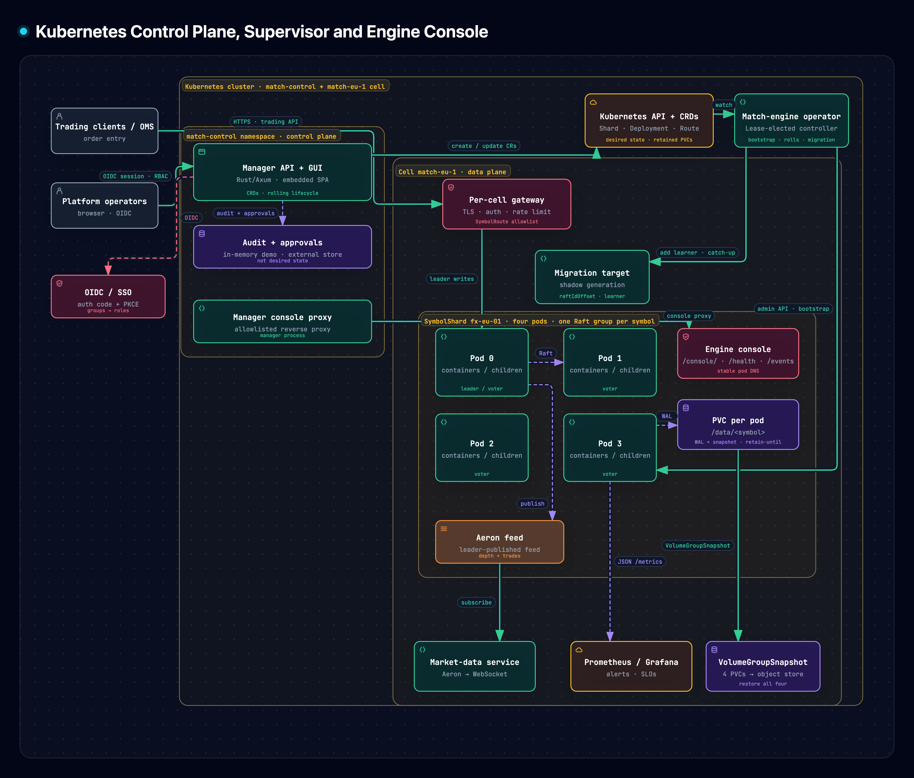
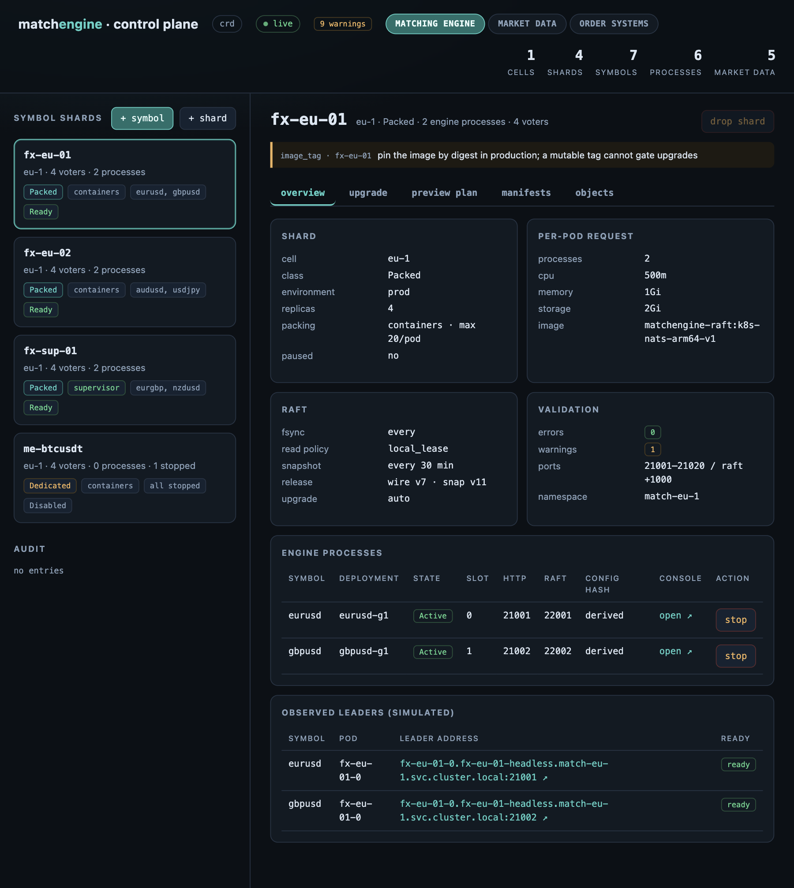

# ☸️ Kubernetes control plane (reference demo)

Reference implementation of the design in
[`docs/KUBERNETES_CONTROL_PLANE.md`](../docs/KUBERNETES_CONTROL_PLANE.md): the CRD-shaped
catalog, preflight validation, Kubernetes manifest rendering, and the operator's reconcile
decision logic for thousands of single-symbol Raft shards.

This is a **reference manager**, not a production operator. It has either a JSON demo store or a
CRD-backed store that writes through the Kubernetes API server; it has no controller loop, no
admission webhooks and no authentication. It exists to make the design executable and testable:
one command renders the exact manifest set, one command prints what the operator would do next,
and the embedded GUI shows the catalog, validation report and reconcile plan. It never connects to
etcd directly.

[](../docs/kubernetes-console-architecture.html)

[Open the interactive diagram](../docs/kubernetes-console-architecture.html).



The reference manager GUI: shard catalog, per-shard packing mode, validation, a read-only preview
plan tab, image upgrade, manifests, audit and engine-console links. The selected `fx-sup-01` shard
is supervisor-mode and hosts two symbols added without restarting the existing engine processes.

```
k8s_control_plane/
├── src/model.rs       CRD-shaped data model (Cell, SymbolShard, SymbolDeployment, …)
├── src/bundle.rs      ShardBundle + built-in demo catalog
├── src/validate.rs    placement, port, resource, symbol and asset rules
├── src/render.rs      StatefulSet / Services / PDB / NetworkPolicy / ConfigMap
├── src/reconcile.rs   bootstrap, membership, config, routing and upgrade plans
├── src/store.rs       catalog cache, CatalogStore abstraction and JSON/memory backends
├── src/crd.rs         CRD definitions, conversions, informers and the CRD-backed store
├── src/operator.rs    Lease-elected operator: watches, apply/prune, status and leader labels
├── src/api.rs         Axum manager API
├── src/gui.rs         embedded single-page GUI
├── src/main.rs        serve | render | validate | plan | seed | crds | crd-backup | crd-restore
├── src/bin/match_operator.rs  cell operator binary
├── deploy/            generated CRDs, least-privilege RBAC and the operator Deployment
└── examples/          demo ShardBundle JSON files
```

## 🚀 Quick start

From the repository root:

```bash
cd k8s_control_plane

# Manager GUI + API on http://127.0.0.1:8099/
cargo run -- serve

# Same, with a persisted JSON catalog (seeded on first start)
cargo run -- serve --state /tmp/matchengine-k8s-control-plane/catalog.json

# CRD-backed desired state through the Kubernetes API server (never direct etcd)
cargo run -- serve --crd --crd-namespace match-eu-1

# Install the CRDs and least-privilege RBAC
cargo run -- crds | kubectl apply -f -
kubectl apply -f deploy/rbac.yaml

# Run the Lease-elected cell operator (separate binary)
cargo run --bin match-operator -- \
  --namespace match-eu-1 \
  --lease-namespace match-control --lease-name match-engine-operator \
  --profile local

# Export/restore a CRD catalog (pass KUBECONFIG or run in-cluster)
cargo run -- crd-backup --out /tmp/crd-catalog.json
cargo run -- crd-restore --input /tmp/crd-catalog.json

# Render a shard (JSON List; kubectl accepts it directly)
cargo run -- render --shard fx-eu-01 --profile local > fx.json
kubectl apply -f fx.json

# Validate the demo catalog or a bundle file
cargo run -- validate
cargo run -- validate --bundle examples/fx-eu-01.json

# Print the operator's next steps for a simulated observation
cargo run -- plan --shard fx-eu-01 --scenario fresh
cargo run -- plan --shard fx-eu-01 --scenario upgrade --wire-version 8

# Regenerate the example bundles
cargo run -- seed --out examples
```

The GUI polls `/api/v1/catalog` and the selected shard every 2 seconds, pauses while a modal is open or the tab is hidden, and shows a `live` / `stale` indicator. The shard table uses the same polling to show `rolling…`, `stopping…` and the rollout banner without a manual refresh. While a containers-mode roll is active, the banner shows a percentage (updated pods / replicas), a progress bar, and separate updated/ready counts; 100% can briefly show `finalizing` until every pod is ready.

The demo catalog contains three shards:

| Shard | Class | Processes | Symbols |
|---|---|---|---|
| `fx-eu-01` | packed | 2 per pod (ports `21001`, `21002`) | `eurusd`, `gbpusd` |
| `fx-eu-02` | packed | 0 (reserved; 4 slots on `21041`–`21044`) | — |
| `me-btcusdt` | dedicated | 1 per pod (port `21001`) | `btcusdt` |

Every shard has four voters. The Raft port is always the HTTP port + 1000. Each process is the
existing single-symbol engine binary; packing does not merge Raft groups.

## 🧩 CRD-backed desired state

The manager has two persistence backends behind the `CatalogStore` abstraction:

- **JSON/memory** (default): `serve` or `serve --state <file>` for the offline demo.
- **CRD**: `serve --crd --crd-namespace <ns>` writes `TradingSymbol`, `SymbolShard`,
  `SymbolDeployment`, `SymbolRoute` and `Cell` CRs through the Kubernetes API server. etcd stores
  them underneath, but the manager never opens an etcd connection. The concrete key layout, live
  inventory and size/write guidance are in [`docs/ETCD_STORAGE.md`](../docs/ETCD_STORAGE.md).

Install the generated CRDs and least-privilege RBAC first:

```sh
cargo run -- crds | kubectl apply -f -
kubectl apply -f deploy/rbac.yaml
```

The manager container must use the `match-manager` ServiceAccount and mount its token:

```yaml
spec:
  serviceAccountName: match-manager
  automountServiceAccountToken: true
```

A manager started with `--crd` and no existing objects seeds the built-in demo catalog unless
`--no-seed` is passed. For a real cluster use `--no-seed` and restore/create objects explicitly.

### Data ownership

| Data | Store |
|---|---|
| Desired state (`TradingSymbol`, `SymbolShard`, `SymbolDeployment`, `SymbolRoute`, `Cell`) | CRDs through the Kubernetes API server |
| Status/conditions/leader address | CRD `/status` subresource, rate-limited to one write per object per second |
| Audit/action history | In-memory in the demo; production should use an append-only store, not etcd |
| Engine WAL/snapshot/order book/events/market data | Engine PVC and feed, never CRDs/etcd |
| Console live snapshots and selected tab | Ephemeral; rebuilt from engine APIs |

The cache is bootstrapped by listing all namespaces and then refreshed by one watcher per kind.
Writes use `resourceVersion` optimistic concurrency; a stale object fails rather than overwriting
a newer one. `crd.rs` deliberately keeps specs compact and rejects the temptation to store rendered
manifests, event data or engine payloads in CRs.

### Backup and restore

`crd-backup` exports the live CRD catalog as the same JSON format used by the demo. `crd-restore`
validates it and writes the objects back through the API server:

```sh
cargo run -- crd-backup --out /tmp/crd-catalog.json
cargo run -- crd-restore --input /tmp/crd-catalog.json
```

The backup is selective (desired state only); audit and engine PVC data are separate. An etcd
snapshot covers all CRs in the cluster, while `crd-backup` is useful for a single catalog export
and for comparing against the operator's view. Restore order is: CRs first, then workloads, then
PVCs/engine recovery.

## ☸️ Cell operator

`match-operator` is the Lease-elected reconciler for a cell. It watches the five CRDs, renders
each shard with the same deterministic renderer as the manager, and reconciles the result:

- **Lease election** — `coordination.k8s.io/v1` Lease, default
  `match-control/match-engine-operator`; renews every 5s with a 15s duration. A non-holder waits
  and only reconciles after acquiring the Lease.
- **Apply** — server-side apply of the desired ConfigMap, Services, PodDisruptionBudget,
  NetworkPolicy and StatefulSet, with field manager `match-engine-operator`.
- **Prune** — managed objects labeled `app.kubernetes.io/managed-by=match-engine-operator` that are
  no longer desired are deleted. Shard render failures are treated as unsafe and their objects are
  not pruned. PVCs are never deleted by the operator.
- **Leader Service labels** — for a dedicated shard, the pod whose engine reports leadership gets
  `matching.io/role=leader`; all other pods have that label removed. The rendered
  `<shard>-leader` Service selects it. If there is no leader, the label is removed.
- **Status and routes** — probes each pod's `/health`, then writes `SymbolShard`,
  `SymbolDeployment`, `TradingSymbol` and `SymbolRoute` status through the `/status` subresource:
  phase, readiness, leader pod/address, applied index/lag, conditions and
  `observedGeneration`. The route only publishes `leaderAddr` when the deployment is ready.

```sh
# Local run; watches one namespace and uses a local Lease.
cargo run --bin match-operator -- \
  --namespace match-eu-1 \
  --lease-namespace match-control --lease-name match-engine-operator \
  --profile local --resync-seconds 10

# Deploy two replicas (Lease handover); install CRDs/RBAC first.
kubectl apply -f deploy/operator.yaml
kubectl -n match-control get lease match-engine-operator
kubectl -n match-control logs deploy/match-operator --tail=20
```

`--dry-run` logs desired counts without applying, pruning, labeling or writing status.
`--namespace` scopes CRD/workload lists and pruning to one namespace; omit it for a cell-wide
operator.

The operator also drives the engine lifecycle once the workload exists:

- **Bootstrap and configuration** — when every pod for a deployment reports healthy and has the
  process container, it calls `/init` with the four pod endpoints if the Raft group is empty,
  adds missing learners, changes membership to the desired voter set, and applies
  `ConfigureSymbol` on the leader. A route publishes `leaderAddr` only after the applied symbol
  config matches the desired `TradingSymbol`.
- **Shard rolls** — for both containers and supervisor shards, it compares each pod's
  `controller-revision-hash` with the StatefulSet `updateRevision`, replaces non-running (for
  example Pending) pods first, and only deletes a running pod after checking that every process it
  hosts retains a healthy Raft quorum. In supervisor mode every active child on the pod must remain
  quorate and both child deployments must be ready before the next deletion. A leader pod is
  transferred only when its removal is already quorum-safe; the deletion happens on the next
  reconcile. This handles image/resource changes as well as adding, removing and re-adding
  containers without a bootstrap deadlock.
- **Fast termination** — the engine binary handles SIGTERM/SIGINT as PID 1, so a containers-mode
  pod drains immediately instead of waiting for Kubernetes' 60-second grace period and SIGKILL.
- **Retention** — orphaned shard PVCs are labeled and annotated with
  `matching.io/retain-until`; the operator deletes them after `--retention-seconds` (or marks
  `manual` when zero) and clears the marker if the shard returns.
- **PVC labels** — the StatefulSet's `volumeClaimTemplates` deliberately carries no labels because
  that field is immutable on an existing StatefulSet; the operator labels each shard PVC after
  creation with `matching.io/shard`, `matching.io/cell` and the placement labels used by retention
  and the GUI. This is what lets an existing fleet be adopted without recreating its storage.
- **Adopted StatefulSet migration** — objects created with `kubectl apply` keep
  `kubectl-client-side-apply` ownership of list entries such as containers. If server-side apply
  fails validation while removing a container, the operator retries that StatefulSet with a merge
  patch, which replaces the container array as a whole. This is the path that makes stopping one
  symbol in a packed containers shard work after a brownfield adoption.
- **Release compatibility** — the operator annotates each pod with the applied wire/snapshot
  versions. Before an image change in a containers shard it compares that release with
  `SymbolShard.spec.release`; an incompatible roll is blocked in `status.releaseBlock` rather than
  mixing peers. Same-version rolls and targets with `mixedVersionSafe: true` proceed.
- **Migration** — a `Shadow` deployment with a non-overlapping `raftIdOffset` is added to the
  source leader as a learner; after catch-up the operator changes membership, switches the route,
  activates the target and drains the source. Route `state: Rollback` reverses the process.

The operator ServiceAccount needs `pods/delete`, PVC list/patch/delete, and CR `patch`/`update` in
addition to list/watch; `deploy/rbac.yaml` includes them. The manager ServiceAccount additionally
gets read-only `nodes`/`pods` `get,list` for the upgrade image inventory. `--dry-run` skips
bootstrap, rollout, retention, migration, status and label actions.

## 🛠️ Manager API

| Method | Path | Description |
|---|---|---|
| `GET` | `/` | embedded GUI |
| `GET` | `/api/v1/health` | catalog counts and validation summary |
| `GET` | `/api/v1/catalog` | full catalog plus validation report |
| `GET` | `/api/v1/images?shard={name}` | selectable engine images from `Node.status.images` and running engine pods, merged with catalog references; marks the shard's configured (`current`) and running (`runningHere`) image |
| `GET` | `/api/v1/shards` | shard list with per-pod CPU/memory requests, `slots`, `freeSlots`, phase and paused state |
| `POST` | `/api/v1/shards` | reserve an empty shard from a `SymbolShard` body |
| `POST` | `/api/v1/shards/{name}/upgrade` | write `spec.image` and `spec.release` to a shard; rejects incompatible releases and per-deployment image overrides; the operator performs the one-pod-at-a-time roll |
| `POST` | `/api/v1/shards/{name}/drop` | drop an idle shard; `retainStorage` (default `true`) keeps the PVCs so it can be brought up again, `false` deletes them |
| `GET` | `/api/v1/shards/{name}` | shard detail, deployments, symbols, routes, simulated observation, `slots`/`freeSlots`/`empty`, a shard-scoped `shardValidation`, and per-process `engineConsoles` (`url` and `proxyUrl`) |
| `GET/POST` | `/api/v1/shards/{name}/processes/{symbol}/pods/{pod}/console/*` | reverse proxy to that engine's `/console/` assets, JSON APIs and guarded actions; `/init`, `/write`, `/read` and Raft RPCs are never reachable |
| `GET` | `/api/v1/shards/{name}/manifests` | rendered `v1/List`; `?profile=local\|production` |
| `GET` | `/api/v1/shards/{name}/plan` | plan for a simulated observation; `?scenario=…` |
| `POST` | `/api/v1/shards/{name}/plan` | plan for an explicit `observation` and `targetRelease` |
| `POST` | `/api/v1/shards/{name}/simulate` | patch route/deployment status from a scenario (demo only) |
| `GET` | `/api/v1/symbols` | symbols with their deployment, shard and validation |
| `POST` | `/api/v1/symbols` | create a symbol; bind it to `shard`, or auto-place in `cell`; `allowRestart` defaults to `false` |
| `POST` | `/api/v1/symbols/{symbol}/migrate` | create a shadow deployment in `targetShard` and return the migration plan; the target must be zero-impact unless `allowRestart` |
| `POST` | `/api/v1/symbols/{symbol}/shutdown` | gracefully stop one engine; mark its deployment/route `Disabled`, retain data and slot; a non-empty containers shard needs `allowRestart` |
| `POST` | `/api/v1/symbols/{symbol}/start` | re-enable a disabled engine from its retained data/slot; supervisor starts only that child; same `allowRestart` guard |
| `GET` | `/api/v1/validate` | catalog validation report as JSON and text |
| `POST` | `/api/v1/bundles` | validate and upsert a `ShardBundle` |
| `GET` | `/api/v1/audit` | recent audit entries |

### Create a symbol, reserve a shard, migrate

The demo catalog includes `fx-eu-02`, a reserved packed shard with four slots on ports
`21041`–`21044` and no processes. The GUI exposes **+ symbol** and **+ shard**; the same operations
are available over HTTP.

Reserve an empty shard:

```bash
curl -s -X POST http://127.0.0.1:8099/api/v1/shards \
  -H 'content-type: application/json' -d '{
  "name": "fx-eu-03",
  "namespace": "match-eu-1",
  "spec": {
    "cell": "eu-1",
    "environment": "prod",
    "class": "Packed",
    "replicas": 4,
    "packing": { "mode": "containers", "maxProcessesPerPod": 4 },
    "image": "matchengine-raft:k8s-nonroot",
    "storage": { "className": "local-path", "size": "2Gi" },
    "defaultProcessResources": {
      "requests": { "cpu": "250m", "memory": "512Mi" },
      "limits": { "cpu": "1", "memory": "1Gi" }
    },
    "network": { "httpBasePort": 21061 }
  }
}'
```

Place a new symbol on the reserved shard (slot 0, HTTP `21041`):

```bash
curl -s -X POST http://127.0.0.1:8099/api/v1/symbols \
  -H 'content-type: application/json' -d '{
  "shard": "fx-eu-02",
  "symbol": {
    "name": "usdjpy",
    "namespace": "",
    "spec": {
      "symbolId": 10,
      "base": { "code": "USD", "class": "fiat", "decimals": 2 },
      "quote": { "code": "JPY", "class": "fiat", "decimals": 0 },
      "priceDecimals": 3,
      "priceTick": "0.001",
      "baseLot": "0.01",
      "feeAssetPolicy": "received",
      "stp": "off",
      "owner": "fx-team",
      "generation": 1
    }
  }
}'
```

Omit `shard` and supply `cell` to auto-place; the manager chooses the most packed shard with a
free slot. Naming a reserved shard explicitly is how a new or migrated symbol consumes the
reservation.

Prepare a migration from `fx-eu-01` to the reserved shard:

```bash
curl -s -X POST http://127.0.0.1:8099/api/v1/symbols/eurusd/migrate \
  -H 'content-type: application/json' -d '{"targetShard":"fx-eu-02"}'
```

This creates `eurusd-shadow` in the target shard with `desiredState: Shadow`; the source route
stays active. The returned plan covers applying the target shard, `/init` on the target, adding
the target pod/port pairs as learners, catch-up, membership change, route cutover and draining the
source. Data movement is the engine's Raft learner catch-up, not a manager copy.

All three mutations validate the whole candidate catalog before committing. The demo does not
apply Kubernetes objects or call the engine; the operator materializes the rendered shard and
executes the plan.

### Zero-impact additions

A pod's container list is immutable. Adding a container in **containers** mode changes the
StatefulSet pod template, so the operator must recreate every pod in the shard. That restarts
every hosted engine one voter at a time; quorum stays at 3/4 and the PVC keeps the data, but it is
not a no-restart operation. The manager therefore rejects an addition to a non-empty
containers-mode shard with `409 restart_required`. Auto-placement skips those shards by default.

Use **supervisor** mode for zero-impact additions. A supervisor shard runs one supervisor
container per pod; the symbol list is the `processes.json` entry in the shard ConfigMap. Adding a
symbol updates that ConfigMap only: the supervisor starts the new child on each pod, while every
existing child keeps its PID, listener and data directory. The StatefulSet pod template does not
change, so no pod is recreated. New packed shards created through the GUI default to supervisor
mode. An empty containers shard is zero-impact only for its *first* symbol; later additions to it
are treated like any other non-empty containers shard.

```bash
# Reserve a supervisor shard (the GUI's + shard form does this by default).
curl -s -X POST http://127.0.0.1:8099/api/v1/shards \
  -H 'content-type: application/json' -d '{
  "name": "fx-sup-01", "namespace": "match-eu-1",
  "spec": {
    "cell": "eu-1", "class": "Packed", "replicas": 4,
    "packing": { "mode": "supervisor", "maxProcessesPerPod": 4 },
    "image": "matchengine-raft:k8s-nonroot",
    "storage": { "className": "local-path", "size": "2Gi" },
    "defaultProcessResources": {
      "requests": { "cpu": "500m", "memory": "1Gi" },
      "limits": { "cpu": "2", "memory": "4Gi" }
    },
    "network": { "httpBasePort": 21101 }
  }
}'

# Both placements are zero-impact; the supervisor starts a child without a pod restart.
curl -s -X POST http://127.0.0.1:8099/api/v1/symbols \
  -H 'content-type: application/json' -d '{ "shard": "fx-sup-01", "symbol": { ... } }'
curl -s -X POST http://127.0.0.1:8099/api/v1/symbols \
  -H 'content-type: application/json' -d '{ "shard": "fx-sup-01", "symbol": { ... } }'
```

To deliberately add a container to a **non-empty containers** shard, opt in explicitly:

```bash
curl -s -X POST http://127.0.0.1:8099/api/v1/symbols \
  -H 'content-type: application/json' -d '{
    "shard": "fx-eu-01", "allowRestart": true,
    "symbol": { ... }
  }'
```

That path is data-safe (graceful pod recreation, same PVC, one voter at a time) but it **does**
restart every engine in the shard, so it is not used for zero-impact placement. The GUI disables
non-empty containers-mode targets and labels them `restart required`.

### Graceful shutdown

The shard detail table has a **stop** button per active process. It calls:

```bash
curl -s -X POST http://127.0.0.1:8099/api/v1/symbols/nzdusd/shutdown \
  -H 'content-type: application/json' -d '{}'
```

The manager sets `SymbolDeployment.spec.desiredState=Disabled`,
`SymbolRoute.spec.state=Disabled` and both status phases to `Disabled`. The deployment record,
route, slot/ports and PVC stay; the response returns the operator steps:

- **Supervisor mode:** apply the updated ConfigMap. The supervisor sees the child disappear from
  `processes.json`, sends SIGTERM to that PID, waits up to 30 seconds and keeps the other children
  running. This is the zero-impact shutdown path.
- **Containers mode:** the target is the last active engine in the shard: prune the StatefulSet and
  pods, keep the PVC. If other engines are active, the request returns `409 restart_required`
  because removing a container recreates every pod; pass `{"allowRestart": true}` to accept the
  one-voter-at-a-time roll. The GUI reads the `restart_required` error code, asks for a second
  confirmation, and retries with `allowRestart: true`. The other engines keep quorum while losing
  one voter at a time; their PVCs are untouched. For a zero-impact stop, move the symbol to a
  supervisor-mode shard first. While the operator reports `Progressing`, the GUI shows a rollout
  banner and disables start/stop; a containers-mode row reads `stopping…` or `rolling…` until every
  pod has the new template, rather than implying the container is already gone.

`freeSlots` does not increase and the slot is not reused while the data is retained. Disabled rows
remain visible as `stopped` with a **start** button. Starting is the symmetric operation:

```bash
curl -s -X POST http://127.0.0.1:8099/api/v1/symbols/nzdusd/start \
  -H 'content-type: application/json' -d '{}'
```

The manager reuses the existing deployment, generation, slot, ports and PVC. In supervisor mode
the updated ConfigMap makes the supervisor start that child on all four pods; in containers mode
the workload is re-materialized (or rolled with `allowRestart`) and the same PVC is mounted. The
engine recovers its own WAL/snapshot and rejoins the same four-voter group, so the operator does not
call `/init` or `ConfigureSymbol` again unless the data directory was deleted. The route stays
`Pending` until the engine reports `/ready` and a leader, then it is published back to `Active`.
Use `kubectl -n match-eu-1 exec <pod> -- curl -s http://127.0.0.1:9090/processes` to verify
supervisor children before and after.

### ⬆️ Upgrade a shard image

The shard detail **upgrade** tab has an **Upgrade** button (and the manager exposes the same
action as an API call). It writes the target image and release to the `SymbolShard`; the operator
owns the rollout. The **Target image** control is a picker backed by
`GET /api/v1/images?shard=<name>`: it lists engine images cached on Kubernetes nodes
(`Node.status.images`) and images used by running engine pods, with tags, short digests, node counts
and `● running here` / `◆ configured` markers. Choosing an entry fills the digest-pinned reference;
a reference that is not cached can still be typed into the collapsed **Custom image reference**
field. The separate **preview plan** tab simulates the operator's reconcile steps from a synthetic
observation and never writes desired state. The manager
reads nodes and engine-labeled pods read-only (`deploy/rbac.yaml`); if that listing fails the picker
falls back to catalog references and shows the warning. The inventory refreshes every 15 seconds,
and the selected target survives the 2-second live catalog refresh. Use a digest-pinned image:

```bash
curl -s -X POST http://127.0.0.1:8099/api/v1/shards/fx-eu-01/upgrade \
  -H 'content-type: application/json' \
  -d '{"image":"matchengine-raft@sha256:<digest>",
       "release":{"wireVersion":7,"snapshotVersion":11,"mixedVersionSafe":false}}'
```

The response reports `changed:false` when the shard already has that image/release. The endpoint
rejects three cases before writing anything:

- `409 release_incompatible` — the current `spec.release` cannot roll to the target under
  `Release::can_roll_to`. Use the stop-the-world procedure in `docs/RUNBOOK.md` instead of forcing
  a mixed-version roll.
- `409 deployment_image_override` — one or more `SymbolDeployment`s in the shard pin their own
  `spec.image`. Update or clear those first so the shard has one image.
- `409 shard_paused` / `422` validation — resume the shard or fix the catalog.

On success the shard moves to `Pending` and `status.rollout` reports progress. The operator applies
the new StatefulSet template, then replaces pods one at a time, transfers a leader only when the
removal is quorum-safe, and waits for every active engine on the replacement pod to be ready. The
GUI shows the rollout bar. If the live pods' release annotations conflict with the target, the
roll stops at `status.releaseBlock`/`ReleaseCompatible=False` with no pods deleted. The capacity
preflight can also stop the apply at `status.capacityBlock`/`CapacityAvailable=False` when the
rendered per-pod or aggregate requests do not fit the nodes.

Keep `mixedVersionSafe: false` unless the new image explicitly supports mixed peers. An image that
crosses wire or snapshot versions is a stop-the-world change: disable routes, stop the shard, then
apply the image/release and start the shard again.

### Dropping a shard

Dropping is only allowed after every engine in the shard is stopped. The **drop shard** button is
disabled while any process is active; the API returns `409 shard_not_idle` and names the symbols
that still need to be shut down. Dropping an idle shard never restarts another engine.

The drop dialog asks the storage question before anything is removed:

- **Keep storage (recommended, default):** prune the StatefulSet/Services/PDB/NetworkPolicy/
  ConfigMap but keep the PVCs. The shard can be recreated later with the same name, replicas and
  storage class; new pods bind the retained PVCs and recover their WAL/snapshot.
- **Delete storage:** also delete the PVCs. The data cannot be recovered from the cluster.

```bash
# Keep the PVCs: the shard can be brought up again.
curl -s -X POST http://127.0.0.1:8099/api/v1/shards/fx-eu-03/drop \
  -H 'content-type: application/json' -d '{"retainStorage": true}'

# Delete the PVCs: destructive.
curl -s -X POST http://127.0.0.1:8099/api/v1/shards/fx-eu-03/drop \
  -H 'content-type: application/json' -d '{"retainStorage": false}'
```

The manager always removes the shard, its deployments, and routes that point at those deployments.
A symbol is removed only if no deployment in another shard still references it, so a migration
shadow survives. The response lists `removedDeployments`, `removedRoutes`, `removedSymbols` and the
predicted `pvcs` (`data-<shard>-0..N-1`), plus the operator steps:

- `prune-workload` (or `remove-catalog` for a reserved shard);
- `keep-storage` or `delete-storage`;
- `verify`.

The manager does not call Kubernetes. The GUI requires typing the shard name and defaults to
keeping storage. Dropping a shard does not delete its backups; only the PVC deletion is
irreversible.

### Simulation scenarios

`fresh`, `ready`, `degraded`, `leader-loss`, `config-drift`, `upgrade`. They are synthesized
from the catalog, not read from a cluster, so the GUI and `plan` work offline. The synthesized
image for every scenario except `upgrade` is the shard's `spec.image`; `upgrade` uses the older
demo image so the rolling-restart path can be exercised. The GUI labels the **upgrade** tab as a
scenario preview; use **overview** for the operator's live rollout status.

## 🧱 What the renderer emits

For one shard:

- a `ConfigMap` with the derived slot/port map (a cache, not the source of truth);
- a headless `Service` with one HTTP and one Raft port per process, `publishNotReadyAddresses:
  true` (bootstrap needs DNS before readiness);
- a metrics `Service`;
- a leader `Service` for dedicated shards (packed shards use `SymbolRoute.status.leaderAddr`);
- a `PodDisruptionBudget` with `minAvailable: replicas - 1`;
- a `NetworkPolicy` allowing Raft and console peer HTTP only between shard pods, HTTP from
  gateway/observability/control-plane namespaces, plus DNS and HTTPS egress;
- a `StatefulSet` with `podManagementPolicy: Parallel`, `updateStrategy: OnDelete`, one engine
  container per deployment, per-container probes on `/health` and `/ready`, a shared `data` PVC
  and a `tmp` `emptyDir`.

An empty reserved shard renders only the `ConfigMap`, `PodDisruptionBudget` and `NetworkPolicy`.
Binding the first symbol adds the Services, leader Service (dedicated) and StatefulSet. A
containers shard whose deployments are all `Disabled` renders the same minimal set: the workload
can be pruned while the PVC is retained. A supervisor shard keeps its supervisor StatefulSet with
an empty `processes.json`, so the pod stays available for a later re-enable.

For **supervisor** mode the StatefulSet has one `supervisor` container and a read-only ConfigMap
volume; `processes.json` lists the child processes. The headless and metrics Services expose the
full reserved port range, and the supervisor container declares those ports. Adding a
`SymbolDeployment` changes only the ConfigMap, so the pod template and existing child processes
stay untouched. Disabled deployments are omitted from `processes.json`, which stops exactly that
child.

Containers bind their stable pod DNS name (`$(POD_NAME).<shard>-headless.<namespace>.svc...`)
on their own HTTP port. The engine's `--id` is the pod ordinal, which repeats across processes;
the port selects the Raft instance. The image is expected to run as a non-root user (see the
design doc, §5.4).

`--profile local` relaxes required pod anti-affinity to preferred, drops the zone spread
constraint and defaults the storage class to `local-path`, for OrbStack/k3d.

## 🔗 Engine console links

The shard detail page links every engine process through the manager's reverse proxy:

```
/api/v1/shards/<shard>/processes/<symbol>/pods/<pod>/console/
```

The browser only needs the manager origin. The proxy dials the pod's
`<shard>-<pod>.<shard>-headless.<namespace>.svc.cluster.local:<httpPort>/console/`, follows the
observed leader when one exists (falling back to pod 0), and rewrites the console's absolute
asset/API paths onto the proxy prefix. Only the console assets, `/console/api/*`, the five guarded
console actions, `/health` and `/events` are forwardable; `/init`, `/write`, `/read` and Raft RPCs
are not. The manager therefore needs network access to engine pods, which it has in-cluster.

When the manager runs outside the cluster, set a dial host instead of the pod FQDN:

```bash
cargo run -- serve --engine-console-host 127.0.0.1
```

The ports still come from each deployment's placement, so this works when local engines listen on
the catalog's HTTP ports. The direct pod URL remains in the shard detail payload as
`engineConsoles[].url` for `kubectl port-forward` use; the GUI uses `proxyUrl`.

## 🧠 What the planner decides

`reconcile::plan_shard` returns a plan, not a mutation. The order is:

1. **Wait for pods** — no `/init` until every pod for that process is healthy.
2. **Bootstrap** — one `POST /init` per process with the four voter FQDNs. A process that
   already reports voters is never re-initialized.
3. **Membership** — a voter-set mismatch becomes `POST /change-membership`, never a
   StatefulSet replica edit.
4. **Symbol config** — apply `ConfigureSymbol` through the leader when the observed hash
   differs, then verify `/read symbol_config`.
5. **Routing** — publish the observed leader into `SymbolDeployment`/`SymbolRoute` status.
6. **Upgrade** — `auto` picks:
   - rolling when the target release keeps wire v7 / snapshot v11 (or declares
     `mixedVersionSafe`): transfer leadership off each pod, restart it, wait for `/ready`;
   - stop-the-world otherwise: require a verified backup newer than 24 h, pause routes,
     snapshot every process, restart all pods together.

A paused shard produces no mutation steps. A stop-the-world upgrade without a fresh backup is
blocked and returns the backup step first.

## ✅ Validation rules

`validate.rs` encodes the constraints that are expensive to discover at runtime:

- DNS-1123 names, one symbol per process, unique slot and HTTP port per shard;
- `httpPort == httpBasePort + slot` and `raftPort == httpPort + 1000`;
- at least 3 voters; unset WAL fsync requires 4 voters;
- dedicated shards use exactly one process per pod; packed shards cap at 20;
- `priceTick` precision ≤ `priceDecimals`, `baseLot` precision ≤ base decimals;
- ETF/equity bases force `feeAssetPolicy: quote`;
- CPU/memory requests are non-zero and do not exceed limits;
- nodes, deployments and routes must resolve to each other, and symbol IDs are unique per cell;
- images should be digest-pinned (warning);
- supervisor shards with multiple children should size `defaultProcessResources` for the aggregate
  and set `packing.resourcesSizedForAggregate: true` after reviewing the container limits (warning
  otherwise).

Errors block rendering; warnings do not.

## 🧪 Tests and CI

```bash
cargo fmt --manifest-path k8s_control_plane/Cargo.toml -- --check
cargo clippy --manifest-path k8s_control_plane/Cargo.toml --all-targets -- -D warnings
cargo test --manifest-path k8s_control_plane/Cargo.toml --locked
```

The suite covers the CRD model, validation rules, renderer output (including the stable supervisor
pod template and disabled-process filtering), JSON persistence, the CRD manifests/status
subresources, catalog ↔ CRD backup/restore and spec/status diffing, the operator's Lease expiry,
status/route computation, leader-label selection and workload rendering, every API endpoint
(including the containers restart guard, the supervisor zero-impact shutdown, the retained-data
start and the idle-shard drop with both storage choices), and each planner path (fresh bootstrap,
blocked bootstrap, membership drift, config drift, leader loss, rolling upgrade, stop-the-world
backup gate, paused shard, disabled processes). The operator was also exercised against OrbStack:
Lease acquisition/handover, apply/prune of a reserved and a dedicated shard, PVC retention, status
conditions and leader-label removal. A separate OrbStack run proved the full operator lifecycle on
a packed containers shard: four-voter `/init`, `ConfigureSymbol`, leader label/Service, adding a
second symbol, stopping it, re-adding it, image and config rolls, with the per-pod quorum gate and
leader handoff. The root crate adds `tests/cluster/test_supervisor.rs` (add/remove PID stability,
restart backoff, max-child backpressure, orphan cleanup) and `tests/cluster/test_shutdown.rs`
(prompt SIGTERM shutdown of the real engine process).

The crate is standalone (`[workspace]` in its `Cargo.toml`) but has a dedicated
`k8s-control-plane` job in `.github/workflows/ci.yml` that runs fmt, Clippy and
`cargo test --locked`. The `msrv` job also runs `cargo check --all-targets --locked` against this
crate on Rust 1.89.

## ⚠️ Deliberate limitations

- The reference operator applies/prunes workloads, labels the dedicated-shard leader, writes
  status, bootstraps/configures Raft groups (`/init`, learners, membership, `ConfigureSymbol`),
  runs quorum-safe containers-mode add/start/stop rolls, executes PVC retention and performs
  cross-shard cutover/rollback with `raftIdOffset`.
- No admission webhooks, finalizers or multi-version CRD conversion. The CRD schema uses
  preserve-unknown fields; typed schemas are a follow-up.
- Supervisor mode is implemented as a reference pod agent (`src/bin/match_supervisor.rs`); it
  manages children under the shared container CPU/memory limit with bounded restart backoff,
  max-child backpressure, orphan cleanup, opt-in per-child cgroup v2 placement and optional
  rotating per-child logs. Cgroup writes are fail-open when the pod cannot delegate a writable
  subtree; validate that on a Linux node with delegation before relying on per-process limits.
- Status is synthesized for the demo; there is no per-process status endpoint in the engine yet
  (phase 2 in the design doc). CRD status writes are rate-limited coalescing writes, not a full
  operator status controller.
- Engine PVC backups are planned but not executed; the demo has no `VolumeGroupSnapshot`
  integration. CRD backup/restore is implemented.
- No authentication or authorization. The real manager and operator sit behind the platform's
  SSO and RBAC; the public engine edge remains plaintext behind the gateway.
- The demo audit log is in-memory. Production audit belongs in an append-only store, not etcd.
  There is no multi-user concurrency control beyond the write mutex and Kubernetes
  `resourceVersion` checks.

The engine interface used by the plans is real: `/init`, `/add-learner`,
`/change-membership`, `/write {"ConfigureSymbol": …}`, `/read symbol_config`, `/ready`,
`/metrics`, and the console actions for transfer-leader and snapshot.
