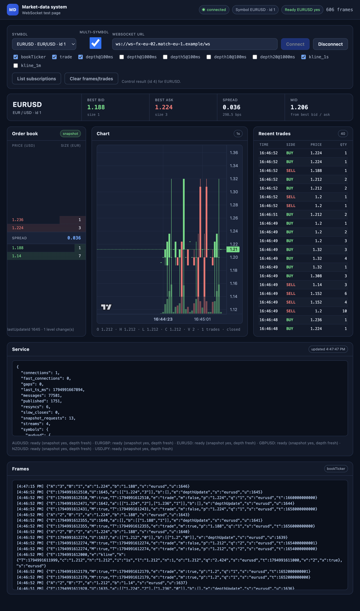

# 📡 Market-data system

A standalone service that consumes the engine's deterministic market-data feed
and serves **Binance-style WebSocket streams**. It is a separate process and
crate; the engine's matching, Raft and storage paths are untouched.

One instance can serve **several instruments**. Each symbol has its own feed
source and shadow state; the WebSocket hub is shared, and a connection owns one
subscription set over `<symbol>@<stream>` keys. Following Binance, switching
symbols is `UNSUBSCRIBE` for the old symbol's topics plus `SUBSCRIBE` for the
new ones **on the same socket** — no reconnect. A client may also hold streams
for several symbols at once (up to 1024 streams per connection).

<p align="center">
  
</p>

The page is arranged like a trading terminal: a market summary strip with the
sticky best bid/ask, spread and mid, then the order-book ladder, the candlestick
chart and the recent-trades tape side by side, with diagnostics and raw frames
below. It shows the shared hub in action: one WebSocket connection, per-symbol
readiness and the raw frames. Switching the dropdown unsubscribes the old
symbol's topics and subscribes the new ones without reconnecting. The chart
follows one `kline_<interval>` stream at a time (toggle a kline stream to switch
intervals); the vendor copy of TradingView Lightweight Charts v5.3.0 lives in
`web/lightweight-charts.js` (Apache-2.0, with `lightweight-charts.LICENSE` and
`lightweight-charts.NOTICE`) and keeps its upstream banner, so the page needs
no CDN. The tape deliberately does not show fees: the public WebSocket follows
Binance's public trade stream, which has no fee field (commission only appears
on private user-data streams). Fees remain available to internal consumers in
the engine's replicated match events and the engine's own wire feed. The demo
launcher serves the public Binance-compatible catalogue; pass `--extensions`
to add the engine's `@sweep`, `@status` and `@lifecycle` streams for internal
diagnostics.

The reference implementation currently ships **Aeron** ingestion and the JSONL fallback. For
Kubernetes/AWS EKS, **Profile A (direct Aeron multicast)** is the default implementation; it needs
a multicast-capable platform (Cilium/Isovalent multicast, or Multus with AWS Transit Gateway
multicast), and the default VPC CNI cannot carry it. Direct NATS and the per-pod bridge are
fallbacks; the transport comparison and multicast caveats are in
[`docs/AERON_K8S_MESSAGE_BUS.md`](../docs/AERON_K8S_MESSAGE_BUS.md).

```
engine A (EUR/USD) ── AeronSink ── streams 2001..2007 ──┐
engine B (BTC/USDT) ─ AeronSink ── streams 2001..2007 ──┤  multicast / IPC
                                                        ▼
                                        market-data instance
                     per-symbol AeronSource → assembler → depth conflation
                                                        │
                                          shared WS hub → clients
```

## 🚀 Why Aeron

The production path is built for a live feed, not a request/response API:

- **One exclusive publication per stream** (TRADE, BBO, DEPTH_SNAPSHOT,
  DEPTH_DELTA, LIFECYCLE, STATUS, BAR) from a dedicated publisher thread. A
  large depth snapshot cannot head-of-line-block a trade or status frame.
- **Multicast fan-out**: the engine publishes once and every market-data
  instance subscribes independently. Adding WebSocket clients or service
  instances does not change the engine's publish cost.
- **Never on the matching path**: `apply` only appends the visible-depth
  journal and `try_send`s into a bounded tap. A full queue drops frames and
  emits `GAP`; consensus latency is independent of subscribers.
- **Deterministic content**: `(symbol_id, stream_id, market_seq, sub_seq)` keys
  are identical on leader, followers, failover and restart, so instances and
  clients can deduplicate and replay safely.
- **Service-side fan-out**: a per-symbol assembler, 100/1000 ms depth
  conflation, one JSON encode per stream message shared as `Bytes`, bounded
  per-connection FIFOs, and close code `1013` for slow consumers.
- **Stateless scale-out**: an instance rebuilds from the periodic reset
  snapshot plus deltas; add instances behind a load balancer without any engine
  involvement.

The feed path has been load-tested at 500k fills/s (495k fills/s, zero drops
at the 8,192-frame tap queue; see [`docs/PERFORMANCE.md`](../docs/PERFORMANCE.md)).
The Aeron transport keeps that same backpressure contract: a slow instance
falls behind and re-syncs from the next snapshot rather than slowing the
engine.

## 🛰️ Run with Aeron (one host, IPC)

```shell
../scripts/market-data-system.sh
```

It builds the engine with `--features market-data-aeron,aeron-precompiled` and this crate with
`--features aeron,aeron-precompiled`, then starts two single-node engines with embedded media
drivers in separate directories: EUR/USD on `127.0.0.1:24801` and BTC/USDT on
`127.0.0.1:24802`. One service on `127.0.0.1:24800` consumes both. Open the test
page at `http://127.0.0.1:24800/` and switch symbols from the dropdown; the
page keeps one WebSocket open and changes subscriptions live. Raw endpoints are
`ws://127.0.0.1:24800/ws/eurusd@bookTicker` and
`ws://127.0.0.1:24800/stream?streams=eurusd@bookTicker/btcusdt@depth@100ms`.

For multiple hosts, run a supervised Aeron media driver on each host (or one
embedded publisher driver plus a driver per service host) and publish each
symbol to its own multicast channel:

```shell
# engine A: EUR/USD
cargo run --release --features market-data-aeron,aeron-precompiled -- \
  --id 1 --http-addr 127.0.0.1:21001 \
  --market-data-aeron-channel 'aeron:udp?endpoint=239.1.2.3:24001' \
  --market-data-aeron-snapshot-every-ms 5000

# engine B: BTC/USDT
cargo run --release --features market-data-aeron,aeron-precompiled -- \
  --id 1 --http-addr 127.0.0.1:21002 \
  --market-data-aeron-channel 'aeron:udp?endpoint=239.1.2.4:24001' \
  --market-data-aeron-snapshot-every-ms 5000

# service (repeat per instance / host); channels and dirs align with --symbol
cargo run --release --manifest-path market_data_system/Cargo.toml --features aeron,aeron-precompiled -- \
  --addr 127.0.0.1:24700 \
  --aeron-channel 'aeron:udp?endpoint=239.1.2.3:24001' \
  --aeron-channel 'aeron:udp?endpoint=239.1.2.4:24001' \
  --symbol eurusd:0:EUR:USD \
  --symbol btcusdt:1:BTC:USDT
```

The engine picks the Aeron sink when `--market-data-aeron-channel` is set. One
exclusive publication per stream prevents a large depth snapshot from
head-of-line-blocking a trade or status frame. A fresh reset depth snapshot is
re-broadcast every `--market-data-aeron-snapshot-every-ms` (default 30 s) so a
service that starts mid-stream can join without waiting for an election.

## 🧾 Run with JSONL (no media driver)

```shell
# engine: write the feed to a local JSONL file
cargo run --release --bin matchengine-raft -- \
  --id 1 --http-addr 127.0.0.1:21001 \
  --market-data-log /tmp/market-data.jsonl

# service: replay the file from the start and follow it
cargo run --manifest-path market_data_system/Cargo.toml -- \
  --market-data-log /tmp/market-data.jsonl \
  --symbol eurusd:0:EUR:USD

# several symbols: repeat --market-data-log once per --symbol, in order
cargo run --manifest-path market_data_system/Cargo.toml -- \
  --market-data-log /tmp/eurusd.jsonl \
  --market-data-log /tmp/btcusdt.jsonl \
  --symbol eurusd:0:EUR:USD \
  --symbol btcusdt:1:BTC:USDT
```

The JSONL log is node-local and debug-only (it duplicates lines when the engine
replays entries after a restart); the assembler dedupes by
`(stream, market_seq, sub_seq)` and a body-flagged reset rewinds state.

## 🛰️ Run with NATS (Profile N)

Direct NATS avoids Aeron media drivers and multicast entirely. The engine
publishes raw wire-v7 frames to `md.<cell>.<feed-group>.<stream-id>`; this
service subscribes to `<prefix>.*` and feeds the same assembler and WebSocket
hub. Core NATS is at-most-once, so reset snapshots and the startup snapshot
request are what make a late or reconnected subscriber whole.

```shell
# terminal 1: NATS Core
docker run --rm -p 4222:4222 nats:2.11-alpine

# terminal 2: engine (build with --features market-data-nats)
cargo run --release --features market-data-nats -- \
  --id 1 --http-addr 127.0.0.1:21001 \
  --market-data-nats-url nats://127.0.0.1:4222 \
  --market-data-nats-subject-prefix md.local.eurusd

# terminal 3: service
cargo run --release --manifest-path market_data_system/Cargo.toml -- \
  --addr 127.0.0.1:24700 --symbol eurusd:0:EUR:USD \
  --nats-url nats://127.0.0.1:4222 \
  --nats-subject-prefix md.local.eurusd
```

`--nats-subject-prefix` is repeatable and aligns with `--symbol`.
`--nats-stream-base` defaults to `2001` and selects the stream ids in the last
subject token. A fresh source requests a snapshot on
`<prefix>.snapshot.request`; the engine answers through the same
`MarketDataSnapshot` path used by Aeron stream 2010.

For Kubernetes, use `k8s_control_plane/deploy/nats.yaml` and set the
`MarketDataService` `spec.transport` to `mode: nats` with `natsUrl`. The
renderer derives one canonical subject prefix per symbol so a fast shard
service and the global terminal service receive the same feed.

## 📼 Archive and replay

`--archive-dir <dir>` records every message the service consumes to
`<dir>/<symbol>.jsonl`. The file uses the engine's JSONL shape, so it can be
inspected with the existing tooling and replayed without a media driver:

```shell
# record while serving a live Aeron or JSONL source
cargo run --manifest-path market_data_system/Cargo.toml --features aeron,aeron-precompiled -- \
  --addr 127.0.0.1:24700 \
  --aeron-channel 'aeron:ipc' \
  --symbol eurusd:0:EUR:USD \
  --archive-dir /var/lib/market-data/archive

# replay the archive; no --aeron-channel or --market-data-log
cargo run --manifest-path market_data_system/Cargo.toml -- \
  --addr 127.0.0.1:24700 \
  --symbol eurusd:0:EUR:USD \
  --replay-dir /var/lib/market-data/archive
```

Archives are append-only per symbol. Each line is flushed before the message is
served, so a crash leaves a complete prefix; use a fresh directory per capture
or truncate the old file before reusing a path. `--archive-dir` and
`--replay-dir` are mutually exclusive, and replay cannot be combined with a
live source.

### External media driver

For a supervised driver instead of `--aeron-embedded-driver`:

```shell
# terminal 1: driver
AERON_DIR=/dev/shm/aeron-$USER aeronmd

# terminal 2: engine and service; the same directory is used on both sides
AERON_DIR=/dev/shm/aeron-$USER cargo run --release --features market-data-aeron,aeron-precompiled -- \
  --id 1 --http-addr 127.0.0.1:21001 \
  --market-data-aeron-channel 'aeron:ipc' \
  --market-data-aeron-dir /dev/shm/aeron-$USER

AERON_DIR=/dev/shm/aeron-$USER cargo run --manifest-path market_data_system/Cargo.toml \
  --features aeron,aeron-precompiled -- \
  --addr 127.0.0.1:24700 --aeron-channel 'aeron:ipc' \
  --aeron-dir /dev/shm/aeron-$USER --symbol eurusd:0:EUR:USD
```

For multicast, use one `aeron:udp?endpoint=<group>:<port>|interface=<nic>`
channel per symbol on the engine and the matching channel on every service
instance. Each instance receives the same frames independently; no service
state is shared.

### Heartbeat and snapshot requests

The engine re-broadcasts a reset depth snapshot every
`--market-data-aeron-snapshot-every-ms` (default 30 s) and emits a diagnostic
`STATUS` heartbeat with the reserved `HEARTBEAT_SUB_SEQ` every
`--market-data-aeron-heartbeat-ms` (default 1 s) when no frame was applied.
The service exposes the heartbeat on `@status`; a silent feed is therefore
visible without waiting for a trade.

Stream 2010 (base + 9) is the one subscriber-to-engine path. When a WebSocket
client subscribes to depth/bookTicker while the service cache is empty or marked
stale, the service sends a fixed 24-byte `MSRQ` v1 request. The engine captures
the current book under the state-machine lock and queues a reset snapshot through
the same processor path as the periodic broadcast. If the request publication is
not connected yet, the service retains the request and retries it; the periodic
snapshot remains the fallback if the request cannot be delivered.

### Linux external-driver/multicast validation

`scripts/aeron-linux-lab.sh` automates the Linux validation on OrbStack. It
builds the engine with `--features market-data-aeron,aeron-precompiled` and the demo with
`--features aeron,aeron-precompiled`, then runs a separate driver process
(`market_data_system/src/bin/aeron_driver.rs`, a small Rust equivalent of
`aeronmd` using the same Aeron C media driver) for two scenarios:

```shell
../scripts/aeron-linux-lab.sh ipc
../scripts/aeron-linux-lab.sh multicast
../scripts/aeron-linux-lab.sh all
```

The script uses OrbStack's x86_64 Linux userland (Rosetta) because `rusteron`
0.2.13 publishes precompiled Linux static libraries only for x86_64. A native
aarch64 build needs CMake >= 3.30 and a source build; that is not part of the
script. The container has a 1 GiB `/dev/shm`, `NET_ADMIN`, and its own network
namespace; the multicast scenario uses `239.1.2.3:24001` on `lo`.

For the manual IPC check, use the helper binary instead of `aeronmd`:

```shell
# terminal 1: supervised driver
AERON_DIR=/dev/shm/aeron-ipc \
  cargo run --release --manifest-path market_data_system/Cargo.toml \
    --features aeron,aeron-precompiled --bin aeron_driver

# terminal 2: engine
AERON_DIR=/dev/shm/aeron-ipc cargo run --release --features market-data-aeron,aeron-precompiled -- \
  --id 1 --http-addr 127.0.0.1:21001 \
  --market-data-aeron-channel 'aeron:ipc' \
  --market-data-aeron-dir /dev/shm/aeron-ipc

# terminal 3: service
AERON_DIR=/dev/shm/aeron-ipc cargo run --release \
  --manifest-path market_data_system/Cargo.toml --features aeron,aeron-precompiled -- \
  --addr 127.0.0.1:24700 --aeron-channel 'aeron:ipc' \
  --aeron-dir /dev/shm/aeron-ipc --symbol eurusd:0:EUR:USD
```

For multicast, start one supervised driver per process, give the engine and
each service its own `--aeron-dir`/`--aeron-channel`, and use the same
`aeron:udp?endpoint=239.1.2.3:24001|interface=lo` channel. The script starts
three drivers: one for the engine and one for each of two service instances.
`--aeron-embedded-driver` starts **one** driver per symbol (each symbol owns its Aeron directory and can restart its driver independently);
pass a repeatable `--aeron-stream-base` aligned with `--symbol` when the symbols
come from engine processes with different feed bases. For Kubernetes, put
`|interface={pod_ip}` in the `MarketDataService` channel; the control-plane
renderer expands `{pod_ip}` to the pod's `POD_IP`. Do not use `interface=eth0`:
the static Aeron build does not resolve the interface name and the publication
stays backpressured. The process handles
SIGTERM/SIGINT, stops the HTTP/WebSocket server gracefully and then stops an
embedded driver, which is what the Kubernetes `preStop` drain relies on.

Expected result: both service `/ready` endpoints return `200`, both `/metrics`
counters advance for the same order flow and now include a per-symbol
`symbols` object (`ready`, `last_ts_ms`, `streams`, `subscribers`), a WebSocket `@depth@100ms` client gets
a `depthSnapshot` immediately on subscribe (via stream 2010) rather than waiting
for the periodic snapshot, and killing one service does not affect the other.

**Verified 2026-11-11** in the OrbStack x86_64 lab:

- IPC: external driver plus engine/service; service ready `200`; `snapshot_requests=1`;
  the first `depthSnapshot` arrived in ~0.06 s with the configured bid/ask book.
- Multicast: three external drivers and two independent service instances; both
  ready `200`; both metrics advanced on the same order flow; both depth clients
  received a populated `depthSnapshot`; killing one service left the other ready
  and receiving.
- The first stream-2010 request can arrive before its Aeron publication has
  connected. The source now keeps that request pending and retries it instead
  of dropping it; this was found during the validation.
- A freshly created Aeron subscription can occasionally miss the image
  registration race and receive no fragments. Each source now re-subscribes
  after 5 s without a fragment, backing off to 30 s, and resets the watchdog on
  the first message. This also recovers a feed after an engine leader transfer.
  Engine publishers keep `interface={pod_ip}`; market-data receivers strip the
  parameter and bind wildcard so several pods on one node can join the same
  group.
- **Kubernetes (2026-11-16):** a single-node OrbStack engine pod -> market-data
  pod feed is live (`/ready` 200, `MarketDataService.status.phase=Ready`) when
  the channel uses `interface={pod_ip}`; the control plane expands it to each
  pod's `POD_IP`. `interface=eth0` starts but never emits multicast and the
  engine publication stays backpressured. Cross-node Kubernetes multicast is
  still unverified.

This validates the external-driver and multicast **code paths on a single
Linux host/network namespace**. Cross-host multicast on a real fabric remains a
deployment-network check, not a code-path check. The embedded-driver path is
also covered by `cargo test --features aeron,aeron-precompiled --test aeron` on development hosts.

### WebSocket fan-out benchmark

```shell
cargo bench --manifest-path market_data_system/Cargo.toml \
  --bench ws_fanout -- --clients 64 --updates 5000 --rate 5000
```

Measured on the reference macOS host (loopback, channel source, `bookTicker`):
64 clients delivered 110,649 frames (1,728.9/client) at 110,571 frames/s at a
5k/s offer rate; at 20k/s the effective fan-out was 186,217 frames/s with more
latest-value coalescing. A 16-client, 20k offers/s run delivered 158,052
frames/s. `bookTicker` is a latest-value stream, so slow clients intentionally
coalesce older updates. The full table and caveats are in
[`docs/PERFORMANCE.md`](../docs/PERFORMANCE.md#websocket-fan-out-2026-11-10).

## 🔌 Streams

The default catalogue is the Binance spot set. `--extensions` adds the
engine-only streams; a public deployment should leave it off unless its clients
know about them. Binance-compatible streams carry no fees, match errors, log
indices or order sequences. Trade `t` is a deterministic id derived from the
fill's `(log index, ordinal)`, so it stays unique and stable across replicas and
restarts.

| Stream | Payload |
|---|---|
| `<symbol>@trade` | Binance spot trade: `e`, `E`, `s`, `t`, `p`, `q`, `T`, `m` (no fees; fees stay internal) |
| `<symbol>@bookTicker` | Binance spot book ticker: `u`, `s`, `b`, `B`, `a`, `A` |
| `<symbol>@depth@100ms` / `@1000ms` | conflated `U`..`u` diff depth, absolute levels |
| `<symbol>@depth5/10/20@100ms` / `@1000ms` | partial book depth (`lastUpdateId`, `bids`, `asks`, plus `s` for raw multi-symbol connections) |
| `<symbol>@kline_<interval>` | Binance kline: `e`, `E`, `s`, `k.{t,T,s,i,o,c,h,l,v,n,x,q}` |
| `<symbol>@sweep` | one taker with all fills (engine extension) |
| `<symbol>@status` | engine watermark, epoch, leader (engine extension) |
| `<symbol>@lifecycle` | visible order lifecycle, no fees/errors (engine extension; `--no-lifecycle` hides it) |
| `resync` notice | sent on a gap/reset before a fresh snapshot (engine extension) |
| `depthSnapshot` | subscribe-time full book (engine extension; Binance clients would fetch REST depth) |

Subscribe with Binance control messages:

```json
{"method":"SUBSCRIBE","params":["eurusd@bookTicker","eurusd@depth@100ms"],"id":1}
{"method":"UNSUBSCRIBE","params":["eurusd@depth@100ms"],"id":2}
{"method":"LIST_SUBSCRIPTIONS","id":3}
```

The subscription set belongs to the connection, not to a server-side "current
symbol". Switching symbols means unsubscribing the old symbol's topics and
subscribing the new ones; the socket stays open. Every data payload carries
`s` (lowercase symbol), so a client can also hold streams for several symbols at
once and route each frame by `s`. Fees, match errors, log indices and order
sequences never appear on the public WebSocket; they are execution details and
remain internal to the engine.

Raw URLs (`/ws/<stream>`), combined streams (`/stream?streams=a/b`, wrapped in
`{"stream":...,"data":...}`), subscribe-time snapshots for `bookTicker`,
`depth` and `kline`, ping/pong, a 24-hour connection lifetime, a 1024-stream
cap, a 1024-message FIFO and close code 1013 for slow consumers are implemented.

### Two WebSocket profiles

Binance has two protocol families, not a fast/terminal split: **WebSocket
Streams** (`wss://stream.binance.com`, market-data push, raw/combined, 1024
streams and 5 client messages per second per connection) and the
**WebSocket API** (`wss://ws-api.binance.com/ws-api/v3`, request/response for
trading, account and market-data queries). SBE Market Data Streams are a binary
variant of Streams with the same 1024/5 limits. Binance supports many symbols on
one Streams connection (`SUBSCRIBE btcusdt@bookTicker`, `ethusdt@bookTicker`) and
also offers all-market aggregate streams such as `!miniTicker@arr`; it does not
define a separate terminal socket.

We keep the Binance control protocol but enforce two server-side profiles:

| Profile | Endpoint | Symbol scope | Stream cap | Delivery |
|---|---|---|---:|---|
| **Fast** | `/ws/<symbol>@<stream>` | exactly one symbol, fixed by the path | 32 | exact; no display conflation; intended for API/algo clients |
| **Terminal** | `/ws` + `SUBSCRIBE`, or `/stream?streams=...` | multi-symbol | 1024 | conflates `bookTicker` and partial depth to `--terminal-conflation-ms` (default 100 ms); sequenced streams stay exact |

Set `--fast-only` on a shard-local deployment to disable the terminal routes: `/ws` and
`/stream?streams=...` return `404` (`{"code":"fast_only"}`), while
`/ws/<symbol>@<stream>` keeps working. A global terminal deployment omits the flag and can
subscribe to several shard feeds at once by repeating `--aeron-channel` and
`--aeron-stream-base` per symbol.

A fast connection rejects a `SUBSCRIBE` for a different symbol with Binance
error code `2`; use `/stream` for multi-symbol. Terminal clients should prefer
the conflatable streams for large symbol sets; a slow terminal consumer still
gets close code `1013` rather than stalling the fast feed. All connections share
one hub and one process, so every pod serves every configured symbol and one
terminal socket can observe all of them.

The control protocol also follows Binance's request-id rules (64-bit integer,
alphanumeric string up to 36 characters, or `null`), echoes the id unchanged,
returns top-level `{"code","msg","id"}` errors, and allows 5 client control
messages per second.

### Native arm64 image

The rusteron 0.2.13 prebuilt Linux libraries are x86_64-only. For a native
Apple Silicon/arm64 image, build Aeron from source (omit the
`aeron-precompiled` feature) with CMake >= 3.30 and `rustfmt` present:

```sh
docker build --platform linux/arm64 \
  -f market_data_system/docker/k8s.Dockerfile \
  -t matchengine-marketdata:aeron-arm64 .
```

The Dockerfile installs CMake 3.31 and builds `--features aeron`. The
`aeron-precompiled` feature remains available for macOS and Linux x86_64.

## 🧭 Depth synchronization

Depth payloads use a 1-based update id (`market_seq + 1`). A subscribe-time
`depthSnapshot` carries `lastUpdateId`; clients apply Binance rules: drop
`u <= lastUpdateId`, require `U <= lastUpdateId + 1 <= u` for the first update,
then `U == previous u + 1`; a `resync` notice means re-snapshot. Because the
engine emits depth deltas only for entries that change visible depth, the
service widens a window's `U` to `previous u + 1`, so the range is contiguous
even when entries in between did not touch the book.

## ⚙️ Configuration

| Flag | Default | Meaning |
|---|---|---|
| `--addr` | `127.0.0.1:24700` | HTTP/WebSocket listener |
| `--market-data-log` | unset | JSONL feed (fallback transport); repeat per symbol |
| `--archive-dir` | unset | record consumed messages to `<dir>/<symbol>.jsonl` |
| `--replay-dir` | unset | replay `<dir>/<symbol>.jsonl`; excludes live sources |
| `--nats-url` | unset | NATS server URL for the direct Profile N source |
| `--nats-subject-prefix` | unset | NATS prefix per symbol; repeat once per `--symbol` |
| `--nats-stream-base` | `2001` | first NATS stream id per symbol; repeat once per `--symbol` |
| `--aeron-channel` | unset | Aeron feed (requires `--features aeron`); repeat per symbol |
| `--aeron-stream-base` | `2001` | first stream id per symbol; repeat once per `--symbol` |
| `--aeron-dir` | `AERON_DIR` | media-driver directory; repeat per symbol |
| `--aeron-embedded-driver` | off | embed one driver per symbol (demos/tests) |
| `--symbol` | required | `name:id:base:quote`, repeatable (e.g. `eurusd:0:EUR:USD`) |
| `--bar-intervals-ms` | `1000,60000` | kline intervals (match the engines) |
| `--max-connections` | `256` | per instance |
| `--max-streams` | `1024` | terminal multi-symbol connection (Binance parity) |
| `--fast-max-streams` | `32` | fast single-symbol connection |
| `--fast-only` | off | disable `/ws` and `/stream`; serve only `/ws/<symbol>@<stream>` |
| `--terminal-conflation-ms` | `100` | terminal conflation for latest-value streams; `0` disables |
| `--queue` | `1024` | per-connection sequenced queue |
| `--ping-secs` / `--pong-timeout-secs` | `180` / `600` | connection hygiene |
| `--connection-lifetime-secs` | `86400` | forced reconnect |
| `--heartbeat-timeout-secs` | `30` | mark a symbol not ready when no frame/heartbeat arrives within this window |
| `--snapshot-levels` | `200` | subscribe-time depth levels |
| `--extensions` | off | expose the engine extension streams (`@sweep`, `@status`, `@lifecycle`); off keeps the public catalogue Binance-only |
| `--no-lifecycle` | off | hide the extension `@lifecycle` stream even with `--extensions` |

Engine-side Aeron flags (feature `market-data-aeron`):

| Flag | Default | Meaning |
|---|---|---|
| `--market-data-aeron-channel` | unset | enables `AeronSink` on this channel |
| `--market-data-aeron-stream-base` | `2001` | feed base; snapshot requests use base + 9 |
| `--market-data-aeron-snapshot-every-ms` | `30000` | periodic reset depth snapshot; `0` disables |
| `--market-data-aeron-heartbeat-ms` | `1000` | idle STATUS heartbeat; `0` disables |

## 📈 Scale-out

Instances are homogeneous and stateless: each subscribes to the same Aeron
streams and serves the complete catalogue. Add instances behind a load balancer
(any instance can serve any client); the marginal client cost is one queue and
socket writes, while upstream ingestion is constant per instance. State is
rebuilt from the periodic snapshot + deltas, so restart and replacement need no
engine involvement. A slow instance is isolated by Aeron flow control; a slow
client is isolated by its own queue.

## 🧪 Tests

```shell
cargo test --manifest-path market_data_system/Cargo.toml
cargo test --manifest-path market_data_system/Cargo.toml --features aeron
cargo clippy --manifest-path market_data_system/Cargo.toml --all-targets -- -D warnings
```

The default suite covers stream parsing, kline intervals, payloads, WebSocket
snapshots/conflation/combined streams, control errors, two-symbol tests, and
archive record-then-replay:
one holds both symbols on a single connection, the other switches
`UNSUBSCRIBE`/`SUBSCRIBE` and verifies `LIST_SUBSCRIPTIONS` and the
per-connection metrics; `tests/archive.rs` records a channel source and re-reads
the same messages through `jsonl_source`. The `aeron` feature adds an
embedded-driver test that publishes engine wire frames over IPC and asserts they
reach the WebSocket client, plus a stream-2010 request round-trip; the engine has
matching `market_data::aeron` tests for publish/receive, the idle heartbeat and
the stream-2010 subscription behind `--features market-data-aeron,aeron-precompiled`.
`cargo bench --manifest-path market_data_system/Cargo.toml --bench ws_fanout`
reports WebSocket fan-out (see [`docs/PERFORMANCE.md`](../docs/PERFORMANCE.md#websocket-fan-out-2026-11-10)).

> **Dependency pin:** rusteron is pinned to `0.2.13`. Versions from `0.2.14`
> call `std::hint::cold_path`, which is not available on the project's stable
> toolchain. The feature uses `static` + `precompile-rustls`, so the first build
> downloads precompiled Aeron C libraries (no cmake/Java needed). On Linux the
> static link also needs `libbsd-dev` and `uuid-dev`; CI installs them.
